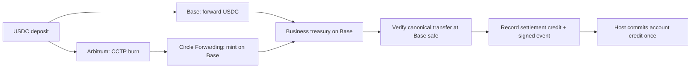

# Settle Kit

**USDC deposits for your app. Your server. Your treasury.**

Settle Kit is an open-source TypeScript SDK being built to accept native USDC on
Base and Arbitrum and settle it to a business's treasury on Base. A React deposit
widget and two hooks sit on top of a self-hosted payment engine.

**Status:** the scope and user journeys are defined, and a zero-ETH browser payment
has been verified on Base Sepolia. The SDK is not implemented end to end or
published to npm. Contracts are experimental and unaudited.

[Live test transaction](https://sepolia.basescan.org/tx/0x9b2a8e601638aa2031324dab2e25216b2028d61d1f63f0b1342dc015adac0cf3)
· [Test report](scripts/spikes/s16-browser-wallet/README.md)
· [Decisions](docs/decisions.md)
· [User journeys](docs/journeys/settle-kit.md)

## The deposit experience

The planned product gives users two ways to fund an app account:

- **Connect a wallet.** Enter how much to receive or how much to pay. Review the
  exact credit and fixed processing fee, then sign a USDC authorization. The
  business's operator submits the transaction and pays ETH gas; the payer needs
  no ETH for this path.
- **Send to an address.** Copy or scan a reusable deposit address and transfer
  native USDC from an external wallet or an exchange that supports the selected
  network. This path credits the verified net arrival; its displayed estimate is
  not a locked quote. The sending wallet or exchange handles the withdrawal cost.

Both paths show progress through settlement and the host's account update.
Developers can use `<Deposit />` or build their own interface with `useDeposits()`
and `usePayWithWallet()`.

## How settlement is designed to work



The engine will run on the business's server with Postgres and DBOS durable
workflows. Its job includes recovering interrupted work, reconciling chain
transfers with recorded credits, and retrying signed webhook delivery.

The money rules matter as much as the happy path:

- **Chain evidence authorizes credit.** A provider's success response is not
  enough. The engine verifies the stored token, recipient and amount at Base's
  `safe` block and prevents the same backing from funding two credits.
- **A retry keeps its identity.** An uncertain broadcast is tracked using its
  original operation and transaction, rather than becoming a second payment.
- **Settlement and account credit are separate.** Webhooks are delivered
  at least once. The host deduplicates the event and updates its balance in one
  database transaction; the widget waits for acknowledgment before showing credit.
- **The host owns the operating costs.** It funds the operator with ETH, keeps the
  disclosed fixed fee on quoted payments and absorbs overruns. Collecting USDC
  does not automatically replenish ETH.

The SDK will not require payer or treasury private keys. The business controls
its gas wallet, treasury and resulting customer-credit liability.

## What is proven today

In the [recorded MetaMask test](scripts/spikes/s16-browser-wallet/README.md), the
payer authorized **1.00 test USDC** while holding **zero ETH**. The operator paid
gas; the treasury received **0.99 USDC** and the operator received a **0.01 USDC**
fee. Independent checks verified the canonical transaction at Base safe, and
USDC rejected reuse of the authorization in a read-only simulation.

That proves one browser payment using ERC-3009 authorization and a host relayer,
without a paymaster. It does not establish the full SDK, a combined CCTP route,
crash recovery or compatibility with every wallet. The amounts are experiment
inputs, not a production fee recommendation.

[All experiment results and evidence limits](docs/spikes.md) are recorded separately
from the specification. Exploratory spikes are complete; the next step is a short
technical design and implementation task breakdown. Remaining checks will be part
of the build. See [planning status](docs/spec/README.md).

## Explore the repository

| Location | Purpose |
|---|---|
| [`docs/decisions.md`](docs/decisions.md) | Scope, trade-offs, money rules and the agreed API |
| [`docs/journeys/settle-kit.md`](docs/journeys/settle-kit.md) | Generated journeys, acceptance criteria and invariants |
| [`docs/examples/minimal-host.md`](docs/examples/minimal-host.md) | Proposed host integration, explicitly labeled pseudocode |
| [`scripts/spikes/`](scripts/spikes/) | Isolated experiments and reproducible evidence |
| [`packages/core`](packages/core) | Placeholder for shared deposit/quote types and errors |
| [`packages/server`](packages/server) | Placeholder for settlement, verification and recovery |
| [`packages/react`](packages/react) | Placeholder for the widget and hooks |
| [`apps/demo`](apps/demo) | Reference-app scaffold |

To run the app scaffold, use Bun 1.4+ and Node.js 20.9+:

```sh
bun install
bun run dev
```

Open [localhost:3003](http://localhost:3003). This currently shows a placeholder
page, not a working deposit integration. To reproduce the separate wallet test,
follow the [browser experiment setup](scripts/spikes/s16-browser-wallet/README.md);
it requires testnet setup and runs on port 3004.

## Scope

The first release focuses on account deposits: native USDC, Base and Arbitrum,
owned deposit contracts, CCTP, and a small developer-facing API. Checkout, swaps,
Relay Protocol, paymasters, bank payouts and customer withdrawals are out of scope.

The aim is to make the mechanics of a stablecoin deposit system understandable
and independently verifiable, from payer consent to the host's committed credit.
Every implementation test will trace back to a decision, journey criterion or
invariant. Repository conventions are in [AGENTS.md](AGENTS.md).

Licensed under [MIT](LICENSE).
