# settle-kit: journey spine

<!-- Generated by scripts/journey.ts. Edit the .yaml spine, not this file. -->

Design doc: [docs/decisions.md](../decisions.md)

## Actors

| ID | Actor | Type |
|---|---|---|
| `developer` | Developer integrating Settle Kit | person |
| `user` | User depositing USDC | person |
| `engine` | Settle Kit engine (indexer, workflows, scheduled jobs) | system |
| `host` | The business's server | system |
| `circle` | Circle CCTP (attestation and Forwarding Service) | external |

## Invariants

Rules that hold across every journey, ordering and crash point. Tests cite `I1: …`.

| ID | Invariant | Rule | Decisions | Steps that could break it |
|---|---|---|---|---|
| `I1` | One credit per transfer | THE SYSTEM SHALL NOT credit the same on-chain transfer (chain ID, tx hash, log index) more than once | D23 | `J2.S3` `J2.S4` `J2.S5` `J3.S3` `J3.S5` `J4.S2` `J5.S2` `J6.S1` `J7.S3` `J8.S4` `J8.S5` `J8.S7` `J8.S11` `J10.S2` `J10.S3` `J12.S3` `J12.S5` |
| `I4` | A credit is final | THE SYSTEM SHALL NOT change a credited deposit's amount or move it out of the credited state | D32 | `J2.S5` `J3.S5` `J6.S3` `J8.S7` `J12.S5` |
| `I5` | Secrets stay secret | THE SYSTEM SHALL NOT put the gas wallet key or the webhook secret in logs, errors or API responses | D27 | `J1.S2` `J5.S1` |
| `I10` | Every credit has exclusive verified backing | THE SYSTEM SHALL NOT create a credit without exclusively claimed canonical USDC backing at the stored Base recipient at safe and verified source attribution; manual credit equals its full net arrival, and quoted credit equals the locked quote with sufficient backing and separately recorded host residual | D21, D23, D121, D126, D127 | `J2.S5` `J3.S5` `J6.S3` `J7.S3` `J8.S6` `J8.S7` `J8.S10` `J10.S2` `J12.S3` `J12.S5` |
| `I8` | Complete discovery means a complete captured range | THE SYSTEM SHALL NOT advance a discovery cursor beyond a fully read and committed range, or mark a captured scan complete before every required page and event through its captured safe boundary is read and committed | D34, D131 | `J2.S3` `J2.S4` `J3.S3` `J4.S2` `J6.S1` `J7.S3` `J12.S3` |
| `I11` | Fixed destinations and isolated payment amounts | THE SYSTEM SHALL NOT let a caller redirect funds from stored treasury, route, fee and refund destinations or consume unrelated manual balances in a quoted payment; manual sweep and over-limit recovery obey stored limits and non-USDC rescue uses only the stored refund address | D26, D28, D33, D39, D231 | `J2.S4` `J4.S2` `J7.S2` `J8.S5` `J12.S2` |
| `I12` | Accepted quote matches payer consent | THE SYSTEM SHALL NOT increase the authorized debit, reduce the locked credit, change the accepted destination or fee, or execute an authorization more than once for an accepted quoted payment | D110, D126, D140, D141, D231 | `J8.S2` `J8.S3` `J8.S4` `J8.S5` `J8.S6` `J8.S7` `J8.S10` `J8.S11` `J10.S2` |

## J1 · Developer sets up Settle Kit and shows the deposit widget

**Actor:** Developer integrating Settle Kit  
**Goal:** Integrate the deposit SDK on one long-running server with Postgres and React  
**Proves:** A stranger can install and run it (D5)  

| Exit | Title | Named by |
|---|---|---|
| `ready` | Test widget works and live background setup has been verified | `J1.S5a` |

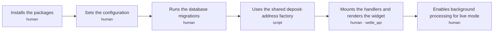

| Step | Bucket | Surface · state | Sees | Does | Next | Criteria |
|---|---|---|---|---|---|---|
| `J1.S1` Installs the packages | human | — | — | Installs the core, server and React packages for the documented long-running reference setup | `J1.S2` | 2 |
| `J1.S2` Sets the configuration | human | — | — | Sets local database and webhook configuration for simulated mode; live mode also requires fixed destinations, gas operator, chain RPCs, namespace, quote deadlines and finite D128 spending limits | `J1.S3` | 10 |
| `J1.S3` Runs the database migrations | human | — | — | Applies the numbered SQL migrations shipped with the package to the app's Postgres | `J1.S4` | 2 |
| `J1.S4` Uses the shared deposit-address factory | script | — | — | Points at the factory Settle Kit deployed once on Base and Arbitrum; nothing to deploy unless the developer sets their own factory address | `J1.S5` | 3 |
| `J1.S5` Mounts the handlers and renders the widget | human | `settle_api` | — | Mounts authenticated settle.handlers, starts settle.start() and renders <Deposit accountId='user_42' /> | `J1.S5a` | 5 |
| `J1.S5a` Enables background processing for live mode | human | — | — | Starts DBOS with the release-pinned version and a unique executor, and verifies scheduled work | exit `ready` | 6 |

### J1 acceptance criteria

**`J1.S1`** Installs the packages · decisions D37, D44

- `J1.S1.c1` WHEN createSettle() starts without SETTLE_MODE THE SYSTEM SHALL refuse to start and name the missing variable
- `J1.S1.c2` WHEN SETTLE_MODE is test THE SYSTEM SHALL simulate deposits and SHALL NOT send any transaction on a real chain

**`J1.S2`** Sets the configuration · decisions D26, D39, D135, D44, D141, D128, D142 · invariants I5

- `J1.S2.c3` IF configuration validation fails THE SYSTEM SHALL NOT include the gas wallet key or webhook secret in the error
- `J1.S2.c5` IF a configured sweep fee is negative or is greater than or equal to its minimum THE SYSTEM SHALL NOT start or create a deposit contract
- `J1.S2.c6` IF a caller is not authorized for the requested account or administrative operation THE SYSTEM SHALL NOT return account data or execute that operation
- `J1.S2.c7` IF the quote fee policy or positive finite quote lifetime is missing THE SYSTEM SHALL NOT prepare live wallet quotes
- `J1.S2.c8` IF SETTLE_MODE is test THE SYSTEM SHALL NOT use a live signing key or expose a live destination as a simulated address
- `J1.S2.c9` WHEN live createSettle starts THE SYSTEM SHALL validate its database, destinations, RPCs, webhook configuration and D128 spend controls and name invalid or missing settings without their secret values
- `J1.S2.c10` IF live treasury or refund configuration is missing or invalid THE SYSTEM SHALL NOT enable live processing
- `J1.S2.c11` IF live address namespace is missing or not 32 bytes THE SYSTEM SHALL NOT issue live addresses and SHALL print a command that generates one
- `J1.S2.c12` WHEN simulated mode starts with a local database and local webhook configuration THE SYSTEM SHALL use isolated fixture destinations and local signing material without requiring live RPC credentials, real keys or wallet funding
- `J1.S2.c13` IF simulated mode is selected THE SYSTEM SHALL NOT load live signing material, submit chain transactions or request real payment signatures

**`J1.S3`** Runs the database migrations · decisions D30, D31

- `J1.S3.c1` WHEN the migrations run THE SYSTEM SHALL apply each numbered migration exactly once, in order
- `J1.S3.c2` WHEN the migrations run a second time THE SYSTEM SHALL change nothing

**`J1.S4`** Uses the shared deposit-address factory · decisions D134

- `J1.S4.c2` WHERE the developer sets their own factory address THE SYSTEM SHALL use it instead of the shared one
- `J1.S4.c3` WHEN live startup or address issuance runs THE SYSTEM SHALL verify the RPC chain ID and factory runtime-code hash against the supported version manifest
- `J1.S4.c4` IF either chain ID or factory code does not match the manifest THE SYSTEM SHALL NOT issue an address and SHALL name the failing chain

**`J1.S5`** Mounts the handlers and renders the widget · decisions D36, D40, D44, D131

- `J1.S5.c1` WHEN the widget requests an account's deposit address through the mounted route THE SYSTEM SHALL answer with that account's address for each supported chain
- `J1.S5.c2` WHEN SETTLE_MODE is test THE SYSTEM SHALL mark the widget and QR code as TEST
- `J1.S5.c3` WHEN SETTLE_MODE is test THE SYSTEM SHALL show a "Simulate a deposit" button that runs the deposit journey (J2) with simulated transfers
- `J1.S5.c6` IF the browser supplies an account ID without host-authorized ownership THE SYSTEM SHALL NOT return its addresses, quotes, payments or deposits
- `J1.S5.c7` WHEN settle.start runs THE SYSTEM SHALL launch DBOS with the explicit workflow compatibility version and a fresh executor ID independent of package semver

**`J1.S5a`** Enables background processing for live mode · decisions D36, D37, D131

- `J1.S5a.c5` WHEN a long-running host calls settle.start() THE SYSTEM SHALL register DBOS chain scans every 10 seconds and the remaining scheduled check every 60 seconds
- `J1.S5a.c8` WHEN live setup is verified THE SYSTEM SHALL show a completed scheduled scan and a persisted DBOS workflow resuming after a process restart
- `J1.S5a.c10` WHEN a compatible package upgrade starts THE SYSTEM SHALL retain the workflow compatibility version and step ordering and resume unfinished operations with their original identities
- `J1.S5a.c11` WHEN an incompatible workflow sequence is introduced THE SYSTEM SHALL keep its old implementation registered under the old name until its pending work drains and route new work to the new name
- `J1.S5a.c12` IF pending work requires an unsupported application version or removed workflow implementation THE SYSTEM SHALL NOT report recovery ready or replay that history with an incompatible sequence
- `J1.S5a.c13` WHEN an applicationVersion change is required THE SYSTEM SHALL keep an old-version worker available until its pending workflows finish

## J2 · User manually deposits USDC on Base

**Actor:** User depositing USDC  
**Goal:** Send USDC on Base to their deposit address and see it credited  
**Proves:** The simplest own-rails path is verified and credited once  

| Exit | Title | Named by |
|---|---|---|
| `credited` | Verified deposit credited; host acknowledgment recorded | `J2.S6` |

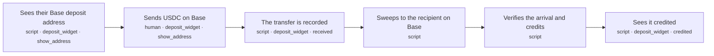

| Step | Bucket | Surface · state | Sees | Does | Next | Criteria |
|---|---|---|---|---|---|---|
| `J2.S1` Sees their Base deposit address | script | `deposit_widget` · show_address | QR code, the address in groups, 'USDC on Base only', minimum 2 USDC, 'you'll receive about X' | Returns the account's stored address, computing and storing it on first use | `J2.S2` | 12 |
| `J2.S2` Sends USDC on Base | human | `deposit_widget` · show_address | — | Scans the QR code with a wallet or withdraws from an exchange to the address | `J2.S3` | 4 |
| `J2.S3` The transfer is recorded | script | `deposit_widget` · received | 'Received 10.00 USDC. Moving it to your account' | Reads the USDC transfer at or below Base's safe block and records the deposit | `J2.S4` | 8 |
| `J2.S4` Sweeps to the recipient on Base | script | — | — | The gas wallet deploys the address's contract if needed and calls sweep(), which pays the sweep fee and forwards the rest | `J2.S5` | 14 |
| `J2.S5` Verifies the arrival and credits | script | — | — | Reads the USDC arrival at the stored recipient at the safe block and credits the deposit | `J2.S6` | 10 |
| `J2.S6` Sees it credited | script | `deposit_widget` · credited | '9.99 USDC credited' with a Base explorer link to the arrival | Shows the credited amount | exit `credited` | 2 |

### J2 acceptance criteria

**`J2.S1`** Sees their Base deposit address · decisions D13, D20, D28, D33, D38, D39, D135, D134, D140, D43

- `J2.S1.c2` WHEN the account asks again THE SYSTEM SHALL return the same stored address and SHALL NOT issue a new one
- `J2.S1.c3` IF the browser sends a recipient, minimum or lane THE SYSTEM SHALL NOT use it
- `J2.S1.c4` WHEN the address is shown THE SYSTEM SHALL show the minimum (2 USDC) and the sweep fee (0.01 USDC by default) before the user sends
- `J2.S1.c5` WHEN an account first requests an address THE SYSTEM SHALL atomically store the address and its complete versioned CREATE2 inputs under a unique business, account and route key, and return the stored winner of concurrent requests
- `J2.S1.c6` WHEN an address is predicted THE SYSTEM SHALL bind the namespace and account ID with unambiguous encoding and bind every immutable D33 money setting and supported creation-code version
- `J2.S1.c7` IF a predicted contract already exists with different code, version or immutable settings THE SYSTEM SHALL NOT use it or sweep it
- `J2.S1.c8` WHEN depositAddress(accountId, chain) is called by an authorized host THE SYSTEM SHALL return the stored address for that supported native-USDC chain
- `J2.S1.c9` IF the selected token or source chain is unsupported THE SYSTEM SHALL NOT present it as an accepted deposit route
- `J2.S1.c10` WHEN manual payment instructions are shown THE SYSTEM SHALL label net credit as an estimate and disclose that exchange withdrawal fees and the actual arrival determine final credit
- `J2.S1.c11` WHEN manual instructions are displayed, copied or encoded as QR THE SYSTEM SHALL use the same authenticated account and selected-chain stored address and expose the complete address and chain for inspection
- `J2.S1.c12` IF incoming activity contains a zero-value transfer or lookalike counterparty THE SYSTEM SHALL NOT change, prefill or suggest a deposit destination from that activity
- `J2.S1.c13` WHEN the account or chain changes THE SYSTEM SHALL clear the previous address and QR, disable copy until matching instructions load and ignore responses for the previous selection

**`J2.S2`** Sends USDC on Base · decisions D131

- `J2.S2.c2` WHILE the widget or useDeposits is mounted THE SYSTEM SHALL scan the account's issued addresses every 5 seconds, including after earlier deposits and during pending work
- `J2.S2.c3` IF a sender transfers an unsupported token or uses an unsupported chain THE SYSTEM SHALL NOT create a USDC credit from that transfer
- `J2.S2.c4` WHEN a sender pays a different amount or makes a later second transfer THE SYSTEM SHALL apply the actual-arrival and minimum rules to each discovered transfer without reusing an earlier quote
- `J2.S2.c5` IF the browser closes or reloads THE SYSTEM SHALL NOT stop server-side discovery or require another transfer to recover progress

**`J2.S3`** The transfer is recorded · decisions D18, D21, D23, D28, D34, D17, D131 · invariants I1, I8

- `J2.S3.c1` WHEN a USDC transfer to the address is at or below the safe block THE SYSTEM SHALL record one deposit keyed by chain ID, tx hash and log index
- `J2.S3.c2` IF the same transfer is read again THE SYSTEM SHALL NOT record a second deposit
- `J2.S3.c4` WHEN our own read finds the transfer at the latest block THE SYSTEM SHALL show "Received" with the amount, and SHALL NOT record or credit it before it is at or below the safe block
- `J2.S3.c5` WHEN a transfer is observed at latest THE SYSTEM SHALL store its provisional observation separately from safe deposit records
- `J2.S3.c6` IF a canonical replacement excludes a provisional transfer THE SYSTEM SHALL NOT retain its provisional amount and SHALL show "Confirmation changed; checking"
- `J2.S3.c7` WHEN the safe unassigned balance is below the stored minimum with no pending sweep THE SYSTEM SHALL keep it awaiting_minimum without starting the processing-delay timer
- `J2.S3.c8` WHEN safe unassigned funds first reach the stored minimum THE SYSTEM SHALL persist the processing-eligibility time for that batch and retain it through top-ups, retries and restarts
- `J2.S3.c9` IF safe unassigned funds are below the stored minimum and no sweep is pending THE SYSTEM SHALL NOT start a sweep and SHALL show "Received X. Send Y more to reach the minimum"

**`J2.S4`** Sweeps to the recipient on Base · decisions D33, D36, D39, D121, D28, D134, D139, D231, D128 · invariants I11, I1, I8

- `J2.S4.c2` WHEN the address has no contract yet THE SYSTEM SHALL deploy it in the sweep workflow before calling sweep()
- `J2.S4.c16` IF an address has an open sweep operation THE SYSTEM SHALL NOT start a second operation, including while the first is sleeping or awaiting verification
- `J2.S4.c7` WHEN a successful sweep is discovered THE SYSTEM SHALL assign only incoming transfers after the preceding successful full-balance drain and before this sweep in chain execution order, including mid-workflow top-ups
- `J2.S4.c8` IF a transfer is already assigned to a sweep or recovery THE SYSTEM SHALL NOT reassign it
- `J2.S4.c9` IF any caller invokes sweep() with zero or less than the stored minimum THE SYSTEM SHALL NOT move USDC or charge a USDC sweep fee
- `J2.S4.c10` WHEN a sweep succeeds THE SYSTEM SHALL emit the gross balance, fixed fee and forwarded amount and pay only the stored recipients
- `J2.S4.c11` WHEN a sweep or deployment is submitted THE SYSTEM SHALL first persist its operation, chain, signer, globally reserved signer nonce, signed bytes and hash
- `J2.S4.c12` IF broadcast times out or its receipt is missing THE SYSTEM SHALL NOT submit a fresh-nonce retry and SHALL reconcile events or rebroadcast the saved transaction
- `J2.S4.c13` WHEN a transaction is fee-replaced THE SYSTEM SHALL keep its nonce, destination and call data and retain both hashes
- `J2.S4.c14` WHEN an attempt is proven reverted or its nonce is proven consumed by another canonical transaction at source safe THE SYSTEM SHALL recheck all sweep guards before any fresh-nonce retry of the same operation
- `J2.S4.c15` WHEN safe unassigned funds meet the minimum and the address has no open operation THE SYSTEM SHALL atomically start one sweep operation keyed by address and sweep number
- `J2.S4.c17` IF a sweep step replays after a crash with an unknown transaction outcome THE SYSTEM SHALL NOT create an independently executable fresh-nonce transaction and SHALL reconcile or rebroadcast the saved attempt
- `J2.S4.c18` IF an incoming transfer belongs to a verified exact-amount authorization event THE SYSTEM SHALL NOT assign it to a manual full-balance sweep or recovery
- `J2.S4.c19` IF the deployment gas reserve, shared spend budget or bounded retry allowance cannot cover submission THE SYSTEM SHALL NOT broadcast and SHALL retain the original operation with a gas_unavailable or spend_limit reason

**`J2.S5`** Verifies the arrival and credits · decisions D17, D21, D22, D23, D32, D121, D125, D230 · invariants I1, I10, I4

- `J2.S5.c2` IF no matching arrival is verified THE SYSTEM SHALL NOT credit the deposit
- `J2.S5.c3` IF two workers try to credit the same deposit THE SYSTEM SHALL NOT credit it twice
- `J2.S5.c6` IF a deposit is already covered by a credit THE SYSTEM SHALL NOT include it in another
- `J2.S5.c8` WHEN all source attribution and Base verification checks pass THE SYSTEM SHALL atomically claim the source memberships and unique Base arrival, insert one final credit for the verified net Base amount in integer base units and its immutable deposit.credited event, and create pending delivery in one Postgres transaction
- `J2.S5.c9` IF source or drain evidence is not canonical at source safe, gross source units differ from the emitted gross balance, gross differs from the emitted fee plus forwarded or burned amount, or the Base arrival is claimed by a different sweep THE SYSTEM SHALL NOT credit and SHALL enter needs_attention with the failed check
- `J2.S5.c10` IF the corresponding Base arrival is not the canonical USDC net transfer to the stored recipient at the captured safe boundary or credit creation is paused for an affected chain THE SYSTEM SHALL NOT create a credit
- `J2.S5.c11` IF settlement is pending for at least 2 minutes after processing eligibility and the batch has not entered attention THE SYSTEM SHALL show "Taking longer than usual; checking your deposit"
- `J2.S5.c12` IF settlement is pending for at least 15 minutes after processing eligibility and the batch has no other attention reason THE SYSTEM SHALL NOT create a credit from elapsed time and SHALL enter needs_attention as delayed
- `J2.S5.c13` WHEN internal settlement commits before host acknowledgment THE SYSTEM SHALL show "Received by the business; account update pending" and expose settlement and delivery states through useDeposits
- `J2.S5.c14` WHEN a retry finds this sweep's committed credit and event THE SYSTEM SHALL return the existing result without another credit or attention transition

**`J2.S6`** Sees it credited · decisions D18, D124

- `J2.S6.c2` WHEN the host acknowledges committed processing of deposit.credited THE SYSTEM SHALL show the account as credited with the verified amount and explorer links to the relevant source and Base arrival transactions
- `J2.S6.c3` IF the host has not acknowledged committed processing THE SYSTEM SHALL NOT show the account as credited

## J3 · User manually deposits USDC on Arbitrum

**Actor:** User depositing USDC  
**Goal:** Send USDC on Arbitrum to their deposit address and see it credited on Base  
**Proves:** The own-rails cross-chain path through CCTP is verified and credited once  

| Exit | Title | Named by |
|---|---|---|
| `credited` | Verified deposit credited; host acknowledgment recorded | `J3.S6` |

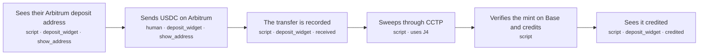

| Step | Bucket | Surface · state | Sees | Does | Next | Criteria |
|---|---|---|---|---|---|---|
| `J3.S1` Sees their Arbitrum deposit address | script | `deposit_widget` · show_address | QR code, address, 'USDC on Arbitrum only', minimum 2 USDC, maximum automatic balance (1,000 USDC by default), estimated fees | Returns the account's stored Arbitrum address, computing and storing it on first use | `J3.S2` | 13 |
| `J3.S2` Sends USDC on Arbitrum | human | `deposit_widget` · show_address | — | Scans the QR code with a wallet or withdraws from an exchange on Arbitrum | `J3.S3` | 4 |
| `J3.S3` The transfer is recorded | script | `deposit_widget` · received | 'Received 10.00 USDC on Arbitrum. Moving it to Base' | Reads the USDC transfer at or below Arbitrum's safe block and records the deposit | `J3.S4` | 8 |
| `J3.S4` Sweeps through CCTP | script | — | — | — | uses `J4`; `J3.S5` | 0 |
| `J3.S5` Verifies the mint on Base and credits | script | — | — | Reads the USDC minted to the stored recipient on Base at the safe block and credits the deposit | `J3.S6` | 12 |
| `J3.S6` Sees it credited | script | `deposit_widget` · credited | '9.94 USDC credited' with explorer links to the Arbitrum burn and the Base mint | Shows the credited amount | exit `credited` | 2 |

### J3 acceptance criteria

**`J3.S1`** Sees their Arbitrum deposit address · decisions D13, D20, D28, D33, D38, D39, D135, D134, D140, D43

- `J3.S1.c2` WHEN the account asks again THE SYSTEM SHALL return the same stored address and SHALL NOT issue a new one
- `J3.S1.c3` IF the browser sends a recipient, minimum or lane THE SYSTEM SHALL NOT use it
- `J3.S1.c4` WHEN the address is shown THE SYSTEM SHALL show the minimum (2 USDC), the sweep fee (0.05 USDC by default) and the estimated CCTP fee before the user sends
- `J3.S1.c5` WHEN an account first requests an address THE SYSTEM SHALL atomically store the address and its complete versioned CREATE2 inputs under a unique business, account and route key, and return the stored winner of concurrent requests
- `J3.S1.c6` WHEN an address is predicted THE SYSTEM SHALL bind the namespace and account ID with unambiguous encoding and bind every immutable D33 money setting and supported creation-code version
- `J3.S1.c7` IF a predicted contract already exists with different code, version or immutable settings THE SYSTEM SHALL NOT use it or sweep it
- `J3.S1.c8` WHEN the Arbitrum address is shown THE SYSTEM SHALL show the address's stored gross automatic-processing maximum (1,000 USDC by default) and explain that larger balances require host recovery
- `J3.S1.c9` WHEN depositAddress(accountId, chain) is called by an authorized host THE SYSTEM SHALL return the stored address for that supported native-USDC chain
- `J3.S1.c10` IF the selected token or source chain is unsupported THE SYSTEM SHALL NOT present it as an accepted deposit route
- `J3.S1.c11` WHEN manual payment instructions are shown THE SYSTEM SHALL label net credit as an estimate and disclose that exchange withdrawal fees and the actual arrival determine final credit
- `J3.S1.c12` WHEN manual instructions are displayed, copied or encoded as QR THE SYSTEM SHALL use the same authenticated account and selected-chain stored address and expose the complete address and chain for inspection
- `J3.S1.c13` IF incoming activity contains a zero-value transfer or lookalike counterparty THE SYSTEM SHALL NOT change, prefill or suggest a deposit destination from that activity
- `J3.S1.c14` WHEN the account or chain changes THE SYSTEM SHALL clear the previous address and QR, disable copy until matching instructions load and ignore responses for the previous selection

**`J3.S2`** Sends USDC on Arbitrum · decisions D131

- `J3.S2.c2` WHILE the widget or useDeposits is mounted THE SYSTEM SHALL scan the account's issued addresses every 5 seconds, including after earlier deposits and during pending work
- `J3.S2.c3` IF a sender transfers an unsupported token or uses an unsupported chain THE SYSTEM SHALL NOT create a USDC credit from that transfer
- `J3.S2.c4` WHEN a sender pays a different amount or makes a later second transfer THE SYSTEM SHALL apply the actual-arrival and minimum rules to each discovered transfer without reusing an earlier quote
- `J3.S2.c5` IF the browser closes or reloads THE SYSTEM SHALL NOT stop server-side discovery or require another transfer to recover progress

**`J3.S3`** The transfer is recorded · decisions D18, D21, D23, D28, D34, D17, D131 · invariants I1, I8

- `J3.S3.c1` WHEN a USDC transfer to the address is at or below Arbitrum's safe block THE SYSTEM SHALL record one deposit keyed by chain ID, tx hash and log index
- `J3.S3.c2` IF the same transfer is read again THE SYSTEM SHALL NOT record a second deposit
- `J3.S3.c4` WHEN our own read finds the transfer at the latest block THE SYSTEM SHALL show "Received" with the amount, and SHALL NOT record or credit it before it is at or below the safe block
- `J3.S3.c5` WHEN a transfer is observed at latest THE SYSTEM SHALL store its provisional observation separately from safe deposit records
- `J3.S3.c6` IF a canonical replacement excludes a provisional transfer THE SYSTEM SHALL NOT retain its provisional amount and SHALL show "Confirmation changed; checking"
- `J3.S3.c7` WHEN the safe unassigned balance is below the stored minimum with no pending sweep THE SYSTEM SHALL keep it awaiting_minimum without starting the processing-delay timer
- `J3.S3.c8` WHEN safe unassigned funds first reach the stored minimum THE SYSTEM SHALL persist the processing-eligibility time for that batch and retain it through top-ups, retries and restarts
- `J3.S3.c9` IF safe unassigned funds are below the stored minimum and no sweep is pending THE SYSTEM SHALL NOT start a sweep and SHALL show "Received X. Send Y more to reach the minimum"

**`J3.S5`** Verifies the mint on Base and credits · decisions D17, D21, D22, D23, D32, D121, D125, D230, D138 · invariants I1, I10, I4

- `J3.S5.c2` IF no matching mint is verified on Base THE SYSTEM SHALL NOT credit the deposit, whatever the burn or attestation shows
- `J3.S5.c3` IF two workers try to credit the same deposit THE SYSTEM SHALL NOT credit it twice
- `J3.S5.c5` IF a deposit is already covered by a credit THE SYSTEM SHALL NOT include it in another
- `J3.S5.c6` IF any transfer linked to the sweep is not yet at or below Arbitrum's safe block, or the linked transfers do not add up to what the sweep burned plus its sweep fee, THE SYSTEM SHALL NOT record the credit
- `J3.S5.c8` WHEN all source attribution and Base verification checks pass THE SYSTEM SHALL atomically claim the source memberships and unique Base arrival, insert one final credit for the verified net Base amount in integer base units and its immutable deposit.credited event, and create pending delivery in one Postgres transaction
- `J3.S5.c9` IF source or drain evidence is not canonical at source safe, gross source units differ from the emitted gross balance, gross differs from the emitted fee plus forwarded or burned amount, or the Base arrival is claimed by a different sweep THE SYSTEM SHALL NOT credit and SHALL enter needs_attention with the failed check
- `J3.S5.c10` IF the corresponding Base arrival is not the canonical USDC net transfer to the stored recipient at the captured safe boundary or credit creation is paused for an affected chain THE SYSTEM SHALL NOT create a credit
- `J3.S5.c11` IF settlement is pending for at least 2 minutes after processing eligibility and the batch has not entered attention THE SYSTEM SHALL show "Taking longer than usual; checking your deposit"
- `J3.S5.c12` IF settlement is pending for at least 15 minutes after processing eligibility and the batch has no other attention reason THE SYSTEM SHALL NOT create a credit from elapsed time and SHALL enter needs_attention as delayed
- `J3.S5.c13` WHEN internal settlement commits before host acknowledgment THE SYSTEM SHALL show "Received by the business; account update pending" and expose settlement and delivery states through useDeposits
- `J3.S5.c14` IF the verified mint is not linked to the recorded CCTP burn message or its net amount does not match the message amount less executed CCTP fees THE SYSTEM SHALL NOT credit
- `J3.S5.c15` WHEN a retry finds this sweep's committed credit and event THE SYSTEM SHALL return the existing result without another credit or attention transition

**`J3.S6`** Sees it credited · decisions D18, D124

- `J3.S6.c2` WHEN the host acknowledges committed processing of deposit.credited THE SYSTEM SHALL show the account as credited with the verified amount and explorer links to the relevant source and Base arrival transactions
- `J3.S6.c3` IF the host has not acknowledged committed processing THE SYSTEM SHALL NOT show the account as credited

## J4 · Engine sweeps an Arbitrum deposit to Base through CCTP

**Actor:** Settle Kit engine (indexer, workflows, scheduled jobs)  
**Goal:** Move a recorded Arbitrum deposit to its recipient on Base  
**Proves:** The cross-chain sweep survives slow steps and restarts (D36)  
Reusable sub-journey: other journeys include it with `uses`.  

| Exit | Title | Named by |
|---|---|---|
| `minted` | USDC minted to the recipient on Base | `J4.S4` |

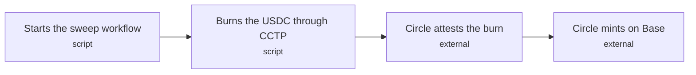

| Step | Bucket | Surface · state | Sees | Does | Next | Criteria |
|---|---|---|---|---|---|---|
| `J4.S1` Starts the sweep workflow | script | — | — | Starts one durable workflow per sweep, one sweep at a time per address | `J4.S2` | 3 |
| `J4.S2` Burns the USDC through CCTP | script | — | — | The gas wallet deploys the contract if needed and calls sweep(), which pays the sweep fee and burns the rest with CCTP V2 Fast and the Forwarding Service | `J4.S3` | 14 |
| `J4.S3` Circle attests the burn | external | — | — | Circle signs the burn message | `J4.S4` | 5 |
| `J4.S4` Circle mints on Base | external | — | — | The Forwarding Service mints the USDC to the recipient on Base and takes its fee from the minted amount | exit `minted` | 6 |

### J4 acceptance criteria

**`J4.S1`** Starts the sweep workflow · decisions D36, D28, D17

- `J4.S1.c3` IF an address has an open sweep operation THE SYSTEM SHALL NOT start another operation, including while it is sleeping or awaiting mint verification
- `J4.S1.c4` IF the gross address balance exceeds the address's stored maximum (1,000,000,000 USDC base units by default) or its net burn exceeds Circle's current on-chain per-message limit THE SYSTEM SHALL NOT start an automatic burn and SHALL enter needs_attention as over_limit
- `J4.S1.c5` WHEN safe unassigned funds meet the minimum, satisfy both Arbitrum limits and the address has no open operation THE SYSTEM SHALL atomically start one sweep operation keyed by address and sweep number

**`J4.S2`** Burns the USDC through CCTP · decisions D33, D39, D121, D28, D134, D139, D231, D128 · invariants I11, I1, I8

- `J4.S2.c1` WHEN the address has no contract yet THE SYSTEM SHALL deploy it before calling sweep()
- `J4.S2.c14` WHEN an eligible sweep executes THE SYSTEM SHALL pay exactly the stored fee and burn the remainder to the stored Base domain and recipient using CCTP V2 Fast and Forwarding Service
- `J4.S2.c6` IF any caller invokes sweep() below the minimum, above the address's stored gross maximum or above Circle's current net-burn limit THE SYSTEM SHALL NOT burn any USDC or charge any USDC sweep fee
- `J4.S2.c7` IF the burn amount minus its maximum CCTP protocol and forwarding fee budget is not positive THE SYSTEM SHALL NOT burn or charge a sweep fee and SHALL enter needs_attention as route_fee_unaffordable
- `J4.S2.c8` WHEN a successful burn is discovered THE SYSTEM SHALL assign only incoming transfers after the preceding successful full-balance drain and before this sweep in chain execution order, record the gross, fee and burned amounts, and retain the burn-message identity
- `J4.S2.c9` IF a transfer is already assigned to a sweep or recovery THE SYSTEM SHALL NOT reassign it
- `J4.S2.c10` WHEN a deployment or sweep is submitted THE SYSTEM SHALL persist its operation, chain, signer, globally reserved signer nonce, signed bytes and hash before broadcast
- `J4.S2.c11` IF a broadcast times out or lacks a receipt THE SYSTEM SHALL NOT submit a fresh-nonce retry and SHALL reconcile events or rebroadcast the saved transaction
- `J4.S2.c12` WHEN a transaction is fee-replaced THE SYSTEM SHALL keep its nonce, destination and call data and retain both hashes
- `J4.S2.c13` WHEN an attempt is proven reverted or its nonce is proven consumed by another canonical transaction at source safe THE SYSTEM SHALL recheck all sweep guards before any fresh-nonce retry of the same operation
- `J4.S2.c15` IF a sweep step replays after a crash with an unknown transaction outcome THE SYSTEM SHALL NOT create an independently executable fresh-nonce transaction and SHALL reconcile or rebroadcast the saved attempt
- `J4.S2.c16` IF an incoming transfer belongs to a verified exact-amount authorization event THE SYSTEM SHALL NOT assign it to a manual full-balance sweep or recovery
- `J4.S2.c17` IF the deployment gas reserve, shared spend budget or bounded retry allowance cannot cover submission THE SYSTEM SHALL NOT broadcast and SHALL retain the original operation with a gas_unavailable or spend_limit reason
- `J4.S2.c18` WHEN an Arbitrum manual burn executes THE SYSTEM SHALL emit a contract-derived unique operation tag and carry that same tag in protected CCTP hook data so repeated equal-amount burns remain distinguishable

**`J4.S3`** Circle attests the burn · decisions D17, D56, D138

- `J4.S3.c3` WHILE a known burn is pending before attention THE SYSTEM SHALL schedule Iris polls no less than 5 seconds apart through one persisted poller per burn and a shared rolling budget of at most 20 requests per second across all workers and stages
- `J4.S3.c4` WHEN a pending burn enters attention THE SYSTEM SHALL replace the five-second poll schedule with a poll every 15 minutes for 7 days from attention entry and daily after that, subject to the shared budget
- `J4.S3.c5` WHEN Iris returns 404 or an empty message list THE SYSTEM SHALL retain the known burn as pending
- `J4.S3.c6` IF Iris returns 429 THE SYSTEM SHALL NOT call Iris from any worker in the shared budget for at least 300 seconds or a longer valid Retry-After
- `J4.S3.c7` IF a burn awaits attestation or forwarding recovery THE SYSTEM SHALL NOT burn again or start a custom re-attestation loop and SHALL retain the original message for Circle forwarding

**`J4.S4`** Circle mints on Base · decisions D21, D17, D138, D56, D38

- `J4.S4.c1` WHEN Circle reports the mint THE SYSTEM SHALL wait for the mint to be at or below Base's safe block before reporting the exit
- `J4.S4.c2` IF Circle reports a mint that is not found on Base THE SYSTEM SHALL NOT report the exit
- `J4.S4.c3` WHEN Circle forwarding is pending THE SYSTEM SHALL retain the original burn message and continue its due verification under D17 and D56
- `J4.S4.c4` IF Circle reports forwarding failure or an unknown forwarding status THE SYSTEM SHALL NOT treat it as a mint or a lost-funds verdict and SHALL enter needs_attention with the reported status and known message and transaction identities
- `J4.S4.c5` IF another party submitted the original mint THE SYSTEM SHALL NOT mint or credit it again and SHALL locate and verify that same message's Base arrival
- `J4.S4.c6` WHEN Circle executes the original message at Standard rather than Fast finality THE SYSTEM SHALL record its executed threshold and continue verification of that same burn without promising a fixed completion time

## J5 · The business receives a deposit event

**Actor:** The business's server  
**Goal:** Process signed deposit events safely across retries and commit each account credit once  
**Proves:** Delivery is signed, retried and safe to receive twice (D14, D45)  

| Exit | Title | Named by |
|---|---|---|
| `delivered` | The business acknowledged the event | `J5.S3` |

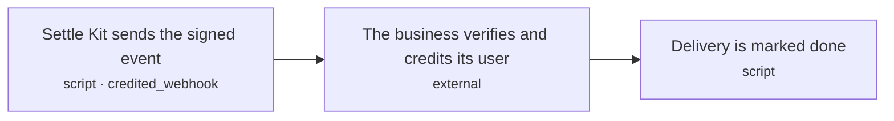

| Step | Bucket | Surface · state | Sees | Does | Next | Criteria |
|---|---|---|---|---|---|---|
| `J5.S1` Settle Kit sends the signed event | script | `credited_webhook` | — | POSTs an immutable deposit.credited or deposit.needs_attention event with Standard Webhooks signing | `J5.S2` | 9 |
| `J5.S2` The business verifies and credits its user | external | — | — | Calls settle.webhook(handler), which checks the signature, then credits user_42 in its own database | `J5.S3` | 6 |
| `J5.S3` Delivery is marked done | script | — | — | Records the acknowledgment | exit `delivered` | 3 |

### J5 acceptance criteria

**`J5.S1`** Settle Kit sends the signed event · decisions D14, D22, D45, D121, D230, D54, D126, D127 · invariants I5

- `J5.S1.c2` IF the business does not answer with a 2xx status within 10 s THE SYSTEM SHALL retry up to 10 times, waiting 2^(n-1) minutes before retry n, and SHALL NOT change the event ID or payload
- `J5.S1.c3` IF a delivery attempt fails THE SYSTEM SHALL NOT log the webhook secret or the signature
- `J5.S1.c4` IF all 11 attempts fail THE SYSTEM SHALL NOT retry again, and SHALL mark the delivery failed so an operator can resend it, leaving the credit unchanged
- `J5.S1.c5` WHEN an attention episode is entered THE SYSTEM SHALL atomically store its state and one immutable deposit.needs_attention event containing account, reason, stage and known transaction identities with pending delivery
- `J5.S1.c6` WHEN any pending event delivery is resumed THE SYSTEM SHALL use its saved event ID and body with a fresh delivery-attempt signature timestamp
- `J5.S1.c7` WHEN a delivery exhausts its 11 attempts THE SYSTEM SHALL create an alert exposed by listAlerts and the demo without requiring webhook delivery
- `J5.S1.c8` IF a pending delivery is recovered after a crash THE SYSTEM SHALL NOT reset its saved retry budget or resend an exhausted delivery without an operator request
- `J5.S1.c9` WHEN the credit belongs to a wallet quote THE SYSTEM SHALL include paymentId, quoted debit, disclosed processing fee, exact credit and recorded backing allocation in the immutable event
- `J5.S1.c10` WHEN a credit is recorded THE SYSTEM SHALL POST one deposit.credited with stable event ID, account ID, credited USDC as a decimal string and its source and backing identities

**`J5.S2`** The business verifies and credits its user · decisions D44, D124 · invariants I1

- `J5.S2.c2` IF the signature is missing, invalid or older than 5 minutes THE SYSTEM SHALL answer 401 and SHALL NOT call the handler
- `J5.S2.c4` WHEN settle.webhook receives a valid request THE SYSTEM SHALL await the host handler before returning its acknowledgment
- `J5.S2.c5` WHEN the host receives a new deposit.credited event THE SYSTEM SHALL insert its unique event ID and update the account balance in one host-database transaction before returning 2xx
- `J5.S2.c6` IF the event ID is already committed THE SYSTEM SHALL NOT update the balance again and SHALL return 2xx
- `J5.S2.c7` IF host processing fails before commit THE SYSTEM SHALL NOT return 2xx
- `J5.S2.c8` IF the event type is deposit.needs_attention THE SYSTEM SHALL NOT credit the account balance

**`J5.S3`** Delivery is marked done · decisions D45, D18

- `J5.S3.c1` WHEN the business answers with a 2xx status THE SYSTEM SHALL mark the delivery done
- `J5.S3.c2` IF the delivery is already done THE SYSTEM SHALL NOT send the event again unless an operator calls resendWebhook
- `J5.S3.c3` WHEN an operator resends an event THE SYSTEM SHALL restart its delivery budget with the same event ID and immutable body

## J6 · The minute check

**Actor:** Settle Kit engine (indexer, workflows, scheduled jobs)  
**Goal:** Every minute, find every deposit, restart stuck work and check the books  
**Proves:** Nothing is missed and nothing is credited without an arrival (D131, D35)  

| Exit | Title | Named by |
|---|---|---|
| `checked` | Check finished; problems flagged | `J6.S4` |

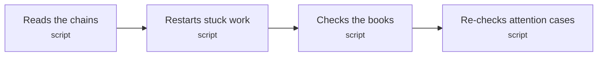

| Step | Bucket | Surface · state | Sees | Does | Next | Criteria |
|---|---|---|---|---|---|---|
| `J6.S1` Reads the chains | script | — | — | Reads incoming USDC, manual drains, quoted-payment execution and recovery events through captured safe boundaries | `J6.S2` | 12 |
| `J6.S2` Restarts stuck work | script | — | — | Resumes persisted operation stages and pending deliveries, and starts eligible work without an open operation | `J6.S3` | 14 |
| `J6.S3` Checks the books | script | — | — | Reconciles manual full-net credits, fixed quoted credits, host fee residuals and any host-funded shortfall against exclusive verified backing | `J6.S4` | 13 |
| `J6.S4` Re-checks attention cases | script | — | — | Re-checks deposits in needs_attention on D17's schedule | exit `checked` | 6 |

### J6 acceptance criteria

**`J6.S1`** Reads the chains · decisions D34, D131, D121, D135, D231, D127 · invariants I1, I8

- `J6.S1.c2` IF two runs overlap THE SYSTEM SHALL NOT record a transfer twice
- `J6.S1.c4` WHEN a scan starts THE SYSTEM SHALL capture each chain's safe block number and hash and read every page of each range from its committed cursor through that boundary
- `J6.S1.c5` WHEN a range completes THE SYSTEM SHALL atomically commit its incoming transfers, successful sweep and recovery events, drain memberships and block-hash cursor
- `J6.S1.c6` IF any page or required RPC read fails THE SYSTEM SHALL NOT advance the incomplete range or report the scan complete
- `J6.S1.c7` IF concurrent or targeted scans run THE SYSTEM SHALL NOT move a global cursor backwards or advance it from an address-only scan
- `J6.S1.c8` WHEN an address is first issued THE SYSTEM SHALL persist its scan start before returning it
- `J6.S1.c9` WHEN any successful sweep or recovery event is read THE SYSTEM SHALL record its unique chain, transaction and event-log identity regardless of caller, existing workflow or current address balance
- `J6.S1.c10` WHEN a newly issued address joins discovery THE SYSTEM SHALL scan it from its stored start through the captured boundary even if the global cursor has advanced past that start
- `J6.S1.c11` IF a newly issued address has not completed that catch-up THE SYSTEM SHALL NOT report its discovery complete
- `J6.S1.c12` WHEN quoted-payment execution is discovered THE SYSTEM SHALL bind its authorization nonce, payer debit, emitted fee and forwarded or burned amount to one stored payment ID before attribution
- `J6.S1.c13` IF a transfer is assigned to a quoted operation THE SYSTEM SHALL NOT assign it to a manual sweep or another quoted operation
- `J6.S1.c14` WHEN another caller executes a later drain while an SDK sweep command is still pending THE SYSTEM SHALL create a separate drain settlement record without starting another SDK sweep command or merging the two drains' source memberships

**`J6.S2`** Restarts stuck work · decisions D36, D139, D230, D45, D140, D231, D111, D128

- `J6.S2.c11` WHEN the minute check finds unfinished work with no valid worker claim and its next action is due THE SYSTEM SHALL resume the persisted stage regardless of current address balance or workflow running label
- `J6.S2.c12` WHEN a worker executes THE SYSTEM SHALL renew its 120-second claim at intervals no greater than 30 seconds and use a new generation when reclaiming expired work
- `J6.S2.c5` WHEN an operation durably sleeps THE SYSTEM SHALL persist its next action time and release its worker claim while retaining the address's open operation
- `J6.S2.c6` IF another worker holds a valid claim or a stale worker tries to commit a stage advance THE SYSTEM SHALL NOT create a competing worker or accept that stale advance
- `J6.S2.c7` IF a successful burn or sweep is recorded THE SYSTEM SHALL NOT repeat it and SHALL resume verification of its original transaction and message
- `J6.S2.c8` WHEN a safe eligible balance has no open sweep operation THE SYSTEM SHALL create one operation under a database-unique address claim after checking minimum and maximum guards
- `J6.S2.c9` WHEN the check finds a pending event delivery THE SYSTEM SHALL resume it even when its deposit is already credited
- `J6.S2.c10` IF a delivery budget is exhausted THE SYSTEM SHALL NOT restart it without an operator resend
- `J6.S2.c3` WHEN a workflow is still pending and the process that ran it has not recorded a heartbeat for 2 minutes THE SYSTEM SHALL resume the workflow from its last completed step
- `J6.S2.c13` IF an executor has a heartbeat in the last 120 seconds and the pending operation holds a valid worker claim THE SYSTEM SHALL NOT resume that operation elsewhere
- `J6.S2.c14` WHEN an accepted wallet payment is due and unclaimed THE SYSTEM SHALL resume its persisted submission or verification stage using the original payment ID and authorization
- `J6.S2.c15` IF a wallet broadcast outcome is unknown THE SYSTEM SHALL NOT create a new authorization or independent fresh-nonce payment to repair it
- `J6.S2.c16` IF accepted work is paused by a gas or spending limit THE SYSTEM SHALL NOT broadcast outside its persisted budget and SHALL continue read-only reconciliation and pending webhook delivery
- `J6.S2.c17` WHEN a wallet attempt satisfies the D111 failed_no_debit proof THE SYSTEM SHALL atomically close that operation and its payment attention episode without creating a credit and retain the evidence in account history

**`J6.S3`** Checks the books · decisions D35, D54, D125, D126, D127 · invariants I10, I4

- `J6.S3.c2` IF a credited deposit has no matching arrival THE SYSTEM SHALL NOT mark the check clean, and SHALL record a critical alert naming the deposit
- `J6.S3.c4` WHEN the check records a problem THE SYSTEM SHALL store it in the alerts table and log it at error level
- `J6.S3.c6` WHEN reconciliation runs THE SYSTEM SHALL verify retained source, destination and cursor block hashes against the canonical chains and rewind invalid uncredited discovery to the last canonical cursor
- `J6.S3.c7` IF a credit loses canonical source or Base backing THE SYSTEM SHALL NOT alter the credit or create an automatic replacement credit and SHALL open a critical incident with old and current block evidence and pause new credits involving the affected chain
- `J6.S3.c8` IF canonical reconciliation has not succeeded or the operator has not acknowledged the reorg incident THE SYSTEM SHALL NOT resume affected-chain credit creation
- `J6.S3.c9` IF any required scan or verification is incomplete or any incident is open THE SYSTEM SHALL NOT report clean books
- `J6.S3.c10` WHEN the demo or listAlerts reports reconciliation THE SYSTEM SHALL include the last complete check time, captured per-chain boundaries and open problems
- `J6.S3.c11` IF no check has completed or the last completed check is older than 120 seconds THE SYSTEM SHALL NOT show clean books and SHALL show unknown or stale respectively
- `J6.S3.c12` WHEN the latest check completed all required work with no open problems and is at most 120 seconds old THE SYSTEM SHALL show "Books: clean as of T" with that check's captured boundaries
- `J6.S3.c13` IF a quoted credit differs from its accepted quote or credit plus host residual differs from verified backing THE SYSTEM SHALL NOT report clean books
- `J6.S3.c14` IF host shortfall funding is already allocated or cannot be verified at Base safe THE SYSTEM SHALL NOT count it as additional backing
- `J6.S3.c15` WHEN the check runs THE SYSTEM SHALL match every credit to exclusive canonical safe USDC backing at its stored Base recipient and reconcile the credit and host residual allocation
- `J6.S3.c16` IF a treasury arrival has no credit, host residual or authenticated shortfall allocation THE SYSTEM SHALL record it for investigation

**`J6.S4`** Re-checks attention cases · decisions D17, D21, D14, D54, D121, D230, D125, D126, D127, D111

- `J6.S4.c1` WHEN a deposit has been in needs_attention for under 7 days THE SYSTEM SHALL re-check it every 15 minutes, and daily after that
- `J6.S4.c3` IF a re-check finds no verified arrival THE SYSTEM SHALL NOT credit the deposit or mark its funds lost
- `J6.S4.c5` WHEN a new attention episode is recorded THE SYSTEM SHALL atomically create its immutable deposit.needs_attention event and pending delivery and expose the problem through listAlerts, the demo and an error log
- `J6.S4.c6` IF the deposit was recovered to the source refund address THE SYSTEM SHALL NOT create a Base credit or mark the payer repaid from that recovery and SHALL retain the unresolved recovery alert
- `J6.S4.c7` WHEN attention rechecking finds candidate backing THE SYSTEM SHALL apply the matching manual or quoted allocation rule plus source attribution, exclusive backing, canonical safe and chain-pause checks before creating a credit
- `J6.S4.c8` IF a wallet attempt has failed_no_debit evidence THE SYSTEM SHALL NOT wait for a nonexistent Base arrival and SHALL close its payment attention episode under D111

## J7 · Operator recovers an over-limit Arbitrum balance

**Actor:** Developer integrating Settle Kit  
**Goal:** Recover an unsweepable balance to the fixed host refund address and keep payer repayment visible  
**Proves:** The cap has a guarded exit without automatic split burns or false Base credit  

| Exit | Title | Named by |
|---|---|---|
| `recovered` | Funds recovered to the host; payer repayment remains open | `J7.S3` |

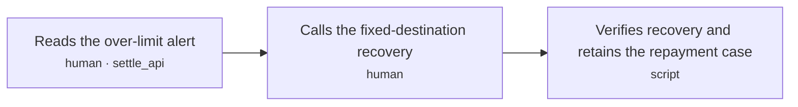

| Step | Bucket | Surface · state | Sees | Does | Next | Criteria |
|---|---|---|---|---|---|---|
| `J7.S1` Reads the over-limit alert | human | `settle_api` | — | Reads listAlerts and verifies the account, source balance and stored refund address | `J7.S2` | 2 |
| `J7.S2` Calls the fixed-destination recovery | human | — | — | Calls recoverOverLimit() from a block explorer or operator script; the SDK observes the result and does not submit recovery transactions | `J7.S3` | 3 |
| `J7.S3` Verifies recovery and retains the repayment case | script | — | — | Finds the recovery event at source safe, links its transfers and keeps the repayment alert open | exit `recovered` | 5 |

### J7 acceptance criteria

**`J7.S1`** Reads the over-limit alert · decisions D17, D28, D44, D54

- `J7.S1.c1` WHEN a safe Arbitrum balance exceeds the gross cap or live net-burn limit THE SYSTEM SHALL expose needs_attention as over_limit with account, address, balance and stored refund destination
- `J7.S1.c2` IF the balance is over either limit THE SYSTEM SHALL NOT split it into automatic burns or charge a sweep fee

**`J7.S2`** Calls the fixed-destination recovery · decisions D27, D28, D33 · invariants I11

- `J7.S2.c1` WHEN recoverOverLimit() executes while either Arbitrum limit is exceeded THE SYSTEM SHALL transfer the entire USDC balance to the stored refund address, charge zero USDC sweep fee and emit the recovered amount and destination
- `J7.S2.c2` IF neither limit is exceeded or the function is invoked on Base THE SYSTEM SHALL NOT recover USDC
- `J7.S2.c3` IF a caller supplies a different recipient or invokes rescue(USDC) THE SYSTEM SHALL NOT move USDC to that recipient or through rescue

**`J7.S3`** Verifies recovery and retains the repayment case · decisions D17, D27, D34, D54, D121, D230, D129 · invariants I1, I10, I8

- `J7.S3.c1` WHEN a canonical recovery is at source safe THE SYSTEM SHALL assign its source transfers after the preceding successful drain and before this recovery, verify the recovered gross amount and fixed refund receipt, and enter needs_attention as recovered_to_refund_address
- `J7.S3.c2` IF a transfer belongs to a recovery THE SYSTEM SHALL NOT include it in a later sweep credit or create a Base credit from the refund receipt
- `J7.S3.c3` WHEN source recovery is verified THE SYSTEM SHALL publish its attention episode through the durable event path and retain the alert until the host records repayment or another verified resolution
- `J7.S3.c4` IF only source recovery evidence is available THE SYSTEM SHALL NOT tell the user that their account was credited or that the payer was repaid
- `J7.S3.c5` WHEN the host records repayment for a verified recovery THE SYSTEM SHALL apply the authenticated evidence and closure procedure in J12 without changing the original recovery evidence

## J8 · User pays from a connected wallet with an exact quote

**Actor:** User depositing USDC  
**Goal:** Choose payment or credit amount, sign once without payer ETH and receive the locked credit after verified settlement  
**Proves:** Receive-first consent, fixed fees and durable recovery preserve the quoted result  

| Exit | Title | Named by |
|---|---|---|
| `credited` | Exact quoted credit acknowledged by the host | `J8.S8` |
| `not_submitted` | No accepted payment; user can retry preparation or use the address option | `J8.S9` |
| `attention` | Original operation retained for recovery; no unsupported credit | `J8.S10` |
| `failed_no_debit` | Authorization cannot execute; no successful payment found; new quote allowed | `J8.S11` |

```mermaid
flowchart LR
  J8_S1["Connects an existing wallet<br/><small>human · deposit_widget · connect_wallet</small>"]
  J8_S2["Edits either amount and prepares a quote<br/><small>script · deposit_widget · quote</small>"]
  J8_S3["Signs the displayed authorization<br/><small>human · deposit_widget · signing</small>"]
  J8_S4["Durably accepts the signed payment<br/><small>script · deposit_widget · submitting</small>"]
  J8_S5["Relays an exact-amount source payment<br/><small>script</small>"]
  J8_S6["Verifies the original Base arrival<br/><small>script · deposit_widget · processing</small>"]
  J8_S7["Commits the exact credit and host allocation<br/><small>script</small>"]
  J8_S8["Receives the quoted account credit<br/><small>script · deposit_widget · account_update_pending</small>"]
  J8_S9["Leaves preparation without an accepted payment<br/><small>script · deposit_widget · not_submitted</small>"]
  J8_S10["Retains an exception for recovery<br/><small>script · deposit_widget · needs_attention</small>"]
  J8_S11["Closes an unsuccessful authorized payment<br/><small>script · deposit_widget · failed_no_debit</small>"]
  J8_S1 -->|"supported wallet and network selected"| J8_S2
  J8_S1 -->|"connection rejected or wallet unsupported"| J8_S9
  J8_S2 -->|"user accepts a valid displayed quote"| J8_S3
  J8_S2 -->|"invalid input, unavailable route or abandoned preparation"| J8_S9
  J8_S3 -->|"matching signature returned"| J8_S4
  J8_S3 -->|"signature rejected, account changed or quote expired"| J8_S9
  J8_S4 -->|"accepted operation recorded"| J8_S5
  J8_S4 -->|"confirmed rejected before acceptance"| J8_S9
  J8_S5 -->|"source execution independently found and canonical at source safe"| J8_S6
  J8_S5 -->|"reverted, uncertain or delayed source execution needs attention"| J8_S10
  J8_S5 -->|"complete source-safe proof establishes failed_no_debit"| J8_S11
  J8_S6 -->|"verified backing covers the exact quoted credit"| J8_S7
  J8_S6 -->|"shortfall, forwarding failure, delay or evidence mismatch"| J8_S10
  J8_S7 --> J8_S8
```

| Step | Bucket | Surface · state | Sees | Does | Next | Criteria |
|---|---|---|---|---|---|---|
| `J8.S1` Connects an existing wallet | human | `deposit_widget` · connect_wallet | — | — | `J8.S2` · supported wallet and network selected; `J8.S9` · connection rejected or wallet unsupported | 8 |
| `J8.S2` Edits either amount and prepares a quote | script | `deposit_widget` · quote | — | — | `J8.S3` · user accepts a valid displayed quote; `J8.S9` · invalid input, unavailable route or abandoned preparation | 13 |
| `J8.S3` Signs the displayed authorization | human | `deposit_widget` · signing | — | — | `J8.S4` · matching signature returned; `J8.S9` · signature rejected, account changed or quote expired | 4 |
| `J8.S4` Durably accepts the signed payment | script | `deposit_widget` · submitting | — | — | `J8.S5` · accepted operation recorded; `J8.S9` · confirmed rejected before acceptance | 8 |
| `J8.S5` Relays an exact-amount source payment | script | — | — | — | `J8.S6` · source execution independently found and canonical at source safe; `J8.S10` · reverted, uncertain or delayed source execution needs attention; `J8.S11` · complete source-safe proof establishes failed_no_debit | 15 |
| `J8.S6` Verifies the original Base arrival | script | `deposit_widget` · processing | — | — | `J8.S7` · verified backing covers the exact quoted credit; `J8.S10` · shortfall, forwarding failure, delay or evidence mismatch | 8 |
| `J8.S7` Commits the exact credit and host allocation | script | — | — | — | `J8.S8` | 5 |
| `J8.S8` Receives the quoted account credit | script | `deposit_widget` · account_update_pending | — | — | exit `credited` | 4 |
| `J8.S9` Leaves preparation without an accepted payment | script | `deposit_widget` · not_submitted | — | — | exit `not_submitted` | 2 |
| `J8.S10` Retains an exception for recovery | script | `deposit_widget` · needs_attention | — | — | exit `attention` | 5 |
| `J8.S11` Closes an unsuccessful authorized payment | script | `deposit_widget` · failed_no_debit | — | — | exit `failed_no_debit` | 5 |

### J8 acceptance criteria

**`J8.S1`** Connects an existing wallet · decisions D10, D11, D41, D50, D231, D140, D128

- `J8.S1.c1` WHEN the connected-wallet view opens THE SYSTEM SHALL show receive-first amount entry and an available manual address option
- `J8.S1.c2` WHEN a wallet connects THE SYSTEM SHALL bind the payer address and supported native-USDC network to payment preparation
- `J8.S1.c3` IF a wallet lacks the required typed-signature capability or refuses a network switch THE SYSTEM SHALL NOT request a seed, upgrade the account or submit a payment
- `J8.S1.c4` WHEN wallet compatibility is unverified THE SYSTEM SHALL label that wallet unsupported for the gasless path and retain manual instructions
- `J8.S1.c5` IF the payer refuses wallet connection THE SYSTEM SHALL NOT hide manual address and QR instructions for the supported chains
- `J8.S1.c6` WHEN the widget opens after reload or on another device THE SYSTEM SHALL fetch authenticated account history and restore accepted wallet attempts even when no transfer or cached payment ID exists
- `J8.S1.c7` IF an unresolved attempt exists THE SYSTEM SHALL NOT present a blank history or describe a new payment as recovery for that attempt
- `J8.S1.c8` WHEN live submission is unavailable due to host gas or spending limits THE SYSTEM SHALL show that reason before requesting a new payment signature

**`J8.S2`** Edits either amount and prepares a quote · decisions D110, D126, D140, D141, D22, D28, D111, D128 · invariants I12

- `J8.S2.c1` WHEN the user edits You receive THE SYSTEM SHALL call preparePayment with that receive amount as the only authoritative amount and display the computed total debit
- `J8.S2.c2` WHEN the user edits You pay THE SYSTEM SHALL call preparePayment with that pay amount as the only authoritative amount and display the computed credit
- `J8.S2.c3` WHEN a quote is returned THE SYSTEM SHALL show its source chain, total debit, exact USDC credit, fixed processing fee and expiry before signing
- `J8.S2.c4` IF both amount directions are supplied, precision exceeds six USDC decimals, input is nonpositive or the route is outside its limits THE SYSTEM SHALL NOT prepare executable signing data
- `J8.S2.c5` WHEN preparePayment repeats the same authenticated idempotency key and canonical input THE SYSTEM SHALL return the same payment and quote; an expired result requires a new preparation key and consent
- `J8.S2.c6` IF the same preparation key has different input THE SYSTEM SHALL NOT mutate the saved quote and SHALL return a conflict
- `J8.S2.c7` IF the route fee cannot be bounded or a required provider read fails THE SYSTEM SHALL NOT display an executable guaranteed quote
- `J8.S2.c8` WHEN an amount, account, payer or chain changes before submission THE SYSTEM SHALL invalidate the displayed consent and ignore stale quote responses
- `J8.S2.c9` WHEN quote arithmetic needs rounding THE SYSTEM SHALL round required debit upward and keep the final displayed credit and fee in integer USDC base units
- `J8.S2.c10` WHEN an Arbitrum quote is prepared THE SYSTEM SHALL persist gross debit, source-retained fee, burn amount, quoted credit and the combined Circle maxFee in integer units with burn amount minus maxFee at least the quoted credit
- `J8.S2.c11` IF the quote requires an ordinary host top-up to cover its permitted Circle deductions THE SYSTEM SHALL NOT return executable signing data
- `J8.S2.c12` WHEN a quote is shown THE SYSTEM SHALL distinguish the submission cutoff from the signed execution deadline and explain that acceptance does not extend that deadline
- `J8.S2.c13` IF the signed execution deadline is not finite or does not follow the submission cutoff THE SYSTEM SHALL NOT issue the quote

**`J8.S3`** Signs the displayed authorization · decisions D110, D231, D141, D126, D111 · invariants I12

- `J8.S3.c2` IF signing is rejected or the wallet account changes THE SYSTEM SHALL NOT submit the signature or imply that funds moved
- `J8.S3.c3` IF the quote expired before submission THE SYSTEM SHALL NOT silently refresh or reprice the signed payment and SHALL require a new displayed quote and consent
- `J8.S3.c4` WHEN the user signs THE SYSTEM SHALL require no prior USDC approval or payer ETH balance for this entry path
- `J8.S3.c5` WHEN the user accepts the quote THE SYSTEM SHALL request an ERC-3009 authorization whose domain and nonce commitment bind payer, token, recipient, gross debit, fee split, quoted credit, burn amount, Circle maxFee, original validity window and payment identity

**`J8.S4`** Durably accepts the signed payment · decisions D140, D141, D231, D139, D126, D128, D111 · invariants I1, I12

- `J8.S4.c2` IF account ownership, payer signature, quote binding, current route guards or expiry validation fails THE SYSTEM SHALL NOT accept or broadcast the payment
- `J8.S4.c3` WHEN the same paymentId and authorization are submitted again THE SYSTEM SHALL return the saved operation without another executable payment
- `J8.S4.c4` IF an accepted payment receives a different authorization THE SYSTEM SHALL NOT replace its consent or create another operation
- `J8.S4.c5` IF submission acknowledgment times out THE SYSTEM SHALL NOT instruct another payment and SHALL recover through getPayment with the original paymentId
- `J8.S4.c6` WHEN getPayment is called before any source transfer exists THE SYSTEM SHALL return the saved preparation or submission state separately from deposit settlement
- `J8.S4.c7` WHEN a matching unexpired signature passes account authorization, route, gas-reserve and submission-budget checks THE SYSTEM SHALL atomically save the accepted quote, authorization and one payment operation before acknowledging acceptance
- `J8.S4.c8` IF gas is unavailable or a submission limit is exhausted before acceptance THE SYSTEM SHALL NOT accept new execution and SHALL return a visible unavailable reason without changing the signed quote
- `J8.S4.c9` WHEN a payment is accepted THE SYSTEM SHALL expose it in authenticated listDeposits history before any on-chain transfer exists and keep the same history identity when its transfer arrives

**`J8.S5`** Relays an exact-amount source payment · decisions D231, D139, D27, D28, D126, D111, D128 · invariants I1, I11, I12

- `J8.S5.c2` WHEN the source contract executes THE SYSTEM SHALL consume one authorization, move exactly its authorized gross amount and fee to configured destinations and emit their payment identity atomically
- `J8.S5.c3` IF signature validation, balance, deadline, amount limits, fee bounds or any source transfer or burn fails THE SYSTEM SHALL NOT retain a payer USDC debit or USDC fee from that transaction
- `J8.S5.c5` IF unrelated manual funds are present at the contract THE SYSTEM SHALL NOT consume them or assign them to the quoted payment
- `J8.S5.c6` IF broadcast outcome is unknown THE SYSTEM SHALL NOT create a fresh authorization or independent retry and SHALL reconcile or rebroadcast the saved transaction
- `J8.S5.c7` WHEN a source transaction is replaced for fees THE SYSTEM SHALL retain its nonce, destination, call data and all transaction hashes
- `J8.S5.c8` WHEN a source transaction is proven reverted THE SYSTEM SHALL record that outcome and the host gas expense without charging a payer USDC fee
- `J8.S5.c10` WHEN an accepted source payment is ready THE SYSTEM SHALL simulate, enforce fee and validity guards, reserve its conservative maximum ETH cost against shared persisted limits and persist the signed transaction, hash and relayer nonce before broadcast
- `J8.S5.c11` IF replay or a changed recipient, quoted credit, principal, fee split, burn amount or Circle maxFee does not match signed consent THE SYSTEM SHALL NOT execute the authorization
- `J8.S5.c12` IF original execution history is incomplete or the authorization can still execute THE SYSTEM SHALL NOT declare failed_no_debit from expiry on the server clock, a nonce-state boolean or a reverted attempt
- `J8.S5.c13` IF burn amount minus Circle maxFee is below the signed quoted credit or gross debit differs from source-retained fee plus burn amount THE SYSTEM SHALL NOT burn or retain a payer debit or fee
- `J8.S5.c14` IF a gas budget, transaction ceiling, reserve or attempt limit blocks broadcast or replacement THE SYSTEM SHALL NOT exceed that configured limit and SHALL retain the operation for reconciliation
- `J8.S5.c15` WHEN a submission receipt is reconciled THE SYSTEM SHALL record its host ETH expense and reconcile the persisted cost reservation while unknown attempts retain their reservation
- `J8.S5.c16` WHEN fee replacement is prepared THE SYSTEM SHALL reserve any additional maximum cost for the same nonce without treating both replacements as simultaneously payable
- `J8.S5.c17` IF an attempt reverted but its authorization remains valid THE SYSTEM SHALL NOT prompt a new payment and SHALL retry only the original operation within its validity and remaining spend allowance
- `J8.S5.c18` WHEN an accepted wallet payment targets an undeployed stored contract THE SYSTEM SHALL complete or resume its persisted factory deployment and verify the expected code and settings before submitting the original authorization within its original deadline and spend bounds

**`J8.S6`** Verifies the original Base arrival · decisions D21, D138, D56, D231, D126, D127, D17, D38 · invariants I10, I12

- `J8.S6.c1` WHEN the source is Base THE SYSTEM SHALL independently verify the exact operation event, payer debit, fee and corresponding native-USDC transfer to the stored treasury at Base safe
- `J8.S6.c2` WHEN the source is Arbitrum THE SYSTEM SHALL retain its original burn message, follow Circle Forwarding under D56 and verify the corresponding Base mint, recipient and executed fee deductions at Base safe
- `J8.S6.c3` IF Circle is delayed, fails or reports an arrival absent on chain THE SYSTEM SHALL NOT credit, burn again or change the quoted credit and SHALL retain the original operation for recovery
- `J8.S6.c4` IF payer debit, authorization identity, gross and fee amounts, source canonicality or destination linkage do not match THE SYSTEM SHALL NOT allocate the arrival to this payment
- `J8.S6.c5` WHEN verified backing is less than the locked credit THE SYSTEM SHALL enter needs_attention as quote_shortfall with the exact deficit and original evidence
- `J8.S6.c6` IF a quote shortfall exists THE SYSTEM SHALL NOT create a partial credit, charge the payer again or treat a host funding promise as chain evidence
- `J8.S6.c7` WHEN the original CCTP message executes at Standard finality THE SYSTEM SHALL retain the quoted credit and original burn identity and show confirmation progress without another burn
- `J8.S6.c8` IF an Arbitrum destination message lacks the protected operation tag matching the verified original source payment THE SYSTEM SHALL NOT allocate its Base arrival to that payment

**`J8.S7`** Commits the exact credit and host allocation · decisions D21, D23, D126, D127, D230, D125 · invariants I1, I4, I10, I12

- `J8.S7.c1` WHEN all quote and safe-backing checks pass THE SYSTEM SHALL atomically claim the source operation and backing group, record the exact quoted credit and separate host residual, and insert its immutable credit event with pending delivery
- `J8.S7.c2` IF backing is already claimed, credited amount differs from the quote, credit plus residual differs from backing or an affected-chain credit pause is active THE SYSTEM SHALL NOT commit the credit
- `J8.S7.c3` WHEN verified backing exceeds the quoted credit THE SYSTEM SHALL retain the difference as recorded host residual without increasing the payer credit
- `J8.S7.c4` WHEN a retry finds the committed payment credit and event THE SYSTEM SHALL return that same result without another credit or event
- `J8.S7.c5` WHEN a quoted credit is committed THE SYSTEM SHALL reconcile total payer debit as quoted credit plus fixed processing fee and verify source USDC fees, actual Circle deductions, Base arrival and host funding without charging extra ETH gas to the payer

**`J8.S8`** Receives the quoted account credit · decisions D18, D124, D140, D41

- `J8.S8.c1` WHEN settlement commits before the host acknowledges processing THE SYSTEM SHALL show account update pending with the locked credit and separate delivery state
- `J8.S8.c2` WHEN the host acknowledges the committed credit event THE SYSTEM SHALL show the exact quoted credit, fixed processing fee and source and Base explorer evidence
- `J8.S8.c4` IF the host has not acknowledged committed processing THE SYSTEM SHALL NOT show the account as credited
- `J8.S8.c5` IF browser state is lost or the user changes device THE SYSTEM SHALL NOT create another payment and SHALL discover the original accepted attempt through authenticated listDeposits before querying getPayment

**`J8.S9`** Leaves preparation without an accepted payment · decisions D10, D110, D140, D141

- `J8.S9.c1` WHEN preparation or signing ends before acceptance THE SYSTEM SHALL show no accepted payment and keep retry preparation and manual address instructions available
- `J8.S9.c2` IF submission outcome is uncertain THE SYSTEM SHALL NOT enter this exit and SHALL query the original payment ID without prompting another transfer

**`J8.S10`** Retains an exception for recovery · decisions D17, D54, D127, D140, D230, D111, D128 · invariants I10, I12

- `J8.S10.c1` WHEN an accepted operation needs attention THE SYSTEM SHALL expose its payment ID, stage, original evidence and reason through getPayment, listAlerts and the durable attention event
- `J8.S10.c2` IF a signed payment is pending or has uncertain outcome THE SYSTEM SHALL NOT present paying again as its recovery action
- `J8.S10.c3` WHEN verified host funding resolves a quote shortfall THE SYSTEM SHALL resume original-payment verification and exact credit allocation through J6 without changing the locked quote
- `J8.S10.c4` IF only source recovery or a host promise is known THE SYSTEM SHALL NOT mark the payer credited or refunded
- `J8.S10.c5` WHEN reconciliation proves failed_no_debit THE SYSTEM SHALL close the payment attention episode using J8.S11 rules without treating it as settled or refunded

**`J8.S11`** Closes an unsuccessful authorized payment · decisions D111, D140, D17 · invariants I1, I12

- `J8.S11.c1` WHEN a complete canonical source-safe scan through the authorization deadline finds no successful execution and the source-safe timestamp is at or beyond validBefore THE SYSTEM SHALL atomically record failed_no_debit and its evidence without a credit
- `J8.S11.c2` WHEN canonical source-safe cancellation and a complete execution scan prove the original authorization cannot execute and did not pay THE SYSTEM SHALL record failed_no_debit without using the nonce-state boolean as payment proof
- `J8.S11.c3` IF any successful matching source operation exists or execution history is incomplete THE SYSTEM SHALL NOT declare failed_no_debit or offer a replacement payment as recovery
- `J8.S11.c4` WHEN failed_no_debit is recorded THE SYSTEM SHALL close its payment attention episode, show that no USDC was charged and permit a new quote only after explicit user action
- `J8.S11.c5` IF a payment already has verified source execution THE SYSTEM SHALL NOT close it as failed_no_debit because a quote or attestation expired

## J9 · Developer builds a custom deposit interface

**Actor:** Developer integrating Settle Kit  
**Goal:** Use the same account data and payment flow without the prebuilt widget  
**Proves:** The headless API is usable and preserves the same quote and money rules  

| Exit | Title | Named by |
|---|---|---|
| `ready` | Custom interface uses the supported hooks | `J9.S2` |

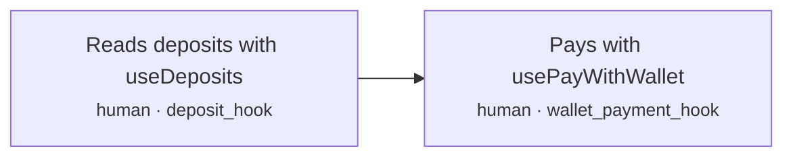

| Step | Bucket | Surface · state | Sees | Does | Next | Criteria |
|---|---|---|---|---|---|---|
| `J9.S1` Reads deposits with useDeposits | human | `deposit_hook` | — | — | `J9.S2` | 2 |
| `J9.S2` Pays with usePayWithWallet | human | `wallet_payment_hook` | — | — | exit `ready` | 5 |

### J9 acceptance criteria

**`J9.S1`** Reads deposits with useDeposits · decisions D18, D40, D41, D140, D111

- `J9.S1.c2` IF the account is unauthorized THE SYSTEM SHALL NOT expose its history, address or payment identifiers
- `J9.S1.c3` WHEN useDeposits is mounted for an authorized account THE SYSTEM SHALL expose manual observations and accepted wallet attempts including pre-transfer pending and failed_no_debit items with settlement and host delivery distinguished

**`J9.S2`** Pays with usePayWithWallet · decisions D41, D110, D140, D141, D231, D43

- `J9.S2.c1` WHEN usePayWithWallet prepares, signs or submits THE SYSTEM SHALL use the same server quote and payment operation rules as Deposit
- `J9.S2.c2` IF custom UI passes changed amounts or destination data with a prepared payment THE SYSTEM SHALL NOT bypass consent validation
- `J9.S2.c3` WHEN the consumer themes Deposit THE SYSTEM SHALL apply documented CSS variables without requiring Tailwind or @repo/ui
- `J9.S2.c4` WHEN the widget is used by keyboard or assistive technology THE SYSTEM SHALL expose labeled amount inputs, actionable errors and status announcements without requiring color to interpret payment state
- `J9.S2.c5` WHEN Deposit displays manual instructions THE SYSTEM SHALL apply D43 to address text, copy and QR through one account-and-chain-scoped state and preserve the test-mode QR watermark

## J10 · Operator checks and recovers processing

**Actor:** Developer integrating Settle Kit  
**Goal:** Inspect alerts, rerun reconciliation and resend events through the small operator API  
**Proves:** Recovery is available without a dashboard or a generic balance override  

| Exit | Title | Named by |
|---|---|---|
| `checked` | Original operation remains tracked and results are visible | `J10.S3` |

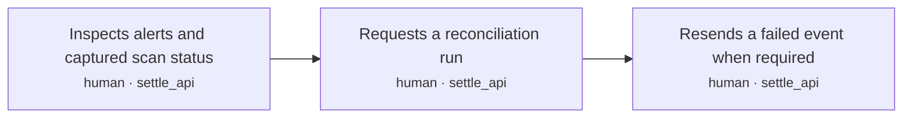

| Step | Bucket | Surface · state | Sees | Does | Next | Criteria |
|---|---|---|---|---|---|---|
| `J10.S1` Inspects alerts and captured scan status | human | `settle_api` | — | — | `J10.S2` | 2 |
| `J10.S2` Requests a reconciliation run | human | `settle_api` | — | — | `J10.S3` | 6 |
| `J10.S3` Resends a failed event when required | human | `settle_api` | — | — | exit `checked` | 3 |

### J10 acceptance criteria

**`J10.S1`** Inspects alerts and captured scan status · decisions D51, D54, D140

- `J10.S1.c1` WHEN an authorized operator calls listAlerts THE SYSTEM SHALL return open attention, failed-delivery and reconciliation problems with their stored identities and last complete scan boundaries
- `J10.S1.c2` IF an operator action lacks host authorization THE SYSTEM SHALL NOT expose private alerts or execute it

**`J10.S2`** Requests a reconciliation run · decisions D35, D36, D140, D126, D127 · invariants I1, I10, I12

- `J10.S2.c1` WHEN an authorized operator calls reconcile THE SYSTEM SHALL run the same captured-range checks and persisted recovery as the scheduled J6 check
- `J10.S2.c2` IF another worker holds a valid claim or any required read fails THE SYSTEM SHALL NOT create a competing payment or report the incomplete scan clean
- `J10.S2.c3` WHEN a host supplies shortfall funding evidence through the documented authenticated operator procedure THE SYSTEM SHALL verify chain, native token, fixed treasury, safe canonical receipt and exclusive transfer identity before linking it to the original payment
- `J10.S2.c4` IF claimed host funding belongs to a customer transfer, another payment, a manual sweep or an already used backing allocation THE SYSTEM SHALL NOT use it to resolve the shortfall
- `J10.S2.c5` WHEN a quote shortfall is backed by verified host funding THE SYSTEM SHALL resume the original exact-quote credit checks without another customer debit
- `J10.S2.c6` IF an affected chain has an open reorg incident THE SYSTEM SHALL NOT resume credit creation until canonical reconciliation succeeds and an authenticated operator records acknowledgment through the documented procedure

**`J10.S3`** Resends a failed event when required · decisions D45, D124, D140 · invariants I1

- `J10.S3.c1` WHEN an operator calls resendWebhook for an existing event THE SYSTEM SHALL restart delivery with that same event ID and immutable payload
- `J10.S3.c2` IF the event was already processed by the host THE SYSTEM SHALL NOT create another balance update
- `J10.S3.c3` IF the requested event does not exist or is outside the host scope THE SYSTEM SHALL NOT create a replacement credit or fabricate an event

## J11 · Developer demonstrates the narrow release publicly

**Actor:** Developer integrating Settle Kit  
**Goal:** Provide reproducible product and infrastructure evidence for hiring  
**Proves:** The public claims match the actual integration and route evidence  

| Exit | Title | Named by |
|---|---|---|
| `shown` | Repo, setup guide, demonstration and evidence ready to share | `J11.S2` |

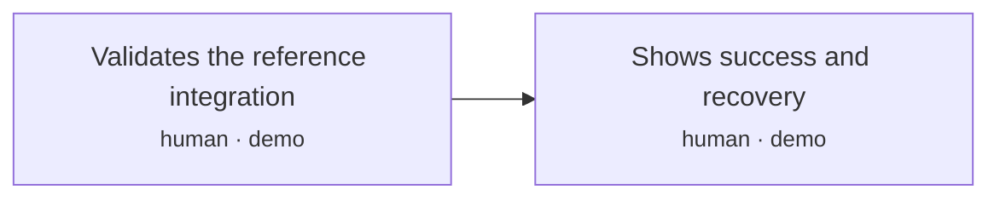

| Step | Bucket | Surface · state | Sees | Does | Next | Criteria |
|---|---|---|---|---|---|---|
| `J11.S1` Validates the reference integration | human | `demo` | — | — | `J11.S2` | 11 |
| `J11.S2` Shows success and recovery | human | `demo` | — | — | exit `shown` | 4 |

### J11 acceptance criteria

**`J11.S1`** Validates the reference integration · decisions D5, D37, D50, D53, D57, D142

- `J11.S1.c1` WHEN the reference integration is evaluated THE SYSTEM SHALL demonstrate a separate consumer setup with the documented long-running server, Postgres and CSS-variable widget or headless hooks
- `J11.S1.c2` IF the only evidence is simulated or fork execution THE SYSTEM SHALL NOT label browser compatibility or a live route as proven
- `J11.S1.c3` WHEN a browser-wallet route is claimed supported THE SYSTEM SHALL link an actual zero-ETH payer testnet transaction and independently verified receipt
- `J11.S1.c4` IF a mainnet route has no recorded live payment THE SYSTEM SHALL NOT describe it as live-proven
- `J11.S1.c5` WHEN onboarding is evaluated THE SYSTEM SHALL provide the separate consumer with authenticated account routes, isolated operator routes, migrations, background startup and atomic webhook balance handling
- `J11.S1.c6` WHEN the consumer starts simulated mode THE SYSTEM SHALL demonstrate manual and wallet scenarios without live keys, RPC credentials or a funded wallet
- `J11.S1.c7` WHEN an independent developer follows the consumer setup THE SYSTEM SHALL record the run and remove any undocumented required step before calling onboarding proven
- `J11.S1.c8` IF the consumer is only a proposed code sketch THE SYSTEM SHALL NOT describe its setup as runnable or independently validated
- `J11.S1.c9` WHEN implementation gates are evaluated THE SYSTEM SHALL record the real Base browser-wallet proof and combined Arbitrum authorization-to-Base proof before treating their integration assumptions as validated
- `J11.S1.c10` WHEN route evidence is recorded THE SYSTEM SHALL distinguish source submission, source safe, Base arrival, Base safe and host acknowledgment times without substituting CCTP attestation latency for account-credit latency
- `J11.S1.c11` WHEN upgrade recovery is demonstrated THE SYSTEM SHALL resume a pending operation across a compatible package upgrade and complete an old workflow through its retained implementation after a new workflow name is introduced

**`J11.S2`** Shows success and recovery · decisions D2, D5, D51, D52, D53, D1

- `J11.S2.c1` WHEN the demonstration is prepared THE SYSTEM SHALL expose connected-wallet and manual paths, fee consent, actual chain evidence, one duplicate or restart recovery case and readable alerts
- `J11.S2.c2` WHEN the public material describes the SDK THE SYSTEM SHALL identify experimental contract status and distinguish simulated, fork, testnet and mainnet evidence
- `J11.S2.c3` WHEN the coherent demo is ready THE SYSTEM SHALL support sharing its repository, setup guide, short video and architectural write-up without requiring a docs website, dashboard or formal npm release
- `J11.S2.c4` WHEN public material describes custody THE SYSTEM SHALL explain that the SDK does not hold payer keys but deposited funds go to the business treasury and app credits are controlled by that business

## J12 · Operator rescues unsupported assets and records payer repayment

**Actor:** Developer integrating Settle Kit  
**Goal:** Recover an allowed asset to the host and close its repayment case with labeled evidence  
**Proves:** Contract recovery and payer repayment are distinct auditable actions  

| Exit | Title | Named by |
|---|---|---|
| `resolved` | Recovery case resolved with an explicit evidence kind | `J12.S5` |
| `open` | Recovery or repayment remains open with its reason | `J12.S6` |

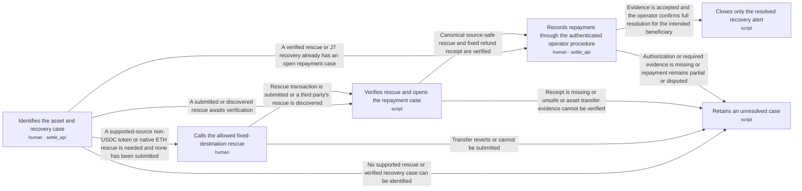

| Step | Bucket | Surface · state | Sees | Does | Next | Criteria |
|---|---|---|---|---|---|---|
| `J12.S1` Identifies the asset and recovery case | human | `settle_api` | — | — | `J12.S2` · A supported-source non-USDC token or native ETH rescue is needed and none has been submitted; `J12.S3` · A submitted or discovered rescue awaits verification; `J12.S4` · A verified rescue or J7 recovery already has an open repayment case; `J12.S6` · No supported rescue or verified recovery case can be identified | 3 |
| `J12.S2` Calls the allowed fixed-destination rescue | human | — | — | Operator calls rescue(token) from an explorer or script and pays its gas; the SDK does not submit it | `J12.S3` · Rescue transaction is submitted or a third party's rescue is discovered; `J12.S6` · Transfer reverts or cannot be submitted | 3 |
| `J12.S3` Verifies rescue and opens the repayment case | script | — | — | — | `J12.S4` · Canonical source-safe rescue and fixed refund receipt are verified; `J12.S6` · Receipt is missing or unsafe or asset transfer evidence cannot be verified | 4 |
| `J12.S4` Records repayment through the authenticated operator procedure | human | `settle_api` | — | — | `J12.S5` · Evidence is accepted and the operator confirms full resolution for the intended beneficiary; `J12.S6` · Authorization or required evidence is missing or repayment remains partial or disputed | 6 |
| `J12.S5` Closes only the resolved recovery alert | script | — | — | — | exit `resolved` | 3 |
| `J12.S6` Retains an unresolved case | script | — | — | — | exit `open` | 2 |

### J12 acceptance criteria

**`J12.S1`** Identifies the asset and recovery case · decisions D27, D33, D51, D129, X6

- `J12.S1.c1` WHEN an authenticated operator follows the recovery procedure THE SYSTEM SHALL identify the account, chain, stored contract, asset and fixed refund address before accepting recovery evidence
- `J12.S1.c2` IF only a support report identifies a transfer THE SYSTEM SHALL NOT label its recovery chain-verified or create a Base credit
- `J12.S1.c3` WHEN an authenticated operator opens a rescue request THE SYSTEM SHALL persist a keyed case with its supplied evidence and unverified recovery state before recording a submission or failure

**`J12.S2`** Calls the allowed fixed-destination rescue · decisions D27, D33, X6 · invariants I11

- `J12.S2.c1` WHEN rescue executes for a transferable non-USDC token or native ETH balance THE SYSTEM SHALL send that asset only to the stored refund address and emit the asset, transferred amount and recipient
- `J12.S2.c2` IF rescue is called for native USDC or a different recipient THE SYSTEM SHALL NOT transfer USDC through rescue or redirect the rescued asset
- `J12.S2.c3` IF the asset transfer fails THE SYSTEM SHALL NOT emit a successful rescue event or record repayment

**`J12.S3`** Verifies rescue and opens the repayment case · decisions D21, D33, D34, D54, D129, D230 · invariants I1, I10, I8

- `J12.S3.c1` WHEN a canonical source-safe rescue is verified THE SYSTEM SHALL persist its contract event and fixed-recipient transfer evidence under a unique chain, transaction and event identity and atomically create or link the recovery case and open its verified-recovery attention episode with pending event delivery
- `J12.S3.c2` IF the same rescue is observed again THE SYSTEM SHALL NOT create another recovery case or attention episode
- `J12.S3.c3` IF the asset is not native USDC THE SYSTEM SHALL NOT create a Base credit or advance the address's USDC drain boundary from its rescue
- `J12.S3.c4` IF the asset's transfer evidence is unavailable or inconsistent THE SYSTEM SHALL NOT label recovery verified or mark the payer repaid

**`J12.S4`** Records repayment through the authenticated operator procedure · decisions D27, D51, D129, X15

- `J12.S4.c1` WHEN an authorized operator records repayment THE SYSTEM SHALL require the recovery-case identity, intended beneficiary, asset and amount, evidence reference and evidence kind and derive the operator identity and recording time on the server
- `J12.S4.c2` WHEN evidence kind is chain_verified THE SYSTEM SHALL independently verify the claimed canonical safe transfer, asset, amount and recipient on a supported chain and require host confirmation that the beneficiary and payment resolve this case
- `J12.S4.c3` WHEN evidence kind is host_reported THE SYSTEM SHALL store the operator's explicit repayment assertion and reference with that label without representing it as independently verified chain evidence
- `J12.S4.c4` IF evidence or authorization is missing or chain verification fails THE SYSTEM SHALL NOT close the recovery alert
- `J12.S4.c5` IF the only transfer is the original recovery into the host refund address THE SYSTEM SHALL NOT accept it as proof of payer repayment
- `J12.S4.c6` WHEN the verified case comes from J7 over-limit USDC recovery or J12 asset rescue THE SYSTEM SHALL accept that case kind's original recovery evidence through the same repayment procedure without requiring a rescue event for USDC recovery

**`J12.S5`** Closes only the resolved recovery alert · decisions D129, D54 · invariants I1, I4, I10

- `J12.S5.c1` WHEN a complete repayment resolution is accepted THE SYSTEM SHALL append its immutable evidence record and close only the matching recovery alert in one database transaction
- `J12.S5.c2` WHEN the resolution is read through the operator procedure THE SYSTEM SHALL expose its chain_verified or host_reported label, operator, time and evidence reference alongside the retained source recovery
- `J12.S5.c3` IF a resolution request is repeated or crashes before commit THE SYSTEM SHALL NOT duplicate the resolution, create a Base credit, alter any credit or close another alert

**`J12.S6`** Retains an unresolved case · decisions D54, D129

- `J12.S6.c1` WHEN recovery or repayment evidence remains incomplete THE SYSTEM SHALL retain the open case and its reason for the next operator attempt
- `J12.S6.c2` IF repayment remains incomplete or disputed THE SYSTEM SHALL NOT present the case as repaid or the deposit as credited

## Surfaces

| Surface | Kind | States | Used by |
|---|---|---|---|
| `deposit_widget` | component | show_address, received, awaiting_minimum, processing, needs_attention, account_update_pending, credited, connect_wallet, quote, signing, submitting, not_submitted, failed_no_debit | `J2.S1` `J2.S2` `J2.S3` `J2.S6` `J3.S1` `J3.S2` `J3.S3` `J3.S6` `J8.S1` `J8.S2` `J8.S3` `J8.S4` `J8.S6` `J8.S8` `J8.S9` `J8.S10` `J8.S11` |
| `settle_api` | endpoint | — | `J1.S5` `J7.S1` `J10.S1` `J10.S2` `J10.S3` `J12.S1` `J12.S4` |
| `credited_webhook` | webhook | — | `J5.S1` |
| `deposit_hook` | hook | — | `J9.S1` |
| `wallet_payment_hook` | hook | — | `J9.S2` |
| `demo` | page | — | `J11.S1` `J11.S2` |

## Tasks

| Task | Serves | Journeys |
|---|---|---|
| `M1.T1` Define package contracts and the explicit mode boundary | `J1.S1` `J1.S2` | J1 |
| `M1.T2` Create the durable store and shipped migrations | `J1.S3` | J1 |
| `M1.T3` Build owned contracts and the versioned factory manifest | `J1.S4` `J7.S2` `J12.S2` | J1, J7, J12 |
| `M1.T4` Prepare immutable quotes in both amount directions | `J8.S2` | J8 |
| `M2.T1` Run recoverable work with bounded transaction submission | `J1.S5a` `J6.S2` `J8.S5` `J8.S11` | J1, J6, J8 |
| `M2.T2` Issue stable addresses and index complete chain ranges | `J2.S3` `J3.S3` `J6.S1` | J2, J3, J6 |
| `M2.T3` Execute and attribute manual sweeps | `J2.S4` `J3.S4` `J4.S1` `J4.S2` | J2, J3, J4 |
| `M2.T4` Accept wallet payments and expose authenticated history | `J8.S4` | J8 |
| `M2.T5` Track the original CCTP message and verify Base backing | `J4.S3` `J4.S4` `J8.S6` | J4, J8 |
| `M2.T6` Allocate backing and commit credit with its event | `J2.S5` `J3.S5` `J8.S7` | J2, J3, J8 |
| `M2.T7` Deliver signed events and commit host credit once | `J5.S1` `J5.S2` `J5.S3` `J10.S3` | J5, J10 |
| `M3.T1` Reconcile books and finish narrow operator recovery | `J6.S3` `J6.S4` `J7.S1` `J7.S3` `J8.S10` `J10.S1` `J10.S2` `J12.S1` `J12.S3` `J12.S4` `J12.S5` `J12.S6` | J6, J7, J8, J10, J12 |
| `M3.T2` Build headless hooks and wallet consent state | `J8.S1` `J8.S3` `J8.S8` `J8.S9` `J9.S1` `J9.S2` | J8, J9 |
| `M3.T3` Ship the Deposit interface and reference wiring | `J1.S5` `J2.S1` `J2.S2` `J2.S6` `J3.S1` `J3.S2` `J3.S6` | J1, J2, J3 |
| `M4.T1` Prove a separate consumer, live routes and upgrade recovery | `J11.S1` | J11 |
| `M4.T2` Prepare the coherent public demonstration | `J11.S2` | J11 |
