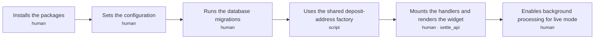
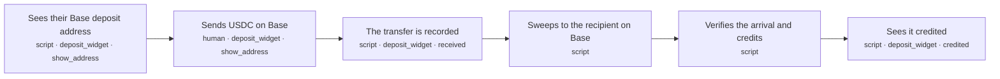
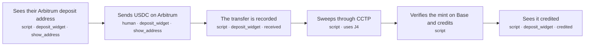
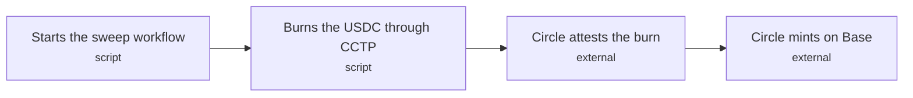
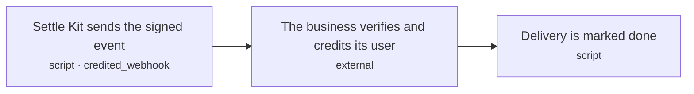
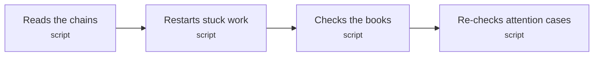
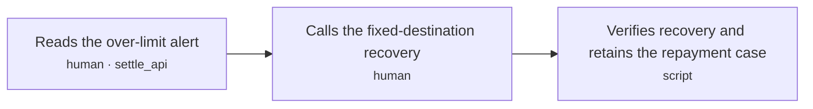

# settle-kit: journey spine

<!-- Generated by scripts/journey.ts. Edit the .yaml spine, not this file. -->

## Actors

| ID | Actor | Type |
|---|---|---|
| `developer` | Developer integrating Settle Kit | person |
| `user` | User depositing USDC | person |
| `engine` | Settle Kit engine (indexer, workflows, scheduled jobs) | system |
| `host` | The business's server | system |
| `circle` | Circle CCTP (attestation and Forwarding Service) | external |

## Invariants

Rules that hold across every journey, ordering and crash point. Tests cite `I1: …`.

| ID | Invariant | Rule | Decisions | Steps that could break it |
|---|---|---|---|---|
| `I1` | One credit per transfer | THE SYSTEM SHALL NOT credit the same on-chain transfer (chain ID, tx hash, log index) more than once | D23 | `J2.S3` `J2.S4` `J2.S5` `J3.S3` `J3.S5` `J4.S2` `J5.S2` `J6.S1` `J7.S3` |
| `I4` | A credit is final | THE SYSTEM SHALL NOT change a credited deposit's amount or move it out of the credited state | D32 | `J2.S5` `J3.S5` `J6.S3` |
| `I5` | Secrets stay secret | THE SYSTEM SHALL NOT put the gas wallet key or the webhook secret in logs, errors or API responses | D27 | `J1.S2` `J5.S1` |
| `I7` | Every credit has unique verified backing when created | THE SYSTEM SHALL NOT create a credit without a uniquely claimed canonical USDC arrival at the stored Base recipient at safe and matching source attribution, or for an amount other than that verified net arrival | D21, D23, D121, D125 | `J2.S5` `J3.S5` `J6.S3` `J7.S3` |
| `I8` | Complete discovery means a complete captured range | THE SYSTEM SHALL NOT advance a discovery cursor beyond a fully read and committed range, or mark a captured scan complete before every required page and event through its captured safe boundary is read and committed | D34, D131 | `J2.S3` `J2.S4` `J3.S3` `J4.S2` `J6.S1` `J7.S3` |
| `I9` | All callers are bound to fixed money destinations | THE SYSTEM SHALL NOT let any caller send deposit-contract USDC except to its stored treasury or CCTP destination and fixed sweep-fee recipient during an eligible sweep, or its entire over-limit Arbitrum balance to its stored refund address with zero sweep fee; non-USDC rescue pays only the stored refund address | D28, D33, D39 | `J2.S4` `J4.S2` `J7.S2` |

## J1 · Developer sets up Settle Kit and shows the deposit widget

**Actor:** Developer integrating Settle Kit  
**Goal:** Show a user's test address from any Node or Bun server with React, and configure live background processing  
**Proves:** A stranger can install and run it (D5)  

| Exit | Title | Named by |
|---|---|---|
| `ready` | Test widget works and live background setup has been verified | `J1.S5a` |

| Step | Bucket | Surface · state | Sees | Does | Next | Criteria |
|---|---|---|---|---|---|---|
| `J1.S1` Installs the packages | human | — | — | Adds @settle-kit/server to the server (Express, Fastify, Hono, Next.js or plain Node/Bun) and @settle-kit/react to the frontend | `J1.S2` | 2 |
| `J1.S2` Sets the configuration | human | — | — | Sets the database URL, treasury and refund addresses, gas wallet key, Base and Arbitrum RPC URLs, webhook URL and secret, and the address namespace (32 random bytes, generated once) | `J1.S3` | 6 |
| `J1.S3` Runs the database migrations | human | — | — | Applies the numbered SQL migrations shipped with the package to the app's Postgres | `J1.S4` | 2 |
| `J1.S4` Uses the shared deposit-address factory | script | — | — | Points at the factory Settle Kit deployed once on Base and Arbitrum; nothing to deploy unless the developer sets their own factory address | `J1.S5` | 3 |
| `J1.S5` Mounts the handlers and renders the widget | human | `settle_api` | — | Mounts settle.handlers on a route, runs scheduled work (settle.start() on a long-running server, or a cron hitting the protected cron route on serverless), and renders <Deposit accountId='user_42' /> on a page | `J1.S5a` | 5 |
| `J1.S5a` Enables background processing for live mode | human | — | — | Starts DBOS with the release-pinned version and a unique executor, and verifies scheduled work | exit `ready` | 5 |

### J1 acceptance criteria

**`J1.S1`** Installs the packages · decisions D37, D44

- `J1.S1.c1` WHEN createSettle() starts without SETTLE_MODE THE SYSTEM SHALL refuse to start and name the missing variable
- `J1.S1.c2` WHEN SETTLE_MODE is test THE SYSTEM SHALL simulate deposits and SHALL NOT send any transaction on a real chain

**`J1.S2`** Sets the configuration · decisions D26, D39, D135, D44 · invariants I5

- `J1.S2.c1` WHEN createSettle() starts THE SYSTEM SHALL validate the database URL and every address and URL, and name each invalid or missing value
- `J1.S2.c2` IF the treasury or refund address is missing or not a valid address THE SYSTEM SHALL NOT start
- `J1.S2.c3` IF configuration validation fails THE SYSTEM SHALL NOT include the gas wallet key or webhook secret in the error
- `J1.S2.c4` IF the address namespace is missing or not 32 bytes THE SYSTEM SHALL NOT start, and SHALL print a command that generates one
- `J1.S2.c5` IF a configured sweep fee is negative or is greater than or equal to its minimum THE SYSTEM SHALL NOT start or create a deposit contract
- `J1.S2.c6` IF a caller is not authorized for the requested account or administrative operation THE SYSTEM SHALL NOT return account data or execute that operation

**`J1.S3`** Runs the database migrations · decisions D30, D31

- `J1.S3.c1` WHEN the migrations run THE SYSTEM SHALL apply each numbered migration exactly once, in order
- `J1.S3.c2` WHEN the migrations run a second time THE SYSTEM SHALL change nothing

**`J1.S4`** Uses the shared deposit-address factory · decisions D134

- `J1.S4.c2` WHERE the developer sets their own factory address THE SYSTEM SHALL use it instead of the shared one
- `J1.S4.c3` WHEN live startup or address issuance runs THE SYSTEM SHALL verify the RPC chain ID and factory runtime-code hash against the supported version manifest
- `J1.S4.c4` IF either chain ID or factory code does not match the manifest THE SYSTEM SHALL NOT issue an address and SHALL name the failing chain

**`J1.S5`** Mounts the handlers and renders the widget · decisions D36, D40, D44, D131

- `J1.S5.c1` WHEN the widget requests an account's deposit address through the mounted route THE SYSTEM SHALL answer with that account's address for each supported chain
- `J1.S5.c2` WHEN SETTLE_MODE is test THE SYSTEM SHALL mark the widget and QR code as TEST
- `J1.S5.c3` WHEN SETTLE_MODE is test THE SYSTEM SHALL show a "Simulate a deposit" button that runs the deposit journey (J2) with simulated transfers
- `J1.S5.c4` WHEN settle.start() runs THE SYSTEM SHALL launch the durable engine with Settle Kit's pinned release as the application version and a fresh executor ID for this process
- `J1.S5.c5` WHEN the cron route receives a request without the configured cron secret THE SYSTEM SHALL answer 401 and SHALL NOT run any scheduled work

**`J1.S5a`** Enables background processing for live mode · decisions D36, D37, D131

- `J1.S5a.c5` WHEN a long-running host calls settle.start() THE SYSTEM SHALL register DBOS chain scans every 10 seconds and the remaining scheduled check every 60 seconds
- `J1.S5a.c6` WHEN serverless live setup is configured THE SYSTEM SHALL require an authenticated POST cron invocation every 60 seconds
- `J1.S5a.c7` IF the cron secret is absent or invalid THE SYSTEM SHALL NOT execute scheduled work
- `J1.S5a.c8` WHEN live setup is verified THE SYSTEM SHALL show a completed scheduled scan and a persisted DBOS workflow resuming after a process restart
- `J1.S5a.c9` WHEN a compatible release starts THE SYSTEM SHALL preserve its pinned application version and workflow step ordering, and use a new workflow name for an incompatible sequence

## J2 · User deposits USDC on Base

**Actor:** User depositing USDC  
**Goal:** Send USDC on Base to their deposit address and see it credited  
**Proves:** The simplest own-rails path is verified and credited once  

| Exit | Title | Named by |
|---|---|---|
| `credited` | Deposit credited; the business is told once | `J2.S6` |

| Step | Bucket | Surface · state | Sees | Does | Next | Criteria |
|---|---|---|---|---|---|---|
| `J2.S1` Sees their Base deposit address | script | `deposit_widget` · show_address | QR code, the address in groups, 'USDC on Base only', minimum 2 USDC, 'you'll receive about X' | Returns the account's stored address, computing and storing it on first use | `J2.S2` | 6 |
| `J2.S2` Sends USDC on Base | human | `deposit_widget` · show_address | — | Scans the QR code with a wallet or withdraws from an exchange to the address | `J2.S3` | 1 |
| `J2.S3` The transfer is recorded | script | `deposit_widget` · received | 'Received 10.00 USDC. Moving it to your account' | Reads the USDC transfer at or below Base's safe block and records the deposit | `J2.S4` | 8 |
| `J2.S4` Sweeps to the recipient on Base | script | — | — | The gas wallet deploys the address's contract if needed and calls sweep(), which pays the sweep fee and forwards the rest | `J2.S5` | 12 |
| `J2.S5` Verifies the arrival and credits | script | — | — | Reads the USDC arrival at the stored recipient at the safe block and credits the deposit | `J2.S6` | 10 |
| `J2.S6` Sees it credited | script | `deposit_widget` · credited | '9.99 USDC credited' with a Base explorer link to the arrival | Shows the credited amount | exit `credited` | 2 |

### J2 acceptance criteria

**`J2.S1`** Sees their Base deposit address · decisions D13, D20, D28, D33, D38, D39, D135, D134

- `J2.S1.c2` WHEN the account asks again THE SYSTEM SHALL return the same stored address and SHALL NOT issue a new one
- `J2.S1.c3` IF the browser sends a recipient, minimum or lane THE SYSTEM SHALL NOT use it
- `J2.S1.c4` WHEN the address is shown THE SYSTEM SHALL show the minimum (2 USDC) and the sweep fee (0.01 USDC by default) before the user sends
- `J2.S1.c5` WHEN an account first requests an address THE SYSTEM SHALL atomically store the address and its complete versioned CREATE2 inputs under a unique business, account and route key, and return the stored winner of concurrent requests
- `J2.S1.c6` WHEN an address is predicted THE SYSTEM SHALL bind the namespace and account ID with unambiguous encoding and bind every immutable D33 money setting and supported creation-code version
- `J2.S1.c7` IF a predicted contract already exists with different code, version or immutable settings THE SYSTEM SHALL NOT use it or sweep it

**`J2.S2`** Sends USDC on Base · decisions D131

- `J2.S2.c2` WHILE the widget or useDeposits is mounted THE SYSTEM SHALL scan the account's issued addresses every 5 seconds, including after earlier deposits and during pending work

**`J2.S3`** The transfer is recorded · decisions D18, D21, D23, D28, D34, D17, D131 · invariants I1, I8

- `J2.S3.c1` WHEN a USDC transfer to the address is at or below the safe block THE SYSTEM SHALL record one deposit keyed by chain ID, tx hash and log index
- `J2.S3.c2` IF the same transfer is read again THE SYSTEM SHALL NOT record a second deposit
- `J2.S3.c4` WHEN our own read finds the transfer at the latest block THE SYSTEM SHALL show "Received" with the amount, and SHALL NOT record or credit it before it is at or below the safe block
- `J2.S3.c5` WHEN a transfer is observed at latest THE SYSTEM SHALL store its provisional observation separately from safe deposit records
- `J2.S3.c6` IF a canonical replacement excludes a provisional transfer THE SYSTEM SHALL NOT retain its provisional amount and SHALL show "Confirmation changed; checking"
- `J2.S3.c7` WHEN the safe unassigned balance is below the stored minimum with no pending sweep THE SYSTEM SHALL keep it awaiting_minimum without starting the processing-delay timer
- `J2.S3.c8` WHEN safe unassigned funds first reach the stored minimum THE SYSTEM SHALL persist the processing-eligibility time for that batch and retain it through top-ups, retries and restarts
- `J2.S3.c9` IF safe unassigned funds are below the stored minimum and no sweep is pending THE SYSTEM SHALL NOT start a sweep and SHALL show "Received X. Send Y more to reach the minimum"

**`J2.S4`** Sweeps to the recipient on Base · decisions D33, D36, D39, D121, D28, D134, D139 · invariants I9, I1, I8

- `J2.S4.c2` WHEN the address has no contract yet THE SYSTEM SHALL deploy it in the sweep workflow before calling sweep()
- `J2.S4.c16` IF an address has an open sweep operation THE SYSTEM SHALL NOT start a second operation, including while the first is sleeping or awaiting verification
- `J2.S4.c7` WHEN a successful sweep is discovered THE SYSTEM SHALL assign only incoming transfers after the preceding successful full-balance drain and before this sweep in chain execution order, including mid-workflow top-ups
- `J2.S4.c8` IF a transfer is already assigned to a sweep or recovery THE SYSTEM SHALL NOT reassign it
- `J2.S4.c9` IF any caller invokes sweep() with zero or less than the stored minimum THE SYSTEM SHALL NOT move USDC or charge a USDC sweep fee
- `J2.S4.c10` WHEN a sweep succeeds THE SYSTEM SHALL emit the gross balance, fixed fee and forwarded amount and pay only the stored recipients
- `J2.S4.c11` WHEN a sweep or deployment is submitted THE SYSTEM SHALL first persist its operation, chain, signer, globally reserved signer nonce, signed bytes and hash
- `J2.S4.c12` IF broadcast times out or its receipt is missing THE SYSTEM SHALL NOT submit a fresh-nonce retry and SHALL reconcile events or rebroadcast the saved transaction
- `J2.S4.c13` WHEN a transaction is fee-replaced THE SYSTEM SHALL keep its nonce, destination and call data and retain both hashes
- `J2.S4.c14` WHEN an attempt is proven reverted or its nonce is proven consumed by another canonical transaction at source safe THE SYSTEM SHALL recheck all sweep guards before any fresh-nonce retry of the same operation
- `J2.S4.c15` WHEN safe unassigned funds meet the minimum and the address has no open operation THE SYSTEM SHALL atomically start one sweep operation keyed by address and sweep number
- `J2.S4.c17` IF a sweep step replays after a crash with an unknown transaction outcome THE SYSTEM SHALL NOT create an independently executable fresh-nonce transaction and SHALL reconcile or rebroadcast the saved attempt

**`J2.S5`** Verifies the arrival and credits · decisions D17, D21, D22, D23, D32, D121, D125, D230 · invariants I1, I7, I4

- `J2.S5.c2` IF no matching arrival is verified THE SYSTEM SHALL NOT credit the deposit
- `J2.S5.c3` IF two workers try to credit the same deposit THE SYSTEM SHALL NOT credit it twice
- `J2.S5.c6` IF a deposit is already covered by a credit THE SYSTEM SHALL NOT include it in another
- `J2.S5.c8` WHEN all source attribution and Base verification checks pass THE SYSTEM SHALL atomically claim the source memberships and unique Base arrival, insert one final credit for the verified net Base amount in integer base units and its immutable deposit.credited event, and create pending delivery in one Postgres transaction
- `J2.S5.c9` IF source or drain evidence is not canonical at source safe, gross source units differ from the emitted gross balance, gross differs from the emitted fee plus forwarded or burned amount, or the Base arrival is claimed by a different sweep THE SYSTEM SHALL NOT credit and SHALL enter needs_attention with the failed check
- `J2.S5.c10` IF the corresponding Base arrival is not the canonical USDC net transfer to the stored recipient at the captured safe boundary or credit creation is paused for an affected chain THE SYSTEM SHALL NOT create a credit
- `J2.S5.c11` IF settlement is pending for at least 2 minutes after processing eligibility and the batch has not entered attention THE SYSTEM SHALL show "Taking longer than usual; checking your deposit"
- `J2.S5.c12` IF settlement is pending for at least 15 minutes after processing eligibility and the batch has no other attention reason THE SYSTEM SHALL NOT create a credit from elapsed time and SHALL enter needs_attention as delayed
- `J2.S5.c13` WHEN internal settlement commits before host acknowledgment THE SYSTEM SHALL show "Received by the business; account update pending" and expose settlement and delivery states through useDeposits
- `J2.S5.c14` WHEN a retry finds this sweep's committed credit and event THE SYSTEM SHALL return the existing result without another credit or attention transition

**`J2.S6`** Sees it credited · decisions D18, D124

- `J2.S6.c2` WHEN the host acknowledges committed processing of deposit.credited THE SYSTEM SHALL show the account as credited with the verified amount and explorer links to the relevant source and Base arrival transactions
- `J2.S6.c3` IF the host has not acknowledged committed processing THE SYSTEM SHALL NOT show the account as credited

## J3 · User deposits USDC on Arbitrum

**Actor:** User depositing USDC  
**Goal:** Send USDC on Arbitrum to their deposit address and see it credited on Base  
**Proves:** The own-rails cross-chain path through CCTP is verified and credited once  

| Exit | Title | Named by |
|---|---|---|
| `credited` | Deposit credited; the business is told once | `J3.S6` |

| Step | Bucket | Surface · state | Sees | Does | Next | Criteria |
|---|---|---|---|---|---|---|
| `J3.S1` Sees their Arbitrum deposit address | script | `deposit_widget` · show_address | QR code, address, 'USDC on Arbitrum only', minimum 2 USDC, maximum automatic balance (1,000 USDC by default), estimated fees | Returns the account's stored Arbitrum address, computing and storing it on first use | `J3.S2` | 7 |
| `J3.S2` Sends USDC on Arbitrum | human | `deposit_widget` · show_address | — | Scans the QR code with a wallet or withdraws from an exchange on Arbitrum | `J3.S3` | 1 |
| `J3.S3` The transfer is recorded | script | `deposit_widget` · received | 'Received 10.00 USDC on Arbitrum. Moving it to Base' | Reads the USDC transfer at or below Arbitrum's safe block and records the deposit | `J3.S4` | 8 |
| `J3.S4` Sweeps through CCTP | script | — | — | — | uses `J4`; `J3.S5` | 0 |
| `J3.S5` Verifies the mint on Base and credits | script | — | — | Reads the USDC minted to the stored recipient on Base at the safe block and credits the deposit | `J3.S6` | 12 |
| `J3.S6` Sees it credited | script | `deposit_widget` · credited | '9.94 USDC credited' with explorer links to the Arbitrum burn and the Base mint | Shows the credited amount | exit `credited` | 2 |

### J3 acceptance criteria

**`J3.S1`** Sees their Arbitrum deposit address · decisions D13, D20, D28, D33, D38, D39, D135, D134

- `J3.S1.c2` WHEN the account asks again THE SYSTEM SHALL return the same stored address and SHALL NOT issue a new one
- `J3.S1.c3` IF the browser sends a recipient, minimum or lane THE SYSTEM SHALL NOT use it
- `J3.S1.c4` WHEN the address is shown THE SYSTEM SHALL show the minimum (2 USDC), the sweep fee (0.05 USDC by default) and the estimated CCTP fee before the user sends
- `J3.S1.c5` WHEN an account first requests an address THE SYSTEM SHALL atomically store the address and its complete versioned CREATE2 inputs under a unique business, account and route key, and return the stored winner of concurrent requests
- `J3.S1.c6` WHEN an address is predicted THE SYSTEM SHALL bind the namespace and account ID with unambiguous encoding and bind every immutable D33 money setting and supported creation-code version
- `J3.S1.c7` IF a predicted contract already exists with different code, version or immutable settings THE SYSTEM SHALL NOT use it or sweep it
- `J3.S1.c8` WHEN the Arbitrum address is shown THE SYSTEM SHALL show the address's stored gross automatic-processing maximum (1,000 USDC by default) and explain that larger balances require host recovery

**`J3.S2`** Sends USDC on Arbitrum · decisions D131

- `J3.S2.c2` WHILE the widget or useDeposits is mounted THE SYSTEM SHALL scan the account's issued addresses every 5 seconds, including after earlier deposits and during pending work

**`J3.S3`** The transfer is recorded · decisions D18, D21, D23, D28, D34, D17, D131 · invariants I1, I8

- `J3.S3.c1` WHEN a USDC transfer to the address is at or below Arbitrum's safe block THE SYSTEM SHALL record one deposit keyed by chain ID, tx hash and log index
- `J3.S3.c2` IF the same transfer is read again THE SYSTEM SHALL NOT record a second deposit
- `J3.S3.c4` WHEN our own read finds the transfer at the latest block THE SYSTEM SHALL show "Received" with the amount, and SHALL NOT record or credit it before it is at or below the safe block
- `J3.S3.c5` WHEN a transfer is observed at latest THE SYSTEM SHALL store its provisional observation separately from safe deposit records
- `J3.S3.c6` IF a canonical replacement excludes a provisional transfer THE SYSTEM SHALL NOT retain its provisional amount and SHALL show "Confirmation changed; checking"
- `J3.S3.c7` WHEN the safe unassigned balance is below the stored minimum with no pending sweep THE SYSTEM SHALL keep it awaiting_minimum without starting the processing-delay timer
- `J3.S3.c8` WHEN safe unassigned funds first reach the stored minimum THE SYSTEM SHALL persist the processing-eligibility time for that batch and retain it through top-ups, retries and restarts
- `J3.S3.c9` IF safe unassigned funds are below the stored minimum and no sweep is pending THE SYSTEM SHALL NOT start a sweep and SHALL show "Received X. Send Y more to reach the minimum"

**`J3.S5`** Verifies the mint on Base and credits · decisions D17, D21, D22, D23, D32, D121, D125, D230, D138 · invariants I1, I7, I4

- `J3.S5.c2` IF no matching mint is verified on Base THE SYSTEM SHALL NOT credit the deposit, whatever the burn or attestation shows
- `J3.S5.c3` IF two workers try to credit the same deposit THE SYSTEM SHALL NOT credit it twice
- `J3.S5.c5` IF a deposit is already covered by a credit THE SYSTEM SHALL NOT include it in another
- `J3.S5.c6` IF any transfer linked to the sweep is not yet at or below Arbitrum's safe block, or the linked transfers do not add up to what the sweep burned plus its sweep fee, THE SYSTEM SHALL NOT record the credit
- `J3.S5.c8` WHEN all source attribution and Base verification checks pass THE SYSTEM SHALL atomically claim the source memberships and unique Base arrival, insert one final credit for the verified net Base amount in integer base units and its immutable deposit.credited event, and create pending delivery in one Postgres transaction
- `J3.S5.c9` IF source or drain evidence is not canonical at source safe, gross source units differ from the emitted gross balance, gross differs from the emitted fee plus forwarded or burned amount, or the Base arrival is claimed by a different sweep THE SYSTEM SHALL NOT credit and SHALL enter needs_attention with the failed check
- `J3.S5.c10` IF the corresponding Base arrival is not the canonical USDC net transfer to the stored recipient at the captured safe boundary or credit creation is paused for an affected chain THE SYSTEM SHALL NOT create a credit
- `J3.S5.c11` IF settlement is pending for at least 2 minutes after processing eligibility and the batch has not entered attention THE SYSTEM SHALL show "Taking longer than usual; checking your deposit"
- `J3.S5.c12` IF settlement is pending for at least 15 minutes after processing eligibility and the batch has no other attention reason THE SYSTEM SHALL NOT create a credit from elapsed time and SHALL enter needs_attention as delayed
- `J3.S5.c13` WHEN internal settlement commits before host acknowledgment THE SYSTEM SHALL show "Received by the business; account update pending" and expose settlement and delivery states through useDeposits
- `J3.S5.c14` IF the verified mint is not linked to the recorded CCTP burn message or its net amount does not match the message amount less executed CCTP fees THE SYSTEM SHALL NOT credit
- `J3.S5.c15` WHEN a retry finds this sweep's committed credit and event THE SYSTEM SHALL return the existing result without another credit or attention transition

**`J3.S6`** Sees it credited · decisions D18, D124

- `J3.S6.c2` WHEN the host acknowledges committed processing of deposit.credited THE SYSTEM SHALL show the account as credited with the verified amount and explorer links to the relevant source and Base arrival transactions
- `J3.S6.c3` IF the host has not acknowledged committed processing THE SYSTEM SHALL NOT show the account as credited

## J4 · Engine sweeps an Arbitrum deposit to Base through CCTP

**Actor:** Settle Kit engine (indexer, workflows, scheduled jobs)  
**Goal:** Move a recorded Arbitrum deposit to its recipient on Base  
**Proves:** The cross-chain sweep survives slow steps and restarts (D36)  
Reusable sub-journey: other journeys include it with `uses`.  

| Exit | Title | Named by |
|---|---|---|
| `minted` | USDC minted to the recipient on Base | `J4.S4` |

| Step | Bucket | Surface · state | Sees | Does | Next | Criteria |
|---|---|---|---|---|---|---|
| `J4.S1` Starts the sweep workflow | script | — | — | Starts one durable workflow per sweep, one sweep at a time per address | `J4.S2` | 3 |
| `J4.S2` Burns the USDC through CCTP | script | — | — | The gas wallet deploys the contract if needed and calls sweep(), which pays the sweep fee and burns the rest with CCTP V2 Fast and the Forwarding Service | `J4.S3` | 11 |
| `J4.S3` Circle attests the burn | external | — | — | Circle signs the burn message | `J4.S4` | 5 |
| `J4.S4` Circle mints on Base | external | — | — | The Forwarding Service mints the USDC to the recipient on Base and takes its fee from the minted amount | exit `minted` | 5 |

### J4 acceptance criteria

**`J4.S1`** Starts the sweep workflow · decisions D36, D28, D17

- `J4.S1.c3` IF an address has an open sweep operation THE SYSTEM SHALL NOT start another operation, including while it is sleeping or awaiting mint verification
- `J4.S1.c4` IF the gross address balance exceeds the address's stored maximum (1,000,000,000 USDC base units by default) or its net burn exceeds Circle's current on-chain per-message limit THE SYSTEM SHALL NOT start an automatic burn and SHALL enter needs_attention as over_limit
- `J4.S1.c5` WHEN safe unassigned funds meet the minimum, satisfy both Arbitrum limits and the address has no open operation THE SYSTEM SHALL atomically start one sweep operation keyed by address and sweep number

**`J4.S2`** Burns the USDC through CCTP · decisions D33, D39, D121, D28, D134, D139 · invariants I9, I1, I8

- `J4.S2.c1` WHEN the address has no contract yet THE SYSTEM SHALL deploy it before calling sweep()
- `J4.S2.c14` WHEN an eligible sweep executes THE SYSTEM SHALL pay exactly the stored fee and burn the remainder to the stored Base domain and recipient using CCTP V2 Fast and Forwarding Service
- `J4.S2.c6` IF any caller invokes sweep() below the minimum, above the address's stored gross maximum or above Circle's current net-burn limit THE SYSTEM SHALL NOT burn any USDC or charge any USDC sweep fee
- `J4.S2.c7` IF the burn amount minus its maximum CCTP protocol and forwarding fee budget is not positive THE SYSTEM SHALL NOT burn or charge a sweep fee and SHALL enter needs_attention as route_fee_unaffordable
- `J4.S2.c8` WHEN a successful burn is discovered THE SYSTEM SHALL assign only incoming transfers after the preceding successful full-balance drain and before this sweep in chain execution order, record the gross, fee and burned amounts, and retain the burn-message identity
- `J4.S2.c9` IF a transfer is already assigned to a sweep or recovery THE SYSTEM SHALL NOT reassign it
- `J4.S2.c10` WHEN a deployment or sweep is submitted THE SYSTEM SHALL persist its operation, chain, signer, globally reserved signer nonce, signed bytes and hash before broadcast
- `J4.S2.c11` IF a broadcast times out or lacks a receipt THE SYSTEM SHALL NOT submit a fresh-nonce retry and SHALL reconcile events or rebroadcast the saved transaction
- `J4.S2.c12` WHEN a transaction is fee-replaced THE SYSTEM SHALL keep its nonce, destination and call data and retain both hashes
- `J4.S2.c13` WHEN an attempt is proven reverted or its nonce is proven consumed by another canonical transaction at source safe THE SYSTEM SHALL recheck all sweep guards before any fresh-nonce retry of the same operation
- `J4.S2.c15` IF a sweep step replays after a crash with an unknown transaction outcome THE SYSTEM SHALL NOT create an independently executable fresh-nonce transaction and SHALL reconcile or rebroadcast the saved attempt

**`J4.S3`** Circle attests the burn · decisions D17, D56, D138

- `J4.S3.c3` WHILE a known burn is pending before attention THE SYSTEM SHALL schedule Iris polls no less than 5 seconds apart through one persisted poller per burn and a shared rolling budget of at most 20 requests per second across all workers and stages
- `J4.S3.c4` WHEN a pending burn enters attention THE SYSTEM SHALL replace the five-second poll schedule with a poll every 15 minutes for 7 days from attention entry and daily after that, subject to the shared budget
- `J4.S3.c5` WHEN Iris returns 404 or an empty message list THE SYSTEM SHALL retain the known burn as pending
- `J4.S3.c6` IF Iris returns 429 THE SYSTEM SHALL NOT call Iris from any worker in the shared budget for at least 300 seconds or a longer valid Retry-After
- `J4.S3.c7` IF a burn awaits attestation or forwarding recovery THE SYSTEM SHALL NOT burn again or start a custom re-attestation loop and SHALL retain the original message for Circle forwarding

**`J4.S4`** Circle mints on Base · decisions D21, D17, D138, D56

- `J4.S4.c1` WHEN Circle reports the mint THE SYSTEM SHALL wait for the mint to be at or below Base's safe block before reporting the exit
- `J4.S4.c2` IF Circle reports a mint that is not found on Base THE SYSTEM SHALL NOT report the exit
- `J4.S4.c3` WHEN Circle forwarding is pending THE SYSTEM SHALL retain the original burn message and continue its due verification under D17 and D56
- `J4.S4.c4` IF Circle reports forwarding failure or an unknown forwarding status THE SYSTEM SHALL NOT treat it as a mint or a lost-funds verdict and SHALL enter needs_attention with the reported status and known message and transaction identities
- `J4.S4.c5` IF another party submitted the original mint THE SYSTEM SHALL NOT mint or credit it again and SHALL locate and verify that same message's Base arrival

## J5 · The business receives a deposit event

**Actor:** The business's server  
**Goal:** Process signed deposit events safely across retries and commit each account credit once  
**Proves:** Delivery is signed, retried and safe to receive twice (D14, D45)  

| Exit | Title | Named by |
|---|---|---|
| `delivered` | The business acknowledged the event | `J5.S3` |

| Step | Bucket | Surface · state | Sees | Does | Next | Criteria |
|---|---|---|---|---|---|---|
| `J5.S1` Settle Kit sends the signed event | script | `credited_webhook` | — | POSTs an immutable deposit.credited or deposit.needs_attention event with Standard Webhooks signing | `J5.S2` | 8 |
| `J5.S2` The business verifies and credits its user | external | — | — | Calls settle.webhook(handler), which checks the signature, then credits user_42 in its own database | `J5.S3` | 6 |
| `J5.S3` Delivery is marked done | script | — | — | Records the acknowledgment | exit `delivered` | 3 |

### J5 acceptance criteria

**`J5.S1`** Settle Kit sends the signed event · decisions D14, D22, D45, D121, D230, D54 · invariants I5

- `J5.S1.c1` WHEN a credit is recorded THE SYSTEM SHALL POST one deposit.credited with a stable event ID, the account ID, the verified amount as a decimal string and the incoming transfers it covers
- `J5.S1.c2` IF the business does not answer with a 2xx status within 10 s THE SYSTEM SHALL retry up to 10 times, waiting 2^(n-1) minutes before retry n, and SHALL NOT change the event ID or payload
- `J5.S1.c3` IF a delivery attempt fails THE SYSTEM SHALL NOT log the webhook secret or the signature
- `J5.S1.c4` IF all 11 attempts fail THE SYSTEM SHALL NOT retry again, and SHALL mark the delivery failed so an operator can resend it, leaving the credit unchanged
- `J5.S1.c5` WHEN an attention episode is entered THE SYSTEM SHALL atomically store its state and one immutable deposit.needs_attention event containing account, reason, stage and known transaction identities with pending delivery
- `J5.S1.c6` WHEN any pending event delivery is resumed THE SYSTEM SHALL use its saved event ID and body with a fresh delivery-attempt signature timestamp
- `J5.S1.c7` WHEN a delivery exhausts its 11 attempts THE SYSTEM SHALL create an alert exposed by listAlerts and the demo without requiring webhook delivery
- `J5.S1.c8` IF a pending delivery is recovered after a crash THE SYSTEM SHALL NOT reset its saved retry budget or resend an exhausted delivery without an operator request

**`J5.S2`** The business verifies and credits its user · decisions D44, D124 · invariants I1

- `J5.S2.c2` IF the signature is missing, invalid or older than 5 minutes THE SYSTEM SHALL answer 401 and SHALL NOT call the handler
- `J5.S2.c4` WHEN settle.webhook receives a valid request THE SYSTEM SHALL await the host handler before returning its acknowledgment
- `J5.S2.c5` WHEN the host receives a new deposit.credited event THE SYSTEM SHALL insert its unique event ID and update the account balance in one host-database transaction before returning 2xx
- `J5.S2.c6` IF the event ID is already committed THE SYSTEM SHALL NOT update the balance again and SHALL return 2xx
- `J5.S2.c7` IF host processing fails before commit THE SYSTEM SHALL NOT return 2xx
- `J5.S2.c8` IF the event type is deposit.needs_attention THE SYSTEM SHALL NOT credit the account balance

**`J5.S3`** Delivery is marked done · decisions D45, D18

- `J5.S3.c1` WHEN the business answers with a 2xx status THE SYSTEM SHALL mark the delivery done
- `J5.S3.c2` IF the delivery is already done THE SYSTEM SHALL NOT send the event again unless an operator calls resendWebhook
- `J5.S3.c3` WHEN an operator resends an event THE SYSTEM SHALL restart its delivery budget with the same event ID and immutable body

## J6 · The minute check

**Actor:** Settle Kit engine (indexer, workflows, scheduled jobs)  
**Goal:** Every minute, find every deposit, restart stuck work and check the books  
**Proves:** Nothing is missed and nothing is credited without an arrival (D131, D35)  

| Exit | Title | Named by |
|---|---|---|
| `checked` | Check finished; problems flagged | `J6.S4` |

| Step | Bucket | Surface · state | Sees | Does | Next | Criteria |
|---|---|---|---|---|---|---|
| `J6.S1` Reads the chains | script | — | — | Reads incoming USDC, sweeps and recoveries through each captured safe boundary | `J6.S2` | 9 |
| `J6.S2` Restarts stuck work | script | — | — | Resumes persisted operation stages and pending deliveries, and starts eligible work without an open operation | `J6.S3` | 10 |
| `J6.S3` Checks the books | script | — | — | Matches each credited deposit to a verified arrival at its recipient, and each treasury arrival to a credited deposit | `J6.S4` | 11 |
| `J6.S4` Re-checks attention cases | script | — | — | Re-checks deposits in needs_attention on D17's schedule | exit `checked` | 5 |

### J6 acceptance criteria

**`J6.S1`** Reads the chains · decisions D34, D131, D121, D135 · invariants I1, I8

- `J6.S1.c2` IF two runs overlap THE SYSTEM SHALL NOT record a transfer twice
- `J6.S1.c4` WHEN a scan starts THE SYSTEM SHALL capture each chain's safe block number and hash and read every page of each range from its committed cursor through that boundary
- `J6.S1.c5` WHEN a range completes THE SYSTEM SHALL atomically commit its incoming transfers, successful sweep and recovery events, drain memberships and block-hash cursor
- `J6.S1.c6` IF any page or required RPC read fails THE SYSTEM SHALL NOT advance the incomplete range or report the scan complete
- `J6.S1.c7` IF concurrent or targeted scans run THE SYSTEM SHALL NOT move a global cursor backwards or advance it from an address-only scan
- `J6.S1.c8` WHEN an address is first issued THE SYSTEM SHALL persist its scan start before returning it
- `J6.S1.c9` WHEN any successful sweep or recovery event is read THE SYSTEM SHALL record its unique chain, transaction and event-log identity regardless of caller, existing workflow or current address balance
- `J6.S1.c10` WHEN a newly issued address joins discovery THE SYSTEM SHALL scan it from its stored start through the captured boundary even if the global cursor has advanced past that start
- `J6.S1.c11` IF a newly issued address has not completed that catch-up THE SYSTEM SHALL NOT report its discovery complete

**`J6.S2`** Restarts stuck work · decisions D36, D139, D230, D45

- `J6.S2.c11` WHEN the minute check finds unfinished work with no valid worker claim and its next action is due THE SYSTEM SHALL resume the persisted stage regardless of current address balance or workflow running label
- `J6.S2.c12` WHEN a worker executes THE SYSTEM SHALL renew its 120-second claim at intervals no greater than 30 seconds and use a new generation when reclaiming expired work
- `J6.S2.c5` WHEN an operation durably sleeps THE SYSTEM SHALL persist its next action time and release its worker claim while retaining the address's open operation
- `J6.S2.c6` IF another worker holds a valid claim or a stale worker tries to commit a stage advance THE SYSTEM SHALL NOT create a competing worker or accept that stale advance
- `J6.S2.c7` IF a successful burn or sweep is recorded THE SYSTEM SHALL NOT repeat it and SHALL resume verification of its original transaction and message
- `J6.S2.c8` WHEN a safe eligible balance has no open sweep operation THE SYSTEM SHALL create one operation under a database-unique address claim after checking minimum and maximum guards
- `J6.S2.c9` WHEN the check finds a pending event delivery THE SYSTEM SHALL resume it even when its deposit is already credited
- `J6.S2.c10` IF a delivery budget is exhausted THE SYSTEM SHALL NOT restart it without an operator resend
- `J6.S2.c3` WHEN a workflow is still pending and the process that ran it has not recorded a heartbeat for 2 minutes THE SYSTEM SHALL resume the workflow from its last completed step
- `J6.S2.c13` IF an executor has a heartbeat in the last 120 seconds and the pending operation holds a valid worker claim THE SYSTEM SHALL NOT resume that operation elsewhere

**`J6.S3`** Checks the books · decisions D35, D54, D125 · invariants I7, I4

- `J6.S3.c1` WHEN the check runs THE SYSTEM SHALL match every credit to a verified USDC arrival at its stored recipient on Base
- `J6.S3.c2` IF a credited deposit has no matching arrival THE SYSTEM SHALL NOT mark the check clean, and SHALL record a critical alert naming the deposit
- `J6.S3.c3` IF a treasury arrival matches no credit THE SYSTEM SHALL record it for investigation
- `J6.S3.c4` WHEN the check records a problem THE SYSTEM SHALL store it in the alerts table and log it at error level
- `J6.S3.c6` WHEN reconciliation runs THE SYSTEM SHALL verify retained source, destination and cursor block hashes against the canonical chains and rewind invalid uncredited discovery to the last canonical cursor
- `J6.S3.c7` IF a credit loses canonical source or Base backing THE SYSTEM SHALL NOT alter the credit or create an automatic replacement credit and SHALL open a critical incident with old and current block evidence and pause new credits involving the affected chain
- `J6.S3.c8` IF canonical reconciliation has not succeeded or the operator has not acknowledged the reorg incident THE SYSTEM SHALL NOT resume affected-chain credit creation
- `J6.S3.c9` IF any required scan or verification is incomplete or any incident is open THE SYSTEM SHALL NOT report clean books
- `J6.S3.c10` WHEN the demo or listAlerts reports reconciliation THE SYSTEM SHALL include the last complete check time, captured per-chain boundaries and open problems
- `J6.S3.c11` IF no check has completed or the last completed check is older than 120 seconds THE SYSTEM SHALL NOT show clean books and SHALL show unknown or stale respectively
- `J6.S3.c12` WHEN the latest check completed all required work with no open problems and is at most 120 seconds old THE SYSTEM SHALL show "Books: clean as of T" with that check's captured boundaries

**`J6.S4`** Re-checks attention cases · decisions D17, D21, D14, D54, D121, D230, D125

- `J6.S4.c1` WHEN a deposit has been in needs_attention for under 7 days THE SYSTEM SHALL re-check it every 15 minutes, and daily after that
- `J6.S4.c3` IF a re-check finds no verified arrival THE SYSTEM SHALL NOT credit the deposit or mark its funds lost
- `J6.S4.c4` WHEN attention rechecking finds a candidate Base arrival THE SYSTEM SHALL run the same source attribution, unique-arrival, net-amount, canonical-safe and chain-pause checks before creating a credit
- `J6.S4.c5` WHEN a new attention episode is recorded THE SYSTEM SHALL atomically create its immutable deposit.needs_attention event and pending delivery and expose the problem through listAlerts, the demo and an error log
- `J6.S4.c6` IF the deposit was recovered to the source refund address THE SYSTEM SHALL NOT create a Base credit or mark the payer repaid from that recovery and SHALL retain the unresolved recovery alert

## J7 · Operator recovers an over-limit Arbitrum balance

**Actor:** Developer integrating Settle Kit  
**Goal:** Recover an unsweepable balance to the fixed host refund address and keep payer repayment visible  
**Proves:** The cap has a guarded exit without automatic split burns or false Base credit  

| Exit | Title | Named by |
|---|---|---|
| `recovered` | Funds recovered to the host; payer repayment remains open | `J7.S3` |

| Step | Bucket | Surface · state | Sees | Does | Next | Criteria |
|---|---|---|---|---|---|---|
| `J7.S1` Reads the over-limit alert | human | `settle_api` | — | Reads listAlerts and verifies the account, source balance and stored refund address | `J7.S2` | 2 |
| `J7.S2` Calls the fixed-destination recovery | human | — | — | Calls recoverOverLimit() from a block explorer or a one-line script; in slice 1 the SDK does not submit recovery transactions (X6) | `J7.S3` | 3 |
| `J7.S3` Verifies recovery and retains the repayment case | script | — | — | Finds the recovery event at source safe, links its transfers and keeps the repayment alert open | exit `recovered` | 4 |

### J7 acceptance criteria

**`J7.S1`** Reads the over-limit alert · decisions D17, D28, D44, D54

- `J7.S1.c1` WHEN a safe Arbitrum balance exceeds the gross cap or live net-burn limit THE SYSTEM SHALL expose needs_attention as over_limit with account, address, balance and stored refund destination
- `J7.S1.c2` IF the balance is over either limit THE SYSTEM SHALL NOT split it into automatic burns or charge a sweep fee

**`J7.S2`** Calls the fixed-destination recovery · decisions D27, D28, D33 · invariants I9

- `J7.S2.c1` WHEN recoverOverLimit() executes while either Arbitrum limit is exceeded THE SYSTEM SHALL transfer the entire USDC balance to the stored refund address, charge zero USDC sweep fee and emit the recovered amount and destination
- `J7.S2.c2` IF neither limit is exceeded or the function is invoked on Base THE SYSTEM SHALL NOT recover USDC
- `J7.S2.c3` IF a caller supplies a different recipient or invokes rescue(USDC) THE SYSTEM SHALL NOT move USDC to that recipient or through rescue

**`J7.S3`** Verifies recovery and retains the repayment case · decisions D17, D27, D34, D54, D121, D230 · invariants I1, I7, I8

- `J7.S3.c1` WHEN a canonical recovery is at source safe THE SYSTEM SHALL assign its source transfers after the preceding successful drain and before this recovery, verify the recovered gross amount and fixed refund receipt, and enter needs_attention as recovered_to_refund_address
- `J7.S3.c2` IF a transfer belongs to a recovery THE SYSTEM SHALL NOT include it in a later sweep credit or create a Base credit from the refund receipt
- `J7.S3.c3` WHEN source recovery is verified THE SYSTEM SHALL publish its attention episode through the durable event path and retain the alert until the host records repayment or another verified resolution
- `J7.S3.c4` IF only source recovery evidence is available THE SYSTEM SHALL NOT tell the user that their account was credited or that the payer was repaid

## Surfaces

| Surface | Kind | States | Used by |
|---|---|---|---|
| `deposit_widget` | component | show_address, received, awaiting_minimum, processing, needs_attention, account_update_pending, credited | `J2.S1` `J2.S2` `J2.S3` `J2.S6` `J3.S1` `J3.S2` `J3.S3` `J3.S6` |
| `settle_api` | endpoint | — | `J1.S5` `J7.S1` |
| `credited_webhook` | webhook | — | `J5.S1` |
