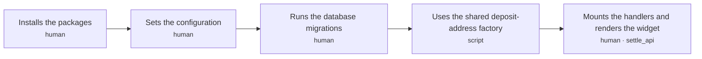
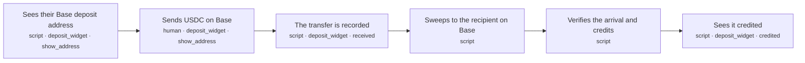
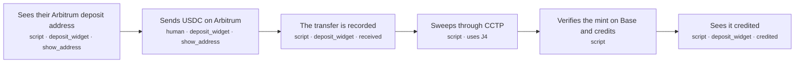
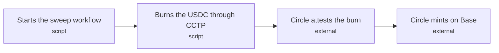
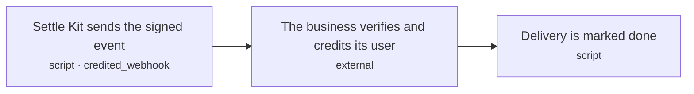
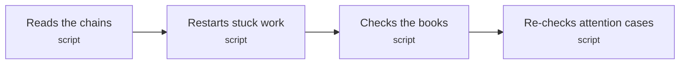

# settle-kit: journey spine

<!-- Generated by scripts/journey.ts. Edit the .yaml spine, not this file. -->

## Actors

| ID | Actor | Type |
|---|---|---|
| `developer` | Developer integrating Settle Kit | person |
| `user` | User depositing USDC | person |
| `engine` | Settle Kit engine (indexer, workflows, scheduled jobs) | system |
| `host` | The business's server | system |
| `circle` | Circle CCTP (attestation and Forwarding Service) | external |

## Invariants

Rules that hold across every journey, ordering and crash point. Tests cite `I1: …`.

| ID | Invariant | Rule | Decisions | Steps that could break it |
|---|---|---|---|---|
| `I1` | One credit per transfer | THE SYSTEM SHALL NOT credit the same on-chain transfer (chain ID, tx hash, log index) more than once | D23 | `J2.S3` `J2.S5` `J3.S3` `J3.S5` `J6.S1` |
| `I2` | Never credit more than arrived | THE SYSTEM SHALL NOT let the total credited for a recipient exceed the total USDC verified arriving at that recipient on Base at the safe block | D21 | `J2.S5` `J3.S5` `J6.S3` |
| `I3` | Contracts pay only fixed destinations | THE SYSTEM SHALL NOT let a deposit contract send USDC anywhere but its stored recipient and its stored sweep fee to the gas wallet, or other tokens anywhere but its refund address | D33, D39 | `J2.S4` `J4.S2` |
| `I4` | A credit is final | THE SYSTEM SHALL NOT change a credited deposit's amount or move it out of the credited state | D32 | `J2.S5` `J3.S5` |
| `I5` | Secrets stay secret | THE SYSTEM SHALL NOT put the gas wallet key or the webhook secret in logs, errors or API responses | D27 | `J1.S2` `J5.S1` |
| `I6` | Nothing is missed | THE SYSTEM SHALL NOT end a scheduled check while a USDC transfer to one of our deposit addresses at or below the safe block has no deposit record | D34, D131 | `J2.S3` `J3.S3` `J6.S1` |

## J1 · Developer sets up Settle Kit and shows the deposit widget

**Actor:** Developer integrating Settle Kit  
**Goal:** Go from an existing app (any Node or Bun server, React for the widget) to a page showing a user's deposit address in test mode  
**Proves:** A stranger can install and run it (D5)  

| Exit | Title | Named by |
|---|---|---|
| `ready` | The deposit widget shows an address for a user | `J1.S5` |

| Step | Bucket | Surface · state | Sees | Does | Next | Criteria |
|---|---|---|---|---|---|---|
| `J1.S1` Installs the packages | human | — | — | Adds @settle-kit/server to the server (Express, Fastify, Hono, Next.js or plain Node/Bun) and @settle-kit/react to the frontend | `J1.S2` | 2 |
| `J1.S2` Sets the configuration | human | — | — | Sets the database URL, treasury and refund addresses, gas wallet key, Base and Arbitrum RPC URLs, webhook URL and secret, and the address namespace (32 random bytes, generated once) | `J1.S3` | 4 |
| `J1.S3` Runs the database migrations | human | — | — | Applies the numbered SQL migrations shipped with the package to the app's Postgres | `J1.S4` | 2 |
| `J1.S4` Uses the shared deposit-address factory | script | — | — | Points at the factory Settle Kit deployed once on Base and Arbitrum; nothing to deploy unless the developer sets their own factory address | `J1.S5` | 2 |
| `J1.S5` Mounts the handlers and renders the widget | human | `settle_api` | — | Mounts settle.handlers on a route, runs scheduled work (settle.start() on a long-running server, or a cron hitting the protected cron route on serverless), and renders <Deposit accountId='user_42' /> on a page | exit `ready` | 5 |

### J1 acceptance criteria

**`J1.S1`** Installs the packages · decisions D37, D44

- `J1.S1.c1` WHEN createSettle() starts without SETTLE_MODE THE SYSTEM SHALL refuse to start and name the missing variable
- `J1.S1.c2` WHEN SETTLE_MODE is test THE SYSTEM SHALL simulate deposits and SHALL NOT send any transaction on a real chain

**`J1.S2`** Sets the configuration · decisions D26, D39, D135 · invariants I5

- `J1.S2.c1` WHEN createSettle() starts THE SYSTEM SHALL validate the database URL and every address and URL, and name each invalid or missing value
- `J1.S2.c2` IF the treasury or refund address is missing or not a valid address THE SYSTEM SHALL NOT start
- `J1.S2.c3` IF configuration validation fails THE SYSTEM SHALL NOT include the gas wallet key or webhook secret in the error
- `J1.S2.c4` IF the address namespace is missing or not 32 bytes THE SYSTEM SHALL NOT start, and SHALL print a command that generates one

**`J1.S3`** Runs the database migrations · decisions D30, D31

- `J1.S3.c1` WHEN the migrations run THE SYSTEM SHALL apply each numbered migration exactly once, in order
- `J1.S3.c2` WHEN the migrations run a second time THE SYSTEM SHALL change nothing

**`J1.S4`** Uses the shared deposit-address factory · decisions D134

- `J1.S4.c1` WHEN createSettle() starts in live mode THE SYSTEM SHALL check that the factory exists at the configured address on Base and on Arbitrum and name any chain where it is missing
- `J1.S4.c2` WHERE the developer sets their own factory address THE SYSTEM SHALL use it instead of the shared one

**`J1.S5`** Mounts the handlers and renders the widget · decisions D36, D40, D44, D131

- `J1.S5.c1` WHEN the widget requests an account's deposit address through the mounted route THE SYSTEM SHALL answer with that account's address for each supported chain
- `J1.S5.c2` WHEN SETTLE_MODE is test THE SYSTEM SHALL mark the widget and QR code as TEST
- `J1.S5.c3` WHEN SETTLE_MODE is test THE SYSTEM SHALL show a "Simulate a deposit" button that runs the deposit journey (J2) with simulated transfers
- `J1.S5.c4` WHEN settle.start() runs THE SYSTEM SHALL launch the durable engine with Settle Kit's pinned release as the application version and a fresh executor ID for this process
- `J1.S5.c5` WHEN the cron route receives a request without the configured cron secret THE SYSTEM SHALL answer 401 and SHALL NOT run any scheduled work

## J2 · User deposits USDC on Base

**Actor:** User depositing USDC  
**Goal:** Send USDC on Base to their deposit address and see it credited  
**Proves:** The simplest own-rails path is verified and credited once  

| Exit | Title | Named by |
|---|---|---|
| `credited` | Deposit credited; the business is told once | `J2.S6` |

| Step | Bucket | Surface · state | Sees | Does | Next | Criteria |
|---|---|---|---|---|---|---|
| `J2.S1` Sees their Base deposit address | script | `deposit_widget` · show_address | QR code, the address in groups, 'USDC on Base only', minimum 2 USDC, 'you'll receive about X' | Returns the account's stored address, computing and storing it on first use | `J2.S2` | 4 |
| `J2.S2` Sends USDC on Base | human | `deposit_widget` · show_address | — | Scans the QR code with a wallet or withdraws from an exchange to the address | `J2.S3` | 1 |
| `J2.S3` The transfer is recorded | script | `deposit_widget` · received | 'Received 10.00 USDC. Moving it to your account' | Reads the USDC transfer at or below Base's safe block and records the deposit | `J2.S4` | 4 |
| `J2.S4` Sweeps to the recipient on Base | script | — | — | The gas wallet deploys the address's contract if needed and calls sweep(), which pays the sweep fee and forwards the rest | `J2.S5` | 6 |
| `J2.S5` Verifies the arrival and credits | script | — | — | Reads the USDC arrival at the stored recipient at the safe block and credits the deposit | `J2.S6` | 7 |
| `J2.S6` Sees it credited | script | `deposit_widget` · credited | '9.99 USDC credited' with a Base explorer link to the arrival | Shows the credited amount | exit `credited` | 1 |

### J2 acceptance criteria

**`J2.S1`** Sees their Base deposit address · decisions D13, D20, D28, D33, D38, D39, D135

- `J2.S1.c1` WHEN an account first asks for a Base deposit address THE SYSTEM SHALL compute its CREATE2 address from a salt of the business's address namespace and the account ID, plus the stored recipient, minimum and sweep fee, and store it with its lane and destination
- `J2.S1.c2` WHEN the account asks again THE SYSTEM SHALL return the same stored address and SHALL NOT issue a new one
- `J2.S1.c3` IF the browser sends a recipient, minimum or lane THE SYSTEM SHALL NOT use it
- `J2.S1.c4` WHEN the address is shown THE SYSTEM SHALL show the minimum (2 USDC) and the sweep fee (0.01 USDC by default) before the user sends

**`J2.S2`** Sends USDC on Base · decisions D131

- `J2.S2.c1` WHILE the widget is open and no transfer is recorded THE SYSTEM SHALL check that one address every 5 s

**`J2.S3`** The transfer is recorded · decisions D18, D21, D23, D28, D34 · invariants I1, I6

- `J2.S3.c1` WHEN a USDC transfer to the address is at or below the safe block THE SYSTEM SHALL record one deposit keyed by chain ID, tx hash and log index
- `J2.S3.c2` IF the same transfer is read again THE SYSTEM SHALL NOT record a second deposit
- `J2.S3.c3` IF the address's balance is below its 2 USDC minimum THE SYSTEM SHALL NOT start a sweep and SHALL show "Received X. Send Y more to reach the 2 USDC minimum"
- `J2.S3.c4` WHEN our own read finds the transfer at the latest block THE SYSTEM SHALL show "Received" with the amount, and SHALL NOT record or credit it before it is at or below the safe block

**`J2.S4`** Sweeps to the recipient on Base · decisions D33, D36, D39, D121 · invariants I3

- `J2.S4.c1` WHEN a recorded deposit brings the address's balance to the minimum or more and no sweep is running for the address THE SYSTEM SHALL start one sweep workflow keyed by the address and a sweep number
- `J2.S4.c2` WHEN the address has no contract yet THE SYSTEM SHALL deploy it in the sweep workflow before calling sweep()
- `J2.S4.c3` IF a sweep is already running for the address THE SYSTEM SHALL NOT start a second one, and a deposit recorded meanwhile SHALL wait for the next sweep
- `J2.S4.c4` IF a sweep transaction fails THE SYSTEM SHALL NOT mark the deposit credited, and SHALL retry the sweep
- `J2.S4.c5` WHEN the sweep transaction is confirmed THE SYSTEM SHALL link to it every USDC transfer into the address that came before it on that chain, recording any not yet recorded
- `J2.S4.c6` IF the sweep step runs again after a crash THE SYSTEM SHALL NOT sign a second sweep transaction for the same sweep, and SHALL re-send or look up the one it already signed

**`J2.S5`** Verifies the arrival and credits · decisions D17, D21, D22, D23, D32, D121 · invariants I1, I2, I4

- `J2.S5.c1` WHEN the sweep's USDC arrival at the stored recipient is at or below the safe block THE SYSTEM SHALL record one credit for that sweep with the verified amount, in base units, covering every deposit linked to it
- `J2.S5.c2` IF no matching arrival is verified THE SYSTEM SHALL NOT credit the deposit
- `J2.S5.c3` IF two workers try to credit the same deposit THE SYSTEM SHALL NOT credit it twice
- `J2.S5.c4` IF a deposit has no verified outcome on Base 15 minutes after it was first seen THE SYSTEM SHALL move it to needs_attention as delayed and SHALL NOT credit it
- `J2.S5.c5` WHEN the deposit is credited THE SYSTEM SHALL start delivery of deposit.credited (J5)
- `J2.S5.c6` IF a deposit is already covered by a credit THE SYSTEM SHALL NOT include it in another
- `J2.S5.c7` IF any transfer linked to the sweep is not yet at or below the safe block, or the linked transfers do not add up to what the sweep moved, THE SYSTEM SHALL NOT record the credit

**`J2.S6`** Sees it credited

- `J2.S6.c1` WHEN the deposit is credited THE SYSTEM SHALL show the credited amount and a Base explorer link to the arrival transaction

## J3 · User deposits USDC on Arbitrum

**Actor:** User depositing USDC  
**Goal:** Send USDC on Arbitrum to their deposit address and see it credited on Base  
**Proves:** The own-rails cross-chain path through CCTP is verified and credited once  

| Exit | Title | Named by |
|---|---|---|
| `credited` | Deposit credited; the business is told once | `J3.S6` |

| Step | Bucket | Surface · state | Sees | Does | Next | Criteria |
|---|---|---|---|---|---|---|
| `J3.S1` Sees their Arbitrum deposit address | script | `deposit_widget` · show_address | QR code, the address in groups, 'USDC on Arbitrum only', minimum 2 USDC, 'you'll receive about X' | Returns the account's stored Arbitrum address, computing and storing it on first use | `J3.S2` | 4 |
| `J3.S2` Sends USDC on Arbitrum | human | `deposit_widget` · show_address | — | Scans the QR code with a wallet or withdraws from an exchange on Arbitrum | `J3.S3` | 1 |
| `J3.S3` The transfer is recorded | script | `deposit_widget` · received | 'Received 10.00 USDC on Arbitrum. Moving it to Base' | Reads the USDC transfer at or below Arbitrum's safe block and records the deposit | `J3.S4` | 4 |
| `J3.S4` Sweeps through CCTP | script | — | — | — | uses `J4`; `J3.S5` | 0 |
| `J3.S5` Verifies the mint on Base and credits | script | — | — | Reads the USDC minted to the stored recipient on Base at the safe block and credits the deposit | `J3.S6` | 7 |
| `J3.S6` Sees it credited | script | `deposit_widget` · credited | '9.94 USDC credited' with explorer links to the Arbitrum burn and the Base mint | Shows the credited amount | exit `credited` | 1 |

### J3 acceptance criteria

**`J3.S1`** Sees their Arbitrum deposit address · decisions D13, D20, D28, D33, D38, D39, D135

- `J3.S1.c1` WHEN an account first asks for an Arbitrum deposit address THE SYSTEM SHALL compute its CREATE2 address from a salt of the business's address namespace and the account ID, plus the stored recipient on Base, minimum and sweep fee, and store it with its lane and destination
- `J3.S1.c2` WHEN the account asks again THE SYSTEM SHALL return the same stored address and SHALL NOT issue a new one
- `J3.S1.c3` IF the browser sends a recipient, minimum or lane THE SYSTEM SHALL NOT use it
- `J3.S1.c4` WHEN the address is shown THE SYSTEM SHALL show the minimum (2 USDC), the sweep fee (0.05 USDC by default) and the estimated CCTP fee before the user sends

**`J3.S2`** Sends USDC on Arbitrum · decisions D131

- `J3.S2.c1` WHILE the widget is open and no transfer is recorded THE SYSTEM SHALL check that one address every 5 s

**`J3.S3`** The transfer is recorded · decisions D18, D21, D23, D28, D34, Q15 · invariants I1, I6

- `J3.S3.c1` WHEN a USDC transfer to the address is at or below Arbitrum's safe block THE SYSTEM SHALL record one deposit keyed by chain ID, tx hash and log index
- `J3.S3.c2` IF the same transfer is read again THE SYSTEM SHALL NOT record a second deposit
- `J3.S3.c3` IF the address's balance is below its 2 USDC minimum THE SYSTEM SHALL NOT start a sweep and SHALL show "Received X. Send Y more to reach the 2 USDC minimum"
- `J3.S3.c4` WHEN our own read finds the transfer at the latest block THE SYSTEM SHALL show "Received" with the amount, and SHALL NOT record or credit it before it is at or below the safe block

**`J3.S5`** Verifies the mint on Base and credits · decisions D17, D21, D22, D23, D32, D121 · invariants I1, I2, I4

- `J3.S5.c1` WHEN the CCTP mint to the stored recipient on Base is at or below the safe block THE SYSTEM SHALL record one credit for that sweep with the verified minted amount, in base units, covering every deposit linked to it
- `J3.S5.c2` IF no matching mint is verified on Base THE SYSTEM SHALL NOT credit the deposit, whatever the burn or attestation shows
- `J3.S5.c3` IF two workers try to credit the same deposit THE SYSTEM SHALL NOT credit it twice
- `J3.S5.c4` WHEN the deposit is credited THE SYSTEM SHALL start delivery of deposit.credited (J5)
- `J3.S5.c5` IF a deposit is already covered by a credit THE SYSTEM SHALL NOT include it in another
- `J3.S5.c6` IF any transfer linked to the sweep is not yet at or below Arbitrum's safe block, or the linked transfers do not add up to what the sweep burned plus its sweep fee, THE SYSTEM SHALL NOT record the credit
- `J3.S5.c7` IF a deposit has no verified outcome on Base 15 minutes after it was first seen, whichever CCTP stage is pending, THE SYSTEM SHALL move it to needs_attention as delayed and SHALL NOT credit it

**`J3.S6`** Sees it credited

- `J3.S6.c1` WHEN the deposit is credited THE SYSTEM SHALL show the credited amount with explorer links to the Arbitrum burn and the Base mint

## J4 · Engine sweeps an Arbitrum deposit to Base through CCTP

**Actor:** Settle Kit engine (indexer, workflows, scheduled jobs)  
**Goal:** Move a recorded Arbitrum deposit to its recipient on Base  
**Proves:** The cross-chain sweep survives slow steps and restarts (D36)  
Reusable sub-journey: other journeys include it with `uses`.  

| Exit | Title | Named by |
|---|---|---|
| `minted` | USDC minted to the recipient on Base | `J4.S4` |

| Step | Bucket | Surface · state | Sees | Does | Next | Criteria |
|---|---|---|---|---|---|---|
| `J4.S1` Starts the sweep workflow | script | — | — | Starts one durable workflow per sweep, one sweep at a time per address | `J4.S2` | 2 |
| `J4.S2` Burns the USDC through CCTP | script | — | — | The gas wallet deploys the contract if needed and calls sweep(), which pays the sweep fee and burns the rest with CCTP V2 Fast and the Forwarding Service | `J4.S3` | 5 |
| `J4.S3` Circle attests the burn | external | — | — | Circle signs the burn message | `J4.S4` | 2 |
| `J4.S4` Circle mints on Base | external | — | — | The Forwarding Service mints the USDC to the recipient on Base and takes its fee from the minted amount | exit `minted` | 2 |

### J4 acceptance criteria

**`J4.S1`** Starts the sweep workflow · decisions D36

- `J4.S1.c1` WHEN a recorded deposit brings the address's balance to the minimum or more and no sweep is running for the address THE SYSTEM SHALL start one sweep workflow keyed by the address and a sweep number
- `J4.S1.c2` IF a sweep is already running for the address THE SYSTEM SHALL NOT start a second one, and a deposit recorded meanwhile SHALL wait for the next sweep

**`J4.S2`** Burns the USDC through CCTP · decisions D33, D39, D121 · invariants I3

- `J4.S2.c1` WHEN the address has no contract yet THE SYSTEM SHALL deploy it before calling sweep()
- `J4.S2.c2` WHEN sweep() runs THE SYSTEM SHALL pay the stored sweep fee to the gas wallet and burn the rest of the balance, with the stored recipient on Base as the mint recipient
- `J4.S2.c3` IF the sweep transaction fails THE SYSTEM SHALL NOT record the burn, and SHALL retry the sweep
- `J4.S2.c4` WHEN the sweep transaction is confirmed THE SYSTEM SHALL link to it every USDC transfer into the address that came before it on that chain, recording any not yet recorded
- `J4.S2.c5` IF the sweep step runs again after a crash THE SYSTEM SHALL NOT sign a second sweep transaction for the same sweep, and SHALL re-send or look up the one it already signed

**`J4.S3`** Circle attests the burn · decisions D17

- `J4.S3.c1` WHILE the attestation is pending THE SYSTEM SHALL ask Circle's attestation API every 5 s
- `J4.S3.c2` WHILE the attestation is still pending 15 minutes after the burn THE SYSTEM SHALL keep asking every 15 minutes (the delayed state is J3.S5.c7)

**`J4.S4`** Circle mints on Base · decisions D21

- `J4.S4.c1` WHEN Circle reports the mint THE SYSTEM SHALL wait for the mint to be at or below Base's safe block before reporting the exit
- `J4.S4.c2` IF Circle reports a mint that is not found on Base THE SYSTEM SHALL NOT report the exit

## J5 · The business's server receives deposit.credited

**Actor:** The business's server  
**Goal:** Learn about each credited deposit exactly once and credit its own user  
**Proves:** Delivery is signed, retried and safe to receive twice (D14, D45)  

| Exit | Title | Named by |
|---|---|---|
| `delivered` | The business acknowledged the event | `J5.S3` |

| Step | Bucket | Surface · state | Sees | Does | Next | Criteria |
|---|---|---|---|---|---|---|
| `J5.S1` Settle Kit sends the signed event | script | `credited_webhook` | — | POSTs deposit.credited, signed with Standard Webhooks | `J5.S2` | 4 |
| `J5.S2` The business verifies and credits its user | external | — | — | Calls settle.webhook(handler), which checks the signature, then credits user_42 in its own database | `J5.S3` | 3 |
| `J5.S3` Delivery is marked done | script | — | — | Records the acknowledgment | exit `delivered` | 2 |

### J5 acceptance criteria

**`J5.S1`** Settle Kit sends the signed event · decisions D14, D22, D45, D121 · invariants I5

- `J5.S1.c1` WHEN a credit is recorded THE SYSTEM SHALL POST one deposit.credited with a stable event ID, the account ID, the verified amount as a decimal string and the incoming transfers it covers
- `J5.S1.c2` IF the business does not answer with a 2xx status within 10 s THE SYSTEM SHALL retry up to 10 times, waiting 2^(n-1) minutes before retry n, and SHALL NOT change the event ID or payload
- `J5.S1.c3` IF a delivery attempt fails THE SYSTEM SHALL NOT log the webhook secret or the signature
- `J5.S1.c4` IF all 11 attempts fail THE SYSTEM SHALL NOT retry again, and SHALL mark the delivery failed so an operator can resend it, leaving the credit unchanged

**`J5.S2`** The business verifies and credits its user · decisions D44

- `J5.S2.c1` WHEN settle.webhook receives a request with a valid signature THE SYSTEM SHALL call the handler once with the parsed event
- `J5.S2.c2` IF the signature is missing, invalid or older than 5 minutes THE SYSTEM SHALL answer 401 and SHALL NOT call the handler
- `J5.S2.c3` WHEN the handler is called THE SYSTEM SHALL pass the event ID, so the business can ignore an event it has already processed

**`J5.S3`** Delivery is marked done · decisions D45

- `J5.S3.c1` WHEN the business answers with a 2xx status THE SYSTEM SHALL mark the delivery done
- `J5.S3.c2` IF the delivery is already done THE SYSTEM SHALL NOT send the event again unless an operator calls resendWebhook

## J6 · The minute check

**Actor:** Settle Kit engine (indexer, workflows, scheduled jobs)  
**Goal:** Every minute, find every deposit, restart stuck work and check the books  
**Proves:** Nothing is missed and nothing is credited without an arrival (D131, D35)  

| Exit | Title | Named by |
|---|---|---|
| `checked` | Check finished; problems flagged | `J6.S4` |

| Step | Bucket | Surface · state | Sees | Does | Next | Criteria |
|---|---|---|---|---|---|---|
| `J6.S1` Reads the chains | script | — | — | Reads USDC transfers to our deposit addresses on Base and Arbitrum from the saved position up to the safe block | `J6.S2` | 3 |
| `J6.S2` Restarts stuck work | script | — | — | Starts the sweep or credit workflow for any address whose deposits have none running | `J6.S3` | 4 |
| `J6.S3` Checks the books | script | — | — | Matches each credited deposit to a verified arrival at its recipient, and each treasury arrival to a credited deposit | `J6.S4` | 5 |
| `J6.S4` Re-checks attention cases | script | — | — | Re-checks deposits in needs_attention on D17's schedule | exit `checked` | 3 |

### J6 acceptance criteria

**`J6.S1`** Reads the chains · decisions D34, D131 · invariants I1, I6

- `J6.S1.c1` WHEN the scheduled job runs THE SYSTEM SHALL read each chain from its saved position up to the safe block and save the new position in the same transaction as the deposits it records
- `J6.S1.c2` IF two runs overlap THE SYSTEM SHALL NOT record a transfer twice
- `J6.S1.c3` IF an RPC call fails THE SYSTEM SHALL NOT advance that chain's saved position

**`J6.S2`** Restarts stuck work · decisions D36

- `J6.S2.c1` WHEN an address holds recorded, uncredited deposits at or above its minimum and has no running sweep or credit workflow THE SYSTEM SHALL start its sweep workflow
- `J6.S2.c2` IF the address already has a running sweep or credit workflow THE SYSTEM SHALL NOT start a second one
- `J6.S2.c3` WHEN a workflow is still pending and the process that ran it has not recorded a heartbeat for 2 minutes THE SYSTEM SHALL resume the workflow from its last completed step
- `J6.S2.c4` IF the process that ran a pending workflow recorded a heartbeat in the last 2 minutes THE SYSTEM SHALL NOT resume that workflow elsewhere

**`J6.S3`** Checks the books · decisions D35, D54 · invariants I2

- `J6.S3.c1` WHEN the check runs THE SYSTEM SHALL match every credit to a verified USDC arrival at its stored recipient on Base
- `J6.S3.c2` IF a credited deposit has no matching arrival THE SYSTEM SHALL NOT mark the check clean, and SHALL record a critical alert naming the deposit
- `J6.S3.c3` IF a treasury arrival matches no credit THE SYSTEM SHALL record it for investigation
- `J6.S3.c4` WHEN the check records a problem THE SYSTEM SHALL store it in the alerts table and log it at error level
- `J6.S3.c5` WHEN the demo page loads THE SYSTEM SHALL show "Books: clean" or the number of open problems, listing each one

**`J6.S4`** Re-checks attention cases · decisions D17, D21

- `J6.S4.c1` WHEN a deposit has been in needs_attention for under 7 days THE SYSTEM SHALL re-check it every 15 minutes, and daily after that
- `J6.S4.c2` WHEN a re-check finds a verified arrival on Base THE SYSTEM SHALL let the credit workflow credit it
- `J6.S4.c3` IF a re-check finds no verified arrival THE SYSTEM SHALL NOT credit the deposit or mark its funds lost

## Surfaces

| Surface | Kind | States | Used by |
|---|---|---|---|
| `deposit_widget` | component | show_address, received, credited | `J2.S1` `J2.S2` `J2.S3` `J2.S6` `J3.S1` `J3.S2` `J3.S3` `J3.S6` |
| `settle_api` | endpoint | — | `J1.S5` |
| `credited_webhook` | webhook | — | `J5.S1` |
