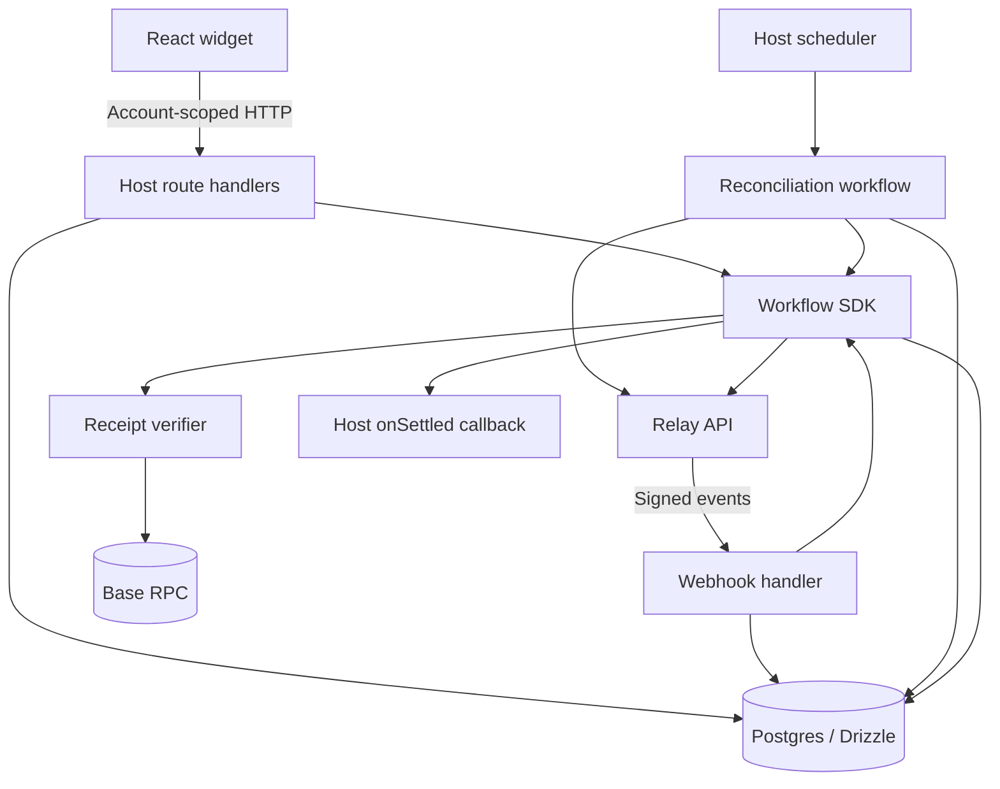

# Settle Kit: v1 checkout and deposit SDK

Status: draft. V1 scope agreed; implementation and release checks pending.
Updated: 2026-10-14.
Evidence: [integration spikes](../spikes.md).

## 1. Scope

**For:** apps that want to get paid in crypto from wherever the payer's money already
is: a shop selling a report for a fixed price, or a game or AI app selling credits.
**Why:** each such app rebuilds payment detection, attribution to the right order or
account, and duplicate-free fulfilment. Settle Kit is that layer, self-hosted.

Users pay from their existing wallet or exchange by address, QR or a connected wallet;
the app receives USDC on Base and either fulfils the order or credits the account. The
SDK runs inside the host app with the host's database and Relay credentials. It is
MIT-licensed and adds no fee above the router's charges.

The first release is intentionally small:

| Area | V1 |
|---|---|
| Modes | **Checkout** (fixed price per order, §6a) and **Deposit** (top up any amount) on one engine |
| Payment method | Address, copy button and QR first; then send from a browser wallet |
| Amount | Checkout: exact, set by the order. Deposit: optional input for estimates; any amount above the route minimum |
| Sources | A tested EVM route manifest |
| Destination | Native USDC on Base, sent to the host's treasury |
| Router | Relay |
| Storage | Postgres 15+ through Drizzle |
| Execution | Workflow SDK on Vercel |
| Host notification | One durable `onSettled` callback for both modes |
| Recovery | Reconciliation, callback replay and manual payer repayment |
| Distribution | Installable packages and a working Next.js reference app |

Base, Arbitrum and Ethereum USDC → Base USDC are the initial routes. Quoted fees
(2026-10-14): Base ~$0.025, Arbitrum ~$0.035, Ethereum ~$0.08 per deposit, roughly
flat, ETA ~2 s. Arbitrum USDT → Base USDC can be included if its fill and refund
handling are proved without delaying release. The published manifest contains only
routes that pass the release checks.

The wallet path supports browser-extension wallets discovered through EIP-6963. It
builds the transfer itself, an ERC-20 `transfer(storedAddress, amount)`, to the
address already stored for the order or account. It never sends a fresh quote's
prepared transaction: every quote issues a new address, which we would not be
tracking. Server processing is identical for both paths. WalletConnect and mobile
wallet pairing are out of v1.

**Two modes, one engine.** *Checkout* sells one thing at one price ("Buy report:
₹100"): each order gets its own single-use Relay *strict* address that delivers exactly
the order amount (§6a). *Deposit* tops up a balance: each account gets a reusable open
address per route and is credited whatever arrives. Workflows, store, verification,
timeline and widget are shared; the difference is the address type and the settlement
rule.

## 2. Design decisions

**Use Relay for addresses and routing.** We need deposit detection, swaps, bridging
and refund paths, but do not need to operate contracts or an indexer to ship this
SDK. The tradeoff is dependence on Relay while funds are in transit. Our code can
observe and verify outcomes; it cannot guarantee recovery during a permanent
provider outage.

**Address and QR first, wallet second.** Address transfers cover exchanges and any
wallet, and reach a working demo fastest. The wallet path follows the demo milestone:
it adds network switching, balance and gas checks, and browser-side recovery after a
wallet timeout, but no server changes, because both paths pay the same address.

**The payer bears route fees.** Relay's fee is deducted in transit and the account is
credited the verified arrival amount. The widget shows the estimate before sending.
S6 measured a roughly flat ~$0.025 fee on Base USDC → Base USDC.

**Fix the destination to USDC on Base.** One asset and one destination keep receipt
verification and account crediting specific. Sources are identified by chain ID and
token contract, rather than token symbol.

**Use Postgres and Drizzle.** The host owns its database. We need unique constraints,
conditional updates and transactions for deposit ownership and credit protection.
Drizzle is the one supported storage integration. The internal store interface exists
for testing, not as a public database plugin contract.

**Use Workflow SDK for execution and the database for payment state.** The Vercel
spike demonstrated retries, durable waits and continuation across a redeploy. Steps
can run more than once, so writes and callbacks remain idempotent. Cron starts
reconciliation; it does not run the deposit lifecycle. No additional queue service
is part of this design.

**Deliver only settlement to the host.** `onSettled` is the one notification the host
needs, to fulfil an order or apply an account credit; the event says which. Progress,
failure and refund states remain queryable in the database. This keeps one delivery
record per deposit and avoids a general event outbox.

**Keep refunds app-controlled.** Address transfers can originate from exchange
wallets. Refunding the transaction sender may not repay the user. Relay returns funds
to the configured app wallet; the host handles payer repayment through its support
process. This adds manual work for the host, but avoids automatic transfers to an
unverified destination.

## 3. Architecture

The existing package split stays:

| Package | Responsibility |
|---|---|
| `@settle-kit/core` | Types, state transitions and typed errors; no network or UI dependencies |
| `@settle-kit/react` | Provider, `useDeposit` and the address/QR widget |
| `@settle-kit/server` | Handlers, Relay adapter, verification, workflows and Drizzle store |
| `apps/demo` | Reference app: "Buy report" checkout, credits top-up, setup instructions |

Server credentials and database access stay in the server package.

### Host requirements

| Requirement | Why |
|---|---|
| Next.js app wrapped with `withWorkflow` | Workflows run inside the host |
| A durable Workflow World (Vercel or Postgres) | The local World loses in-flight runs on a crash |
| Postgres 15+ | `NULLS NOT DISTINCT` and the partial unique index |
| A scheduler calling `deposits.reconcile()` | Recovers missed webhooks and unfinished work |
| A Relay API key with its webhook pointed at the host | Fill discovery and push events |
| A Base RPC endpoint | Receipt verification at the `safe` block |
| App-controlled treasury, refund and recovery addresses | Destination and the return path for refunds |

Requiring Workflow SDK limits adoption to hosts that can run it. That is the price of
durable execution without a separate queue; it is stated up front, not discovered.



A payment follows this path:

1. The authenticated host resolves an `accountId`. Checkout: it creates an order with
   an exact price and gets a single-use address. Deposit: it requests the account's
   reusable address for a route.
2. The SDK stores the address with its order or account and routing configuration.
   Deposit addresses are reused on later requests.
3. The payer transfers outside the widget (address/QR) or signs a transfer to the
   stored address in a connected wallet.
4. A signed Relay event or reconciliation discovers the actual fill.
5. A workflow verifies destination funds and persists settlement.
6. A delivery workflow calls `onSettled`. The host fulfils the order or applies the
   credit atomically; acknowledgment moves the SDK deposit to `credited`.

Closing the widget does not stop tracking.

## 4. Storage and state

An address can receive multiple deposits. Each Relay fill has its own `requestId`
and SDK deposit row. The quote-time request ID is not the deposit identity:
regenerated quotes and repeat deposits can produce different fill IDs.

Tables use the `settle_kit_` prefix. Deposit amounts are stored as integer base units
in `numeric` columns and represented as `bigint` in application code. Amounts inside
JSON evidence and callback payloads use decimal base-unit strings.

```text
settle_kit_deposit_addresses
  id                       text pk
  account_id               text
  route                    jsonb
  router                   text       -- relay
  network                  text       -- mainnet | test
  address                  text
  last_reconciled_at       timestamptz
  last_activity_at         timestamptz -- address created/reused or fill seen; drives scan tiers
  created_at               timestamptz
  UNIQUE (router, network, address)
  UNIQUE (account_id, router, network, route)

settle_kit_deposits
  id                       text pk
  address_id               text → deposit_addresses   -- null for checkout fills
  order_id                 text → orders              -- set for checkout fills (§6a)
  router                   text
  network                  text
  fill_id                  text
  deposit_tx               text       -- payer's transfer to the deposit address
  status                   text
  amount_in                numeric
  amount_out               numeric
  dest_chain_id            int
  dest_tx                  text
  dest_log_index           int
  refund_evidence          jsonb      -- nullable; verified return to the app
  run_id                   text       -- latest processing run; for debugging and restarts
  delivery_run_id          text
  settlement_event         jsonb      -- immutable onSettled payload
  delivery_attempts        int
  delivery_next_attempt_at timestamptz -- null once delivered or exhausted
  delivery_error           text
  error_code               text
  created_at, updated_at   timestamptz
  UNIQUE (router, network, fill_id)
  UNIQUE INDEX NULLS NOT DISTINCT (dest_chain_id, dest_tx, dest_log_index)
    WHERE dest_chain_id IS NOT NULL AND dest_tx IS NOT NULL

settle_kit_send_attempts                  -- wallet path only
  id                       text pk
  address_id               text → deposit_addresses
  attempt_key              text       -- created in the browser before the wallet opens
  tx_hash                  text       -- hint only; set if the wallet returns one
  created_at               timestamptz
  UNIQUE (attempt_key)
```

A send attempt lets the widget show "Checking for your deposit…" after a wallet
timeout or page reload instead of offering a second send. It is never evidence of
payment; fills still come only from Relay and are verified on chain.

`route` is canonical JSON containing source and destination chain/token IDs, treasury,
and refund/recovery addresses. EVM addresses are normalized to lowercase. A treasury
or refund configuration change creates a different address identity; existing
addresses keep their original settings and remain reconciled.

The fill constraint deduplicates provider requests. The transfer constraint prevents
different requests from claiming the same destination transfer. Its partial predicate
allows multiple unfinished deposits. `NULLS NOT DISTINCT` keeps the key safe if a
destination without a log index (a native asset) is ever added. These semantics
require Postgres 15+.

`refund_evidence` groups the fields used together for manual review and display:

```ts
type RefundEvidence = {
  chainId: number;
  token: Address;
  recipient: Address;
  txHash: Hex;
  amountBaseUnits: string;
};
```

Validate this shape and the on-chain return before storing it; the field remains null
until evidence is verified. V1 does not filter or enforce uniqueness on individual
refund fields. Quote estimates remain in the quote response rather than a separate
deposit column.

### Deposit states

| From | Allowed next states |
|---|---|
| `waiting` | processing, delayed, settled, refunded, needs_attention |
| `processing` | delayed, settled, refunded, needs_attention |
| `delayed` | processing, settled, refunded, needs_attention |
| `needs_attention` | processing, settled, refunded after re-check; resolved by an operator |
| `settled` | credited after host acknowledgment |
| `credited`, `refunded`, `resolved` | None; final |

The state machine uses compare-and-set transitions and rejects invalid moves.
Discovery can first observe a completed fill, so intermediate states are not required.

`settled` means destination funds were verified. `credited` means the host acknowledged
the credit. There is no `failed` state: a deposit row exists only after Relay observes
a transfer, so money has always moved. A provider failure ends as a verified refund or
stays `needs_attention`. Failures before any transfer (quote, route, wallet rejection)
are widget errors, not deposit states. `refunded` means verified return to the app's
refund wallet, not completed repayment to the payer. `resolved` means an operator
closed an attention case by hand (repaid outside the SDK, written off) with
`deposits.resolve(id, { note })`; the note is recorded on the timeline and
reconciliation stops checking the deposit.

Delivery has no separate state. `settled` means a credit callback is owed; `credited`
means the host acknowledged it. Settlement and its immutable callback payload are
committed in one transaction; acknowledgment moves `settled → credited`. A settled
deposit with `delivery_error` set and no `delivery_next_attempt_at` has exhausted its
retries. Only settlement schedules delivery.

### Concurrency

There are no locks or leases. Two runs for the same deposit can coexist: a webhook and
reconciliation race, or an enqueue response is lost and the work is started again.
Every write is a compare-and-set transition or a unique insert, so the slower run's
writes fail and it exits. A duplicate `onSettled` call is absorbed by the host's unique
credit on `deposit.id`. Reconciliation restarts work only when the recorded run is no
longer running, which keeps duplicate API calls rare without a lock.

The host owns its credits table. It must enforce `credits.deposit_id UNIQUE` and
apply the credit record and balance change in the same transaction.

## 5. Relay integration

The internal adapter covers `sources`, `depositAddress`, `quote`, `fills`, `status` and
`webhook`. A fake implements the same interface for workflow tests. There is no
public adapter registry or router selection API.

| Operation | Relay request |
|---|---|
| Sources | `GET /chains`, intersected with the tested source manifest |
| Deposit address | `POST /quote/v2` with `useDepositAddress: true` and open `EXACT_INPUT` mode, quoted once at the route minimum; the address then accepts any amount |
| Order address | `POST /quote/v2` with `useDepositAddress: true`, `strict: true`, `tradeType: "EXACT_OUTPUT"`, `amount` = the order's USDC amount; returns the address and the exact amount to send |
| Estimate | `POST /quote/v2` without a deposit address, reading output estimate and fees; display only |
| Fill discovery | `GET /requests/v3?depositAddress=` with `x-api-key` |
| Fill status | `GET /intents/status/v3?requestId=` |

`fills` follows every continuation page. The stored address, router and network
determine ownership. Requests for sources outside the release manifest are rejected.
Relay `errorCode` values map to SDK errors; message text is not parsed.

`waiting` maps to waiting; `depositing`, `pending` and `submitted` map to processing;
`delayed` remains delayed; `success` triggers settlement verification. `refund`
triggers return-to-app verification. `failure` triggers refund verification;
without verified return evidence the deposit stays `needs_attention`.

V1 settles native USDC on Base mainnet only. Relay's testnet is not a supported
profile: in S4a it did not sweep a deposit after 31 minutes and a reindex, and
`/requests/v3` there rejects our key. Development uses test mode (§10.1); the live
proof is a small Base mainnet deposit, as Relay's testnet guide itself recommends.

**Rate limits are per key and constrain polling.** Our key shows `/requests` at
2 req/min (S7), while Relay documents 200/min for `/requests/v3`. Until Relay confirms
which applies, webhooks are the primary discovery path and reconciliation spends at
most the key's actual `/requests` budget. `POST /transactions/deposit-address/reindex`
asks Relay to re-check an address whose funds were not picked up; it is an operator
action, not part of the normal flow.

S2 and S6 returned deposit-address quotes for the proposed cross-chain and same-chain
USDC routes. These were quote checks, not real deposits. Fees and estimated arrival
times come from the current quote rather than fixed values in the SDK.

### Webhook ingestion

Relay's `request.status.updated` event carries the actual fill request ID and, for
deposit-address requests, the deposit address and optional deposit transaction hash.
The adapter verifies `X-Signature-Timestamp` and `X-Signature-SHA256` using HMAC-SHA256
over `${timestamp}.${body}` with the configured API key. Verification uses the original
body, constant-time signature comparison, a freshness check and payload validation.
Signing bytes and timestamp units still require a real-delivery check.

```text
authenticate and normalize event
resolve stored address under router + network
insert fill if new
ensure processing for new or unfinished deposit
return 2xx after persistence and successful enqueue
```

Invalid signatures receive non-2xx responses. Valid irrelevant events and unknown
addresses are acknowledged without crediting. Persistence or enqueue failures return
non-2xx so Relay can retry. An existing fill must still resume unfinished work.

Events trigger a fetch of current provider state. Their supplied status cannot
reverse a verified outcome or authorize credit. If saving a row succeeds but starting
its workflow fails, reconciliation repairs that handoff.

Each Relay API key supports one webhook endpoint. Deployments and networks use
matching keys and endpoints to prevent one environment overwriting another's setup.
Vercel preview deployments therefore receive no webhooks and rely on `POST /check` and
reconciliation. The S4 mainnet run confirms delivery, signing bytes and timestamps.
Provider details: [Relay webhooks](https://docs.relay.link/references/api/api_guides/webhooks).

## 6. Processing and recovery

### Settlement verification

`processDeposit` polls the fill until an outcome or the attention threshold. Mainnet
settlement requires:

- A successful destination receipt at or below Base's `safe` block.
- Exactly one matching USDC `Transfer` from the configured contract to the address's
  stored treasury (for an order, of exactly the order amount).
- A recorded transaction hash, log index and actual received amount.

S3 verified this receipt shape for a sampled Relay fill. The chosen `safe` threshold
reduces the wait relative to finalization; it still carries residual reorg risk.
Wrong recipients, tokens, failed receipts or ambiguous transfers enter
`needs_attention`. Provider success alone does not authorize credit.

Test mode replaces the receipt verifier with a simulated one (§10.1); there is no
native-ETH verifier in v1.

On verified settlement, the workflow atomically stores evidence, `status='settled'`
and the immutable event, then starts delivery. Reported
refunds require verified return-to-app evidence. Unresolved failures remain attention
cases; neither failure nor refund schedules a settlement callback.

The proposed attention threshold is 30 minutes. Reaching it flags the deposit and
ends the run; reconciliation continues checking. Time elapsed never
authorizes a credit or a declaration that funds are lost.

### Host credit delivery

`deliverSettlement` calls `onSettled` with the persisted event. Its identity is
`${deposit.id}:settled` and its type is `deposit.settled`. The snapshot contains
verified `amountOut` for credit. Quote estimates are display data from `POST /quote`,
not required settlement fields. Replay preserves the payload and deposit ID.

The host's atomic unique credit makes a lost response after commit safe to retry.
The SDK marks delivery complete and the deposit credited only after acknowledgment.

Each call has a 10-second timeout. After the initial attempt, retry up to 10 times;
retry n waits `2^(n-1)` minutes, totaling about 17 hours of waits. This is 11 attempts,
with the policy configured independently of default workflow step retries.
Exhaustion records the error and clears the next attempt time; the deposit stays
settled and appears in the operator list.

`deposits.replayDelivery(depositId)` is an authenticated operator action. It restarts
delivery of the same event and does not send funds.

### Reconciliation

A host scheduler starts a bounded reconciliation workflow, proposed every 15 minutes.
It scans unscanned addresses first, then the oldest `last_reconciled_at`, including
inactive addresses. Proposed tiers keep API use proportional to activity: addresses
with a quote or fill in the last 30 days are due every 15 minutes, older ones daily.
Each scan loads all fill pages, inserts new fills and resumes unfinished work. The
timestamp advances only after a successful address scan.

Reconciliation also queries unfinished deposits and due callback deliveries. It
leaves running work alone, restarts rows whose run ended or never started, and skips
final states. Duplicate starts are safe (see Concurrency, §4).

Batch size and API limits must permit every issued address to be revisited. Recovery
does not depend on a user reopening the widget.

### Refund handling

`refundAddress` (sent to Relay as `refundTo`) is the app-controlled origin-chain
address that receives Relay refunds.
`recoveryAddress` is an app-controlled origin-chain EOA authorized to withdraw from
Relay's depository when filling or refunding is unavailable; it does not receive
automatic refunds. These addresses can be the same EOA for the supported EVM routes,
subject to the host's choice and control on each origin chain.

The SDK stores verified return evidence in `refund_evidence`: chain, token,
recipient address, transaction and amount. The widget distinguishes return to the
app from repayment to the payer. Wrong-token, below-minimum and unsupported transfer
cases remain visible with the account's address/deposit ID and a recovery next step.

The host's manual procedure is to inspect that evidence, obtain a payer-controlled
repayment address through authenticated support, return the funds, and record the
repayment transaction against the deposit to prevent duplicate repayment. The SDK
does not hold signing keys or execute repayments.

Recovery during a complete Relay/solver outage remains unproved.
Reference: [Relay refund and recovery behavior](https://docs.relay.link/features/deposit-addresses#refund-behavior).

### Credit contract

The SDK records each fill once and delivers settlement at least once. Preventing a
duplicate balance change requires the host's atomic credit transaction. Completion
depends on the host and dependencies recovering, with retries or operator replay
continuing. Unsupported transfers and permanent outages are not covered by an
eventual-credit guarantee.

Quotes are estimates. Supported deposits credit actual received amounts, including
larger deposits that settle successfully. `limits.maxUsd` changes displayed guidance;
it does not cap external transfers. Below-minimum deposits may be returned or need
attention instead of settling.

## 6a. Checkout mode

### How the exact amount is enforced

A crypto transfer cannot be stopped from carrying the wrong amount, unlike a UPI QR
where the bank enforces it. Checkout makes the **outcome** exact instead, using a Relay
strict deposit address (`strict: true`, `tradeType: "EXACT_OUTPUT"`, `amount` = the
order's USDC amount). Relay's documented rules for strict addresses:

| Payer sends | Outcome |
|---|---|
| The quoted amount | Filled; treasury receives exactly the order amount |
| Less | Not filled; refunded to `refundTo` |
| More | Filled with exactly the order amount; excess refunded to `refundTo` |
| Wrong token | Not filled; recoverable |

Checked 2026-10-14: a strict `EXACT_OUTPUT` quote for 1.15 USDC on Base asked for
1.184261 USDC on Arbitrum (fee included). Expiry behaviour of strict quotes is
unconfirmed until S4.

The wallet path locks the amount completely: the widget builds the transfer and the
user only confirms. The QR encodes the exact amount (EIP-681). Only manual exchange
withdrawals can carry a wrong amount, and the rules above cover them.

### Orders

```text
settle_kit_orders
  id                       text pk
  account_id               text
  external_id              text       -- host's order/cart id
  amount_out               numeric    -- exact USDC base units the treasury must receive
  price                    jsonb      -- what the host priced: { currency: "INR", amount: "100", rate, rateAt }
  route                    jsonb      -- source chosen by the payer
  address                  text       -- strict deposit address, single use
  amount_in                numeric    -- what the payer must send (from the quote)
  status                   text       -- pending | paid | expired | refunded | needs_attention
  expires_at               timestamptz
  created_at, updated_at   timestamptz
  UNIQUE (account_id, external_id)    -- creating the same order twice returns it
  UNIQUE (address)
```

An order's fill becomes an ordinary row in `settle_kit_deposits` (linked by
`order_id`), so processing, verification, delivery and the timeline are unchanged.
Settlement additionally requires `amount_out` to **equal** the order amount; anything
else is `needs_attention`. The same `onSettled` callback fires, with
`event.kind = "order"` and the host's `externalId`; the host dedupes on the event id.

| Order status | Set when |
|---|---|
| `pending` | Created; waiting for payment until `expires_at` |
| `paid` | Its deposit reaches `credited` (host acknowledged fulfilment) |
| `refunded` | Its deposit is `refunded` (underpaid or wrong amount, returned to the app) |
| `needs_attention` | Its deposit is `needs_attention` |
| `expired` | No fill by `expires_at` (a late payment is still processed and moves the order on) |

Reconciliation scans pending order addresses until a grace period after expiry, in
addition to deposit addresses. An order address is never reused: after a refund the
host creates a new order.

Choosing a different source chain or token re-quotes and replaces the pending order's
address (the old one is abandoned before any payment). Expired orders with no fill end
as `expired`; a payment arriving after expiry is still processed and reported.

**Pricing in other currencies.** Prices are USD in the first release. INR (and other
fiat) needs a rate source locked at order creation for the countdown; the order stores
the rate it used.

**Refunds.** Under- and over-payments are refunded to the app-controlled `refundTo`,
on both paths (the sender may be an exchange, and refund addresses never come from
the request).

## 7. Public API

```ts
export const deposits = createDeposits({
  mode: "live",                                   // "test" uses simulated deposits (§10.1)
  relay: { apiKey: env.RELAY_API_KEY },
  routes: ["base-usdc", "arbitrum-usdc", "ethereum-usdc"],  // subset of the tested manifest
  baseRpcUrl: env.BASE_RPC_URL,
  treasury: env.TREASURY,
  refundAddress: env.REFUND_ADDRESS,              // sent to Relay as refundTo
  recoveryAddress: env.RECOVERY_ADDRESS,
  limits: { minUsd: 2, maxUsd: 10 },              // deposit mode only
  store: drizzleStore(db),
  account: (req) => getAccountId(req),
  onSettled: async (event) => {                  // both modes; dedupe on event.id
    if (event.kind === "order") await orders.fulfil(event.order.externalId);  // unlock the report
    else await credits.add(event.deposit);
  },
});

export const { GET, POST } = deposits.handlers;
```

`orders.fulfil` and `credits.add` must record the event id uniquely and apply their
effect in the same transaction. The values shown for `limits` are proposed defaults.

```tsx
<SettleProvider endpoint="/api/settle" wallets={injectedWallets()}>  // wallets optional; omit for QR only
  <CheckoutButton orderId={order.id} onPaid={() => router.refresh()} />
  <DepositButton onCredited={() => router.refresh()} />
</SettleProvider>
```

`onPaid` and `onCredited` refresh the UI. Fulfilment and credit happen only in the
server callback.

| Endpoint | Purpose |
|---|---|
| `GET /sources` | Available routes from the tested manifest |
| `POST /orders { externalId, amountUsd, route }` | Checkout (called by the host server, which sets the price): create or return an order with its strict address, exact amount and expiry |
| `GET /orders/:id` | Checkout: order status for the widget |
| `POST /address` | Deposit: get or create an account's route address; rate-limited per account (each new address costs a Relay quote) |
| `POST /quote` | Current amount/fee estimate |
| `GET /deposits?addressId=` | Account-scoped deposit records |
| `POST /attempts { addressId, attemptKey }` | Record a wallet send attempt before the wallet opens |
| `POST /check { addressId, txHash? }` | Bounded, rate-limited address scan on reopen or when a wallet returns a hash |
| `POST /webhooks/relay/:network` | Signed provider events |

User endpoints require `account(req)` and enforce stored account ownership. The
webhook endpoint authenticates the provider signature instead of a user session.
The client does not submit account ownership or transaction hashes as evidence; a
wallet-returned hash only makes the scan happen sooner.

Operators find stuck work with `deposits.list({ status: "needs_attention" })` and settled
deposits with exhausted delivery, close cases with `deposits.resolve(id, { note })`
and retry delivery with `deposits.replayDelivery(id)`. The demo shows these on an
authenticated admin page.

The host schedules `deposits.reconcile()`. Any HTTP wrapper must authenticate its
scheduler credential. Replay tooling likewise requires operator authorization.
The widget does not call Relay directly.

The store ships a Drizzle schema and matching SQL migration. Its internal contract
covers address ownership/reuse, fill insertion, conditional transitions with their
timeline events, and bounded recovery queries.
These operations are tested against real Postgres. A minimal fake is used only for
workflow tests.

## 8. Widget behavior

| Screen | Required behavior |
|---|---|
| Order summary (checkout) | Item, price in USD (and host currency), countdown to expiry |
| Method | Transfer (address/QR) or Wallet; skipped when only one is enabled |
| Source selection | Tested network/token pairs, route minimum and unavailable reason; skip if only one route exists |
| Amount | Checkout: fixed, "Send exactly 1.184248 USDC on Arbitrum". Deposit: optional; shows "You'll receive about X" and the fee |
| Wallet confirm | Connected account, balance for the chosen token, network switch, gas check, you send / you receive, sign |
| Transfer | QR, copyable address, exact token/network instructions, estimate after fees and exchange network guidance |
| Progress | Detected → Processing → Credited, transaction links and tracking after close |
| Resume | Pending/attention deposits for the selected address |
| Result | Paid / credited amount, return-to-app evidence, expired (start a new order), or attention ID and support route |

A deposit address is presented as reusable for the same route; an order address as
single-use, valid until the countdown ends. Estimated arrival copy is
qualified; the actual amount is displayed after verification. Verified funds awaiting
host acknowledgment remain Processing in the widget.

**No second send.** Before the wallet opens, the widget records a send attempt. If the
wallet times out or the page reloads, it shows "Checking for your deposit…" and scans
the address; it never offers "Send again" while an attempt is unresolved. A clear
wallet rejection is safe to retry.

The demo includes a `/states` page rendering every widget state with fixture data, for
review on desktop, mobile and dark mode.

Quote requests carry a generation number. Changing token, chain or account invalidates
older replies. Once a transfer is detected, a delay or error must not prompt another
transfer to resolve it.

Address/quote failures before money moves can retry loading instructions. After
money moves, the UI shows the deposit's status and recovery path. A verified app refund
reads "Returned to the app; contact support to receive your refund," with the deposit
ID and transaction. It never implies that the payer has already been repaid.

Wallet errors cover `wallet_rejected`, `wrong_network`, `insufficient_balance` and
`insufficient_gas`. Typed errors cover `amount_too_low`, `quote_unavailable`,
`route_unavailable`, `address_blocked`, `router_unavailable` and developer-only
`invalid_config`. Minimum copy uses the current route minimum and app policy.

## 9. Validation and release

The [spike log](../spikes.md) separates existing evidence from pending work:

| Evidence | Status |
|---|---|
| S1: Workflow SDK retries, waits and redeploy on Vercel | Observed |
| S2/S6: Relay discovery endpoints and deposit-address quotes | Read-only checks; no end-to-end deposit proof |
| S3: Base USDC receipt verification | Observed for a sampled existing fill |
| S4a: Testnet deposit | Failed; testnet not usable (not swept, no `/requests/v3` key) |
| S4: $2 Base mainnet deposits (fresh and reused address) | Pending; waiting for funds |
| S7: Relay key limits | `/requests` at 2 req/min observed; support asked |
| Signed Relay events on old/reused addresses and missed-webhook recovery | Pending |
| Mainnet source routes, refund handling and separate-app package consumption | Release checks pending |

Required checks:

- Signed valid, invalid and stale events; unknown addresses, regenerated IDs,
  duplicate and out-of-order delivery.
- Receipt rejection for the wrong contract, recipient, failed receipt or ambiguous
  transfer.
- Success, variable amounts, multiple fills, return to app, below minimum, wrong
  token, and delayed → attention → later settlement.
- Checkout: exact payment → paid; underpayment → refunded; overpayment → paid with
  excess refunded; no payment → expired; late payment after expiry processed; creating
  the same `externalId` twice returns one order.
- Missed webhook; deposit with the browser closed; persistence before an enqueue
  crash; failed run; two concurrent runs for one deposit produce one credit.
- Callback retries, retry exhaustion and replay; host commit followed by a lost
  response produces one credit. Non-settlement outcomes never schedule credit delivery.
- Real Postgres tests for atomic records, state transitions, concurrent transitions,
  duplicate transfer prevention, multiple unfinished rows and host credit transactions.
- Operator actions: `resolve` closes only attention cases; `replayDelivery` repeats
  the same event; both are recorded on the timeline.
- Refund evidence validation and round-trip storage of exact base-unit amounts;
  malformed or unverified evidence cannot mark a deposit refunded.
- Essential widget states and account isolation on mobile and desktop.
- Security table (§10.3): poisoning-resistant address display, cross-account access
  denied, test rows never settle on mainnet, no secrets in errors.
- Test mode: every simulated scenario reaches the same states and callback as a real
  fill; the timeline records each transition atomically.
- Wallet path: rejection, wrong network, insufficient balance/gas, timeout after
  send (no second send offered), and a hash that never becomes a fill.
- Small mainnet fills for every advertised route, including repeat deposits to an
  older address. Confirm webhook signing bytes, timestamp units and provider retries.
  Disable webhooks and prove discovery without reopening the widget. Record refund
  evidence and the manual recovery procedure for each source.
- Before the first npm publish (not needed for the demo): Bun build/pack of all
  public packages, followed by installation of packed artifacts in a separate
  Next.js app. Verify JavaScript exports, type declarations, dependency
  resolution and server/client boundaries without workspace aliases or source
  compilation through `transpilePackages`.

Ship a versioned package only after these checks. Record fill IDs, transaction links
and verified credited amounts for the live proofs. Local tests, deployment checks
and live transactions are separate evidence.

Implementation order:

1. Relay adapter, route profiles, schema, Drizzle store and processing workflows,
   built and tested against simulated deposits. S4 on Base mainnet runs as soon as
   funds arrive; it does not block this step.
2. Account-scoped handlers, checkout orders, signed webhook ingestion, settlement
   delivery, atomic host fulfilment and the deployed QR reference app.
   Test mode and simulated deposits (§10.1) come with these handlers, so the UI can be
   built before S4 succeeds. Deposit events and the timeline (§10.2) land with the store.
   **Demo-ready milestone:** one real Base USDC checkout payment completed end to end
   on the deployed app via QR, with fill ID and transaction links recorded.
3. Wallet path (EIP-6963, send attempts, wallet errors), the `/states` gallery,
   EIP-681 QR codes, theming, copy catalogue and accessibility pass (§10.4–10.5).
4. Reconciliation and replay; Postgres concurrency/crash tests; old-address and
   missed-webhook checks.
5. USDT routes if proved, and refund handling;
   installation, deployment and recovery docs; package consumption check; versioned
   release.

### Showcase cut (built first, ~6 days)

The first build is a working, deployed slice of v1. Everything else in this doc stays
designed and ships after it.

| Day | Build | Visible result |
|---|---|---|
| 1 | T1 router, T2 state machine | Foundation |
| 2 | T3 store, receipt verifier | Duplicate-proof crediting |
| 3 | All workflows: `processDeposit`, `deliverSettlement` with the full retry schedule, `reconcileDeposits` on Vercel Cron, `replayDelivery`; handlers; signed Relay webhook; test mode | Simulated deposits end to end, surviving restarts |
| 4 | Checkout mode (§6a): orders, strict addresses, exact-amount QR with countdown; demo "Buy report" page; real Base USDC payment, deployed | **Demo-ready** |
| 5 | Wallet path (exact amount locked), deposit mode top-up page, timeline page, `/states` gallery, chunked address | Product depth |
| 6 | Live proofs for Arbitrum → Base and Ethereum → Base; README, 2-minute video, "built vs designed" table | Ready to share |

**In the cut:** every Workflow SDK workflow above, webhook verification, account
scoping, secrets kept out of errors, server-config payout addresses, test mode,
timeline, wallet path, checkout and deposit modes, three live USDC routes: Base,
Arbitrum and Ethereum → Base. The demo leads with checkout: "Buy report".

**After the cut:**

| Deferred | Meanwhile |
|---|---|
| Operator UI: admin page, `resolve`, `needs_attention` list, reindex | Visible in the database and on the timeline; `replayDelivery` is a server function |
| Refund evidence verification and the manual repayment procedure | Refunds and failures go to `needs_attention` |
| Rate limits on `POST /address` and `/check` | Known gap |
| Extended Postgres crash/concurrency tests | Core constraint, CAS and timeline tests |
| USDT and other chains | Three USDC routes proven live |
| Build/pack/install check, npm release | Demo consumes workspace source |
| `appearance` theming, copy catalogue, full accessibility audit | Default theme on CSS variables; focus, live region, keyboard basics |

Reconciliation must stay within the Relay key's `/requests` budget (S7): batch size
follows the observed limit until Relay confirms `/requests/v3` rates.

Optional routes that lack evidence are omitted from the release. The reference stack
is Next.js, Workflow SDK's Vercel World and Postgres/Drizzle. The local workflow World
is not used as evidence of crash durability.

## 10. Product quality

These make Settle Kit pleasant to build with, safe to pay through and easy to support.
**V1** items ship with the release; **Later** items are specified now so v1 doesn't
block them.

### 10.1 Test mode and simulated deposits (V1)

`simulateRouter()` implements the router interface without Relay or a chain. With
`mode: "test"`, the widget shows a dev toolbar: **Simulate payment**, **…delayed**,
**…refunded**, **…below minimum**, and for orders **…underpaid**, **…overpaid**,
**…expired**. Simulated fills run through the same workflows,
store, state machine and `onSettled` callback; only the router and the receipt
verifier are replaced. Simulated deposits are stored with `network = "test"` and can
never reach a mainnet treasury configuration. Test mode never calls Relay, and live
mode never loads the simulated router. Analogous to Stripe's test cards.

Later: `bunx settle-kit trigger <scenario> --address <id>`, sending the same scenarios
to a running server from a terminal, like `stripe trigger`.

Why: developers can build the UI and credit logic in minutes, with no testnet funds,
wallet or Relay key. The workflow fake already exists for tests; this exposes it.

### 10.2 Deposit timeline and status page (V1)

An append-only table records every state change with its evidence:

```text
settle_kit_deposit_events
  deposit_id     text → deposits
  seq            int        -- 1, 2, 3… per deposit
  status         text       -- the state entered, or delivery_failed / delivery_replayed
  at             timestamptz
  actor          text       -- system | operator
  evidence       jsonb      -- tx hashes, chain IDs, amounts (base-unit strings), router status, operator note
  PRIMARY KEY (deposit_id, seq)
```

Each transition writes its event in the same transaction as the state change. `GET
/deposits/:id` (account-scoped) returns the deposit plus its timeline; the widget and
an authenticated `/deposits/:id` status page render it: seen at the deposit address →
moving → verified on Base → credited, each with time and transaction link. Refunds
show the returned-to-app evidence and the support next step. Operators see the same
timeline on the admin page.

Why: most payment support is "where's my money?". One timeline serves payers,
operators and audits.

### 10.3 Security (V1)

| Threat | Mitigation |
|---|---|
| Address poisoning: a lookalike address planted in the payer's history | Address rendered in 4-character groups with the first and last groups emphasised; "Check the first and last 4 characters" hint; copy only from our UI |
| Clipboard-hijacking malware | After copy, show "Copied: 0x1a2b…9f8e" to compare with what gets pasted; QR offered as the primary path |
| Account takeover redirecting funds | Treasury, refund and recovery addresses come only from server config, never user input or the request |
| Cross-account access | Every user endpoint checks the stored address's `account_id` against `account(req)` |
| Webhook forgery or replay | HMAC signature, 300 s timestamp freshness, constant-time compare; the event only triggers a re-check of provider state |
| Address-creation spam | Per-account rate limit on `POST /address` |
| Test deposits in production | `network = "test"` rows are only created by the simulated router; live mode never loads it, and test mode never calls Relay or the live store's mainnet rows |
| Secrets in errors and logs | The Relay API key, which also signs webhooks, is never included in thrown errors, `cause` or logs |

### 10.4 Pay-request QR codes (V1)

The QR code encodes an EIP-681 payment request, not a bare address:
`ethereum:<token>@<chainId>/transfer?address=<depositAddress>&uint256=<amount>`
(amount omitted when the payer didn't enter one). Wallets that read it pre-fill
token, network and amount, which prevents the most common deposit mistake: the wrong
network or token. Exchanges don't read EIP-681, so the plain address and network stay
visible beside the QR.

### 10.5 Widget polish (V1)

- **Theming:** CSS variables plus `appearance={{ variables, rules }}`, in the style of
  Stripe Elements. No Tailwind or design-system dependency in the published widget.
- **Copy:** every string lives in one catalogue, so hosts can translate or reword it.
- **Accessibility:** focus moves to each new screen's heading; status changes are
  announced through a polite live region; the whole flow works by keyboard; QR has a
  text alternative.
- **Headless:** `useDeposit()` returns a discriminated union per state, so teams can
  build their own UI on the same logic.

### 10.6 Treasury reconciliation (Later)

Read USDC `Transfer` logs into the treasury on Base (one address, one token, cursor
up to `safe`) and match them against settled deposits. Report money that arrived with
no matching deposit, and settled deposits with no matching inflow. This catches router
bugs, our bugs and direct payments to the treasury, and is the first piece of the
indexer that owning deposit addresses would need.

### 10.7 Public speed numbers (Later)

Record time from deposit detection to credit for every live deposit, and publish the
median and 95th percentile per route on a demo stats page. Measured numbers replace
claims and show what payers actually wait through.

### Not added, on purpose

More routers, our own deposit-address contracts and card onramps widen the product
without deepening it. A Transak card onramp is the most likely later addition; its
feasibility work is in [S5](../spikes/2026-10-14-card-onramp.md) and it would need its
own spec. Depositing into each user's own wallet instead of the treasury (the
trading-app model: `recipient` = the user's server-resolved wallet) is a later option
for deposit mode.

## 11. Open decisions

- Treasury, refund and recovery wallets for the reference app; same or separate
  refund/recovery EOAs, and who handles manual payer repayment.
- Final source manifest after real fill and refund/recovery checks; whether USDT
  meets the release bar without delaying launch.
- Suggested deposit limits: $2 minimum and $10 displayed maximum, checked against
  each route's actual minimum. The displayed maximum is not an enforced transfer cap.
- Reconciliation batch size and API budget; proposed tiers are 15 minutes for
  addresses active in 30 days and daily otherwise, not a guaranteed recovery bound.
- Attention threshold and subsequent check frequency; initial proposal is 30 minutes.
- Recovery actions available during a complete Relay/solver outage.
- Relay support: does the 2 req/min `/requests` limit cover `/requests/v3`; can the
  key get the documented 200/min; is there a key for the testnet API (S7).

The single settlement callback, its retry policy and payer-borne fees are decided
above.
