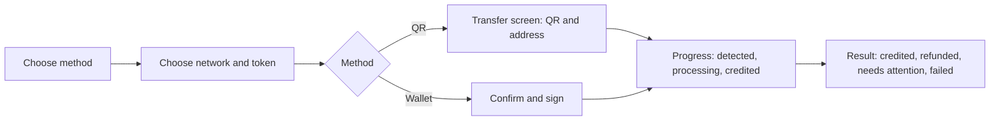
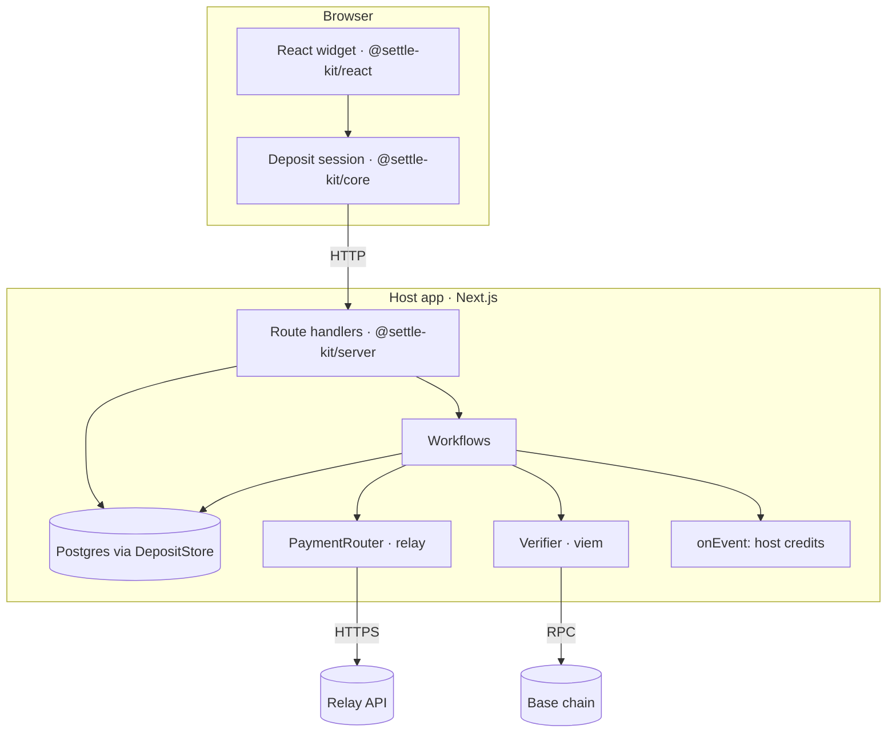

# Settle Kit — deposit kit design

Status: draft for review · 2026-10-13 · Evidence: [spikes](../spikes.md)

This doc is written to be *learned from*, not just approved. Each section says what
we build, **why**, the alternatives we rejected, and what would make it better later.

---

## 1. The problem

A user wants to put money into an app — a game, a trading app, an AI app with
credits. Their money is somewhere else: ETH on Arbitrum, USDC on Ethereum, a balance
on an exchange. The app wants **one** asset on **one** chain (say USDC on Base).

Moving it today means the user bridges, swaps, picks networks, pays gas — and the app
has to detect the deposit, match it to the user, and credit it exactly once, even when
things go wrong (wrong amount, slow fill, refund, a crashed server).

**Settle Kit** removes both halves of that work:

- **For the user:** one widget. Pick what you have, scan a QR or click "send from
  wallet", watch it arrive.
- **For the developer:** one server package that tracks every deposit durably and tells
  your app "credit account X with Y" — once.

Managed deposit products exist, but they are closed, sales-led, and sit in the money
path. Settle Kit is open source and self-hosted: you run it in your own app, with your
own database, and pay no fee on top of the router's.

### Why it's credible

| Concern | Who solves it |
|---|---|
| Swapping and bridging | **Relay** (solvers front liquidity on the destination chain) |
| Durable tracking across crashes and deploys | **Workflow SDK** (proven on Vercel in S1) |
| Exactly-once crediting | **Our database constraints** |
| The experience | **Our widget** |

We do not build a bridge, a wallet, or a blockchain indexer.

---

## 2. Vocabulary

Learn these first; every later section uses them.

| Term | Meaning |
|---|---|
| **Route** | origin chain + token → destination chain + token. e.g. `Arbitrum ETH → Base USDC` |
| **Deposit address** | An address Relay generates for a route. Anything sent there is swapped/bridged to the recipient. Reusable for the same route |
| **Fill** | One completed movement through a deposit address. Relay calls it a *request* (`requestId`). One address can produce many fills |
| **Recipient / treasury** | Where funds land on the destination chain (the app's wallet) |
| **Refund address** (`refundTo`) | Where Relay returns funds if a fill fails |
| **Recovery address** | Fallback when a refund can't go back to the sender (e.g. the sender was an exchange) |
| **Account** | The app's user. The SDK only sees an `accountId` string |
| **Credit** | The app's record that an account received value. Off-chain, in the host's DB |
| **Payment router** | Our interface over Relay (and later Across) |
| **Workflow / step** | Durable function / retried unit of work in the Workflow SDK |
| **`safe` block** | A block the chain considers very unlikely to be reorged (~30 s behind head on Base) |

---

## 3. What the user sees



Both paths end at **the same deposit address**. "Send from wallet" just sends the
transfer the QR asks for — the quote even includes that exact transaction (S2).
One lifecycle, two entry points.

Screen inventory and error copy: §9.

---

## 4. Architecture



| Package | Runs in | Responsibility |
|---|---|---|
| `@settle-kit/core` | anywhere | Types, the deposit state machine, typed errors. No React, no DOM, no network |
| `@settle-kit/react` | browser | Provider, `useDeposit`, the widget |
| `@settle-kit/server` | server | Route handlers, workflows, `PaymentRouter`s, verifier, `DepositStore` |
| `apps/demo` | Vercel | Reference integration: credits top-up, docs, state gallery |

**Why three packages:** the core is shared by browser and server and must stay
dependency-free; the router API key and database must never reach the browser.
*Alternative rejected:* one package with subpath exports — simpler, but makes it easy
to accidentally bundle server code into the widget.

---

## 5. Data model

Postgres, prefixed `settle_kit_` so tables never collide with the host's.

```text
settle_kit_deposit_addresses
  id            text pk
  account_id    text
  route         jsonb      -- origin chain/token, destination chain/token
  router        text       -- "relay" — which router owns this address
  network       text       -- "mainnet" | "testnet"
  address       text
  created_at    timestamptz
  UNIQUE (router, network, address)
  UNIQUE (account_id, router, network, route)   -- reuse, don't re-quote (S2)

settle_kit_deposits                              -- one row per fill
  id            text pk
  address_id    text → deposit_addresses
  fill_id       text       -- Relay requestId
  status        text       -- waiting | processing | delayed | credited | refunded | failed | needs_attention
  amount_in     numeric    -- what the user sent (base units)
  amount_out    numeric    -- what actually arrived, from the receipt
  source_tx     text
  dest_chain_id int
  dest_tx       text
  dest_log_index int       -- null for native ETH
  error_code    text
  created_at, updated_at timestamptz
  UNIQUE (router, fill_id)                       -- a fill is recorded once
  UNIQUE (dest_chain_id, dest_tx, dest_log_index) -- a transfer is credited once
```

**Why two unique keys:** `fill_id` stops the same Relay request from being recorded
twice; the transfer key stops two different requests (or a bug) from claiming the
same on-chain transfer. Learned from lesson 24 / S3.

**Why `numeric`, not float:** USDC has 6 decimals and ETH 18; floats lose cents.
Store base units as `numeric`, convert with `bigint` in code (lesson 04).

**The host's credits table is not ours.** The demo owns `credits(account_id,
deposit_id UNIQUE, amount)`. The SDK only tells it what to add.

---

## 6. Payment routers

```ts
type PaymentRouter = {
  id: "relay" | "across";
  sources(): Promise<Source[]>;                       // chains + tokens accepted
  depositAddress(i: {
    route: Route; recipient: Address; refundTo: Address; recoveryAddress: Address;
  }): Promise<{ address: Address; sendTx: TxRequest }>;  // sendTx powers "send from wallet"
  quote(i: { route: Route; amountIn: bigint }): Promise<Quote>;
  fills(address: Address): Promise<Fill[]>;          // every fill at that address
  status(fillId: string): Promise<FillStatus>;
};
type FillStatus = "waiting" | "processing" | "delayed" | "filled" | "refunded" | "failed";
```

v1 ships `relay({ apiKey, network })`:

| Method | Relay call (verified in S2) |
|---|---|
| `sources` | `GET /chains` → chains with `depositAddressEnabled`, `solverCurrencies` |
| `depositAddress` | `POST /quote/v2` `useDepositAddress: true` → `steps[0].depositAddress`, `items[0].data` |
| `quote` | `POST /quote/v2` → `details.currencyOut`, `fees` |
| `fills` | `GET /requests/v3?depositAddress=` (**needs `x-api-key`**) |
| `status` | `GET /intents/status/v3?requestId=` |

`network: "testnet"` points at `api.testnets.relay.link` (Sepolia ↔ Base Sepolia,
**ETH only** — no testnet USDC).

**Multiple routers:** config takes `routers: [relay()]` (an array from day one). The
first router that supports a route issues its address, and **the address remembers
its router forever** — fills must be tracked by the router that created the address.

**Errors:** Relay returns `{ message, errorCode }`. We map `errorCode`
(`AMOUNT_TOO_LOW`, `INVALID_INPUT_CURRENCY`, …) to our `DepositErrorCode`; never parse
`message`.

*Alternative rejected:* calling Relay directly from workflows — couples everything to
one vendor and makes tests need the network. The fake router (`fakeRouter()`) scripts
any scenario in tests.

---

## 7. Durable tracking (Workflow SDK)

### What the Workflow SDK gives us — and doesn't

- **Gives:** a function that survives crashes, deploys, and long waits. Proven on Vercel
  (S1): a step that killed its process was retried; two 2-minute sleeps resumed; a run
  survived a redeploy.
- **Doesn't give:** exactly-once. Steps retry (default 3 times), so any step with side
  effects must be idempotent. And the *local* dev World loses in-flight runs on a hard
  crash — durability is a property of the Vercel / Postgres Worlds.

So: **workflows provide durability; the database provides exactly-once.**

### Two workflows

**`watchAddress(addressId)`** — runs while an address is active (widget open, then
24 h after last activity):

```text
loop:
  fills = step router.fills(address)
  for each new fill:
    step insert deposit row (UNIQUE router+fill_id) → if inserted: start processDeposit
  sleep (5 s → 30 s → 5 min backoff)
until window closes
```

Late deposits aren't lost: `/requests/v3` returns history, so reopening the widget
(which restarts the watcher) picks them up.

**`processDeposit(depositId)`** — one per fill:

```text
loop: status = step router.status(fillId); sleep    until terminal or SLA (30 min → needs_attention)
if filled:
  step verify on chain   -- receipt success; USDC Transfer (or ETH value on testnet)
                         -- to the treasury; block ≤ "safe"; returns amount_out
  step record            -- UPDATE … SET status='credited' WHERE status<>'credited'
  step notify host       -- onEvent({ type: "deposit.credited", deposit })
if refunded / failed:  record + notify
```

### The guarantee, stated honestly

- Each deposit is **recorded once** (unique constraints).
- The host is **notified at least once** with a stable `deposit.id`.
- The host **dedupes on `deposit.id`** (`credits.deposit_id UNIQUE`) → the credit happens
  exactly once.

This is the same contract Stripe, Daimo and Relay give for webhooks.

### Why verify on chain if Relay says "success"?

Never trust an API for money (same rule as Settle Kit v1's userOp verification). We
credit **what actually arrived** in the receipt, not the quote — so overpay/underpay is
automatically correct.

### Why `safe`, not N confirmations?

S3: a fill 20 blocks deep was `safe` but not `finalized`. `safe` (~30 s on Base) is the
chain's own reorg-risk signal; a fixed number means different things on different chains.
`finalized` (~16 min) is too slow for a deposit UX.

*Alternative rejected:* a Postgres table + cron job. Works, but every wait, retry and
crash-resume would be hand-written. The Workflow SDK is the project's differentiator and
S1 shows it holds.

---

## 8. Bring your own database

The SDK never imports a database driver. It needs four operations:

```ts
type DepositStore = {
  getOrCreateAddress(input): Promise<DepositAddressRow>;
  insertFillIfNew(input): Promise<{ inserted: boolean; deposit: DepositRow }>;
  transition(id, from: Status[], to: Status, patch): Promise<boolean>; // compare-and-set
  listDeposits(query): Promise<DepositRow[]>;
};
```

Any Postgres (local, Neon, RDS, Supabase) supports what these need: unique constraints
and atomic conditional updates.

| Adapter | When |
|---|---|
| `memoryStore()` | Tests, quickstart |
| `drizzleStore(db)` | v1 — demo uses Neon |
| Kysely / Prisma / `pg` | Later — each a thin file |

Schema ships as plain SQL migrations **and** a Drizzle schema to import. Self-hosters
on the Postgres World can point workflow state at the same database.

---

## 9. The widget

### Screens

| Screen | Contents |
|---|---|
| Choose method | Wallet · Transfer crypto (QR) |
| Choose network + token | From `router.sources()`; minimum per token |
| Transfer (QR) | QR, address + copy, "Send only ETH on Sepolia", minimum, "auto-converts to …" |
| Confirm (wallet) | You send / you receive ≈, fees, network switch, signature |
| Progress | Detected → Processing → Credited, tx links, "Your funds are safe. You can close this." |
| Result | Credited (actual amount) · Refunded (tx) · Needs attention (deposit id + support) · Failed (reason + retry) |
| Recent deposits | In-flight deposits on reopen |

### Error catalogue

| Code | Copy |
|---|---|
| `amount_too_low` | "$2 minimum deposit" (S2: smaller amounts lose ~2%+ to fees) |
| `insufficient_balance` | "Insufficient balance. Try another token." |
| `insufficient_gas` | "Not enough ETH on Arbitrum to pay gas." |
| `wallet_rejected` | "Signature declined. Please try again." |
| `wrong_network` | "Switch to Arbitrum to continue." |
| `quote_unavailable` | "Quote unavailable. Try a smaller amount or another token." |
| `route_unavailable` | "Network unavailable right now. Try another." |
| `address_blocked` | "This address can't be used." + support |
| `router_unavailable` | "Deposits are paused. Try again shortly." |
| `invalid_config` | Thrown to the developer, never shown |

Principles: reassure once funds moved; no dead ends;
one noun per concept; refresh quotes silently.

---

## 10. Developer API

```ts
// server
export const deposits = createDeposits({
  routers: [relay({ apiKey: env.RELAY_API_KEY, network: "testnet" })],
  destination: { chainId: 84532, token: NATIVE, recipient: env.TREASURY },
  recoveryAddress: env.RECOVERY_ADDRESS,
  limits: { minUsd: 2, maxUsd: 10 },
  store: drizzleStore(db),
  account: (req) => getAccountId(req),
  onEvent: async (e) => {
    if (e.type === "deposit.credited") await credits.add(e.deposit); // dedupe on e.deposit.id
  },
});
export const { GET, POST } = deposits.handlers;   // app/api/deposits/[...path]/route.ts

// client
<DepositProvider endpoint="/api/deposits" wallet={injectedWallet()}>
  <DepositButton onCredited={() => router.refresh()} />
</DepositProvider>
```

Endpoints: `GET /sources`, `POST /address`, `POST /quote`, `GET /deposits?address=`.
The widget never talks to Relay directly.

---

## 11. Testing

| Layer | How |
|---|---|
| Router mapping | Recorded Relay responses (from S2) as fixtures |
| Workflows | `fakeRouter()` scenarios: success, overpay split into 2 fills, refund, delayed → needs attention, step re-run → one credit |
| Store | Contract tests run against `memoryStore` and `drizzleStore` |
| Widget | `/states` gallery renders every state; screenshot review desktop / mobile / dark |
| Real | S4 on testnet; mainnet USDC run when funded |

---

## 12. Scope

**In v1:** everything above, testnet first, mainnet USDC as the final proof.

**Not in v1:** Across / `pickRouter`, card onramp, signed HTTP webhooks,
reconciliation cron, React Native, npm build step (packages export source until publish).

**Improvements later:** direct execution (skip the deposit address for connected
wallets, saves ~70k gas), SSE instead of polling, exchange connect (some exchanges block
withdrawals to external wallets, e.g. Coinbase India with a linked INR account), multi-router best-quote selection.

---

## 12a. Roadmap: our own deposit addresses

v1 borrows Relay's deposit addresses, so Relay does detection, sweeping, routing and
refunds. Owning the addresses is the next tier — what managed deposit products do.

### What it takes

| Piece | What it means |
|---|---|
| Address generation | A forwarder contract per account, deployed with CREATE2. The address is computable before deployment, so it can be shown immediately and deployed only when funds arrive. Same address on every EVM chain |
| Detection (indexer) | Watch every supported chain for transfers to our addresses: `getLogs` with a cursor up to the `safe` block, or a provider stream |
| Sweeping | Deploy the forwarder on first deposit and move funds out. Gas on every chain — funded gas wallets per chain |
| Routing | Still needed. Call Relay / Across for the swap and bridge, or run our own liquidity |
| Refunds and stuck funds | Wrong token, dust, failed swap, exchange senders — all ours |
| Security | Contracts hold money: audits, key management for sweepers, rate limits |

### What it buys

- **One address per account for every chain and token**, not one per route.
- **Detection independent of any router**, so routers become interchangeable.
- **Control over fees and the experience**, and a treasury indexer that also reconciles
  funds that arrived outside the widget.

### How it fits the design

It is another `PaymentRouter`: `depositAddress()` returns the CREATE2 address,
`fills()` reads from our indexer, and the swap/bridge step calls Relay underneath.
Workflows, store and widget do not change.

### Plan

1. **Stretch (post-v1):** testnet-only forwarder contract + cursor-based indexer on
   Base Sepolia, wrapped as `ownAddresses({ route: relay() })`.
2. **Later:** multi-chain detection, sweeper gas management, audit before any mainnet funds.

**Why not in v1:** weeks of contract and backend work plus an audit, and unaudited
contracts holding real funds are a liability. The `PaymentRouter` seam keeps the door open.

---

## 13. Open questions

- Treasury + recovery wallet address?
- Minimum / maximum per deposit: $2 / $10?
- Watch window after last activity: 24 h?
- `delayed` SLA before needs-attention: 30 min?
