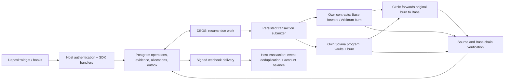
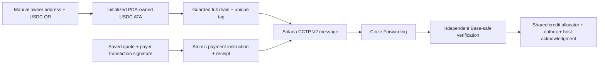

# Settle Kit: technical design

2026-10-15 · Reviewed and expanded for Solana source → Base on 2026-10-18. Design only; no product implementation is claimed.

Build one self-hosted deposit engine, three TypeScript packages and a usable consumer.
[Decisions](../decisions.md) own policy; the [journey spine](../journeys/settle-kit.yaml)
owns acceptance behavior. This document assigns technical responsibilities, durable
identities and transaction boundaries. The [task plan](../tasks/README.md) assigns work.
The superseded checkout plan in `docs/archive` is not a dependency.

## System boundary

The host owns Postgres, the operator ETH/SOL, fixed treasury/refund/fee destinations and
account authorization. Contracts and the Solana program move funds; chain readers establish evidence;
database transactions protect attribution and credit; DBOS schedules recoverable
work. Circle handles forwarding, not account credit (D21, D27, D36, D124, D138).

| Location | Responsibility | Boundary |
|---|---|---|
| `packages/core` | Amount codecs, public records, quote/attempt/settlement/delivery types, stable errors | No wallet keys, RPC or database imports |
| `packages/server` | Configuration, handlers, Drizzle store, chain adapters, submissions, verification, workflows, outbox and operator procedures | One engine per long-running process; no generic provider plugin API |
| `packages/react` | Shared client state, two hooks, Deposit, CSS-variable styles | No server import, Tailwind or `@repo/ui` dependency |
| `contracts` (planned) | Factory and deposit contracts, ABI/bytecode manifest, Foundry tests | Fixed money settings, no upgrade/admin redirection |
| `programs/settle-deposit` (planned) | Rust/Anchor vault/payment program, IDL/artifact manifest and local-validator checks | Fixed settings and permanent replay state; verified immutable release |
| `apps/demo` | Reference account, balance, deposits and readable alerts | Host integration example, not an operator dashboard product |
| Separate consumer fixture (planned) | Install built package archives outside workspace resolution | Proves the actual dependency and setup contract |

Keep live adapters behind the explicit mode boundary. Simulated mode uses the same
database transitions, events and UI with a deterministic local evidence adapter; it
never imports a live signer or calls an RPC. Use a separate database/schema and
fixture destinations. Simulation is visibly labeled and is not chain evidence
(D44; J1.S2, J11.S1).

## API and host integration

Keep the D44/D140 API. HTTP paths and internal helpers are implementation details,
not additional public domain methods. All JSON amounts use decimal base-unit strings.

| Surface | Inputs and result | Authorization |
|---|---|---|
| `createSettle(config)`, `handlers`, `start()`, `webhook(handler)` | Validated configuration, web-standard HTTP, background startup, raw-body signed-event receiver | Host mounts account/operator routes and supplies authorization; receiver verifies signature |
| `depositAddress(accountId, chain)` | Stored address plus route instructions | Account owner |
| `listDeposits(accountId)` | Manual observations and accepted wallet attempts, including attempts without a transaction | Account owner |
| `preparePayment({accountId, chain, payer, amount, idempotencyKey})` | Exactly one `pay` or `receive`; returns immutable quote, deadlines, ID and signing data | Account owner |
| `submitPayment({paymentId, signature})` | Durable acceptance of the stored quote; repeats return the original operation | Stored payment owner |
| `getPayment(paymentId)` | Attempt, settlement and host-delivery state separately | Stored payment owner |
| `listAlerts()`, `resendWebhook(eventId)`, `reconcile()` | Existing operator surface | Host operator |

Handlers must receive a host-authenticated principal through server wiring. Account
IDs from JSON cannot establish identity. Resolve a payment's stored owner before
returning its data or accepting a signature; direct in-process methods are trusted
host calls with the same documented authorization responsibility. Reject missing
authorization and protect cookie-authenticated mutations against cross-origin use.
The separate consumer must provide the actual session and operator wiring, not
leave placeholder `host.*` functions (D26, D140, D142).

Use a discriminated result/error contract: validation/conflict/auth failures before
acceptance; durable operation state afterward. An HTTP timeout is not proof that
submission failed. A retry uses the same payment identity. Never send raw provider
errors, fully signed broadcastable transactions, private keys or webhook secrets to the client.
The Solana preparation response exposes only the saved message for the payer to sign;
host co-signatures are added privately after acceptance (D137/D143).
The [integration sketch](../examples/minimal-host.md) remains pseudocode until the
consumer task replaces it with runnable wiring.

## Persistence and atomic boundaries

Use Drizzle over host Postgres with numbered SQL migrations. Keep queryable identities,
amounts and state in columns. JSON is for versioned immutable quote/signing data and
raw evidence retained for audit, not a substitute for uniqueness constraints.
Use integer `numeric` amounts with nonnegative/range checks and `bigint` conversion;
never pass through a JavaScript number (D22, D30, D31).

| Record group | Why it must survive a crash | Key / constraint |
|---|---|---|
| Deployment settings and addresses | Namespace and complete EVM CREATE2 or Solana PDA/settings/ATA inputs remain stable across config changes | Unique host/account/source route; atomically return first stored winner |
| Quotes and accepted payments | Recover consent and pre-chain history | Unique host/account/idempotency key with canonical-input hash; unique chain/token/payer/authorization nonce |
| SDK commands and worker claims | Resume submission without recreating an external action | One open SDK manual-sweep command per address; payment ID unique; expiring claim plus generation |
| Observed drains and settlement records | Track every successful on-chain sweep or recovery independently of the submitting command | Unique chain/tx/log drain identity; optional command link; separate verification state per drain |
| Shared contract-deployment actions | Let a first wallet payment and a manual sweep reuse deployment work | Unique chain/address/creation-code-version action; retained submitter nonce family |
| Signer nonces and transaction attempts | Recover an uncertain EVM broadcast or replacement | Unique chain/signer/nonce reservation; many replacement hashes belong to one action |
| Solana messages and attempts | Recover exact bytes without requesting another payer signature | Action/attempt, message hash, payer signature, transaction signature, blockhash and lastValidBlockHeight; durable program payment receipt or expected drain sequence |
| Chain events and drain memberships | Discover third-party sweeps and attribute late-indexed transfers | Discriminated EVM chain/tx/log or Solana cluster/signature/outer-inner position; one source owner; retained canonical blockhash and execution order |
| CCTP messages and Base evidence | Link one source action to the destination receipt | Protected operation tag plus source event identity; destination domain/nonce; unique transfer backing owner |
| Backing groups, allocations and credits | Preserve exact quoted credit or full manual net with no double allocation | Each transfer belongs to one group; credit and host residual partition that group; one credit per successful manual drain or quoted payment |
| Outbox events and delivery attempts | Recover credit-to-notification handoff | Immutable event ID/body; mutable attempt budget and next due time |
| Scan ranges and checkpoints | Distinguish a complete captured range from a partial read | Chain/scope cursor plus boundary number/hash; separate per-address catch-up |
| Spend reservations and Iris request budget | Bound concurrent workers' external spending/calls | Shared chain/window accounting; reservation tied to transaction nonce family; serialized request permits |
| Alert episodes and operator evidence | Explain unresolved funds and audit closure | Stable case/episode IDs with over_limit_usdc or asset_rescue kind; immutable resolution request ID; chain pause and retained evidence |

Five transaction boundaries are mandatory:

1. Preparation stores the immutable quote. Acceptance atomically records the accepted
   state and its operation before scheduling work. The due-work scanner repairs a crash
   before enqueue; unsigned drafts do not become runnable operations (D111, D140).
2. On EVM, reserve signer nonce and spend, then persist signed bytes/hash before any broadcast.
   Signing follows nonce reservation; after a signing crash resume the reserved action.
   Reconcile externally consumed nonces before advancing (D128, D139). Solana instead
   persists the exact message/signature, blockhash lifetime, program replay identity
   and SOL/rent reservation under D233; no EVM nonce replacement is applied.
3. Read all RPC pages for a bounded scan range, then commit its events, memberships and
   cursor together. A failed or partial page cannot advance that range's cursor. Advertise
   the overall captured-boundary check complete only after all required ranges and
   verifications succeed (D34, I8).
4. In one credit transaction lock/check the chain-pause state, claim source and backing,
   insert the credit/allocation and immutable outbox event. Concurrent reorg incident creation
   uses that same chain lock. A scheduler crash cannot strand the event (D125, D230).
5. Append a repayment resolution and close that case atomically. A repeated request returns
   its existing result; conflicting reuse is rejected. It cannot write the credit ledger
   (D129; J12.S4–S5).

The host's event-ID insert and balance update are a **separate** transaction (D124).
DBOS completion, SDK credit and host acknowledgment are never collapsed into one status.

The one-open-command constraint limits SDK-initiated sweeps; it cannot prevent another
caller from executing the permissionless contract. Each discovered drain gets its own
settlement record even while an older command awaits a mint. Reconciliation may verify
and credit a later drain without completing the earlier one. An SDK command links only
to its proven source execution; an external drain does not make an unknown signed SDK
transaction safe to replace or forget. Retain that attempt until its outcome is known.
This separates submission mutual exclusion from D121's per-drain accounting
(D34, D36; J6.S1.c9, J6.S1.c14). M1.T2 owns the constraints; M2.T2/M2.T3 own discovery
and attribution, and M2.T6 credits the independently verified drain.

## EVM contracts and source attribution

Version the factory and creation-code manifest together. Verify chain ID and factory
runtime hash before issuing an address. Use `abi.encode` for namespace/account salt
and complete constructor settings; do not deploy a mutable initializer. Store the
prediction inputs first. Reuse a predeployed contract only after checking the expected
code and immutable configuration (D33, D134, D135).

The wallet entry point receives the exact authorization and quote commitment. Define
a versioned ABI encoding for the nonce commitment covering payment identity, payer,
contract/route, debit, source fee, credit, burn/maxFee and validity. The contract
recomputes it, consumes `receiveWithAuthorization`, applies its fixed destinations,
then forwards or burns atomically. Emit the payment identity and amounts. Manual
balances are untouched by this entry point (D231, D126).

### First wallet payment and contract deployment

Preparation uses the same internal address-issuance service as depositAddress to save
the complete recipient contract settings and discovery start before returning signing
data. It predicts the address without spending gas. M1.T4 consumes that service contract;
M2.T2 supplies its live implementation before M2.T4 enables the wallet path.

After durable acceptance, the wallet workflow runs ensure_contract before authorization
submission. M2.T1 owns the shared deployment action and D139 transaction recovery. An
existing supported contract skips deployment; absent code starts or resumes the one
saved factory deployment. Manual and wallet commands reuse that deployment action and
verify runtime/settings before payment execution. Recheck after a deployment reorg.
Deployment and payment costs both use D128 budgets. Recheck original validity after
deployment; a delay cannot extend the signature or trigger a new authorization. A
deployment-only success is never a payment or settlement. Test a fresh account with no
manual deposit, racing deployment requests, and a crash after deployment broadcast
(D134, D135, D139, D231; J8.S5.c18).

Manual sweep and over-limit recovery emit full-drain boundaries; quote transfers are
excluded from manual membership. Reconstruct attribution in chain execution order,
not discovery or workflow order. A mismatch between membership sum and emitted gross
blocks credit. A non-USDC rescue emits separate asset/refund evidence and is **not**
a USDC drain. Use a documented native-ETH marker for `rescue(token)`; handle failed
ERC20 return values and reentrancy. Do not treat an arbitrary token's fabricated
Transfer log as verified receipt (D121, D33; J7, J12).

## EVM verification across Arbitrum and Base

### Unique source-to-destination identity

Every Arbitrum burn carries a bytes32 operation tag in protected hookData. A successful
manual USDC drain increments a per-contract drain sequence; derive its tag from a
versioned abi.encode of source chain, contract, manual kind and that sequence. Recovery
also advances the USDC drain sequence; non-USDC rescue does not. A wallet tag instead
binds the saved payment identity and its authorization commitment. M1.T3 freezes the
encoding, emits the tag with the matching burn, and constructs it in the contract.
Repeated equal-amount burns must have different tags; rollback also rolls back sequence
changes. Callers cannot substitute an unrelated tag.

Use two complete version-1 frames: Circle's cctp-forward frame and a Settle Kit frame
containing the encoding version and tag. Custom bytes stay in their own frame. The
decoder compares that protected tag from the source event/message with the attested
message and destination consumption. A source tx hash from Iris cannot replace it.
M2.T5 must prove equal-amount messages remain distinguishable, including out-of-order
arrival and manual/wallet payments with otherwise identical burn fields
(D121, D138, D231; J4.S2.c18, J8.S6.c8; I10).

Circle documents the [composable forwarding frames](https://developers.circle.com/cctp/concepts/forwarding-service#version-1).
Its [source message encoder](https://github.com/circlefin/evm-cctp-contracts/blob/63ab1f0ac06ce0793c0bbfbb8d09816bc211386d/src/messages/v2/MessageV2.sol)
writes an empty nonce before attestation. These are source-backed format choices;
compatibility with the deployed testnet service remains M2.T5 acceptance evidence.

Persist the source payment/sweep event, matching burn and `MessageSent` log identity.
Match the attested message's protected source fields to that evidence, then match
destination message consumption and its native-USDC mint/transfer to the stored
Base recipient. Check domains, authorized protocol contracts, sender, token, amounts,
fee bounds and executed finality. Bind logs within the same message execution;
equal amounts in a transaction are not sufficient. Ambiguity remains attention.

CCTP V2 assigns its nonce off-chain and fills attestation fields after the source
event. Comparing entire source and attested byte strings for equality would therefore
be wrong. Pin decoding to the deployed V2 ABI and distinguish protected source fields
from attestation-populated fields. [Circle technical guide](https://developers.circle.com/cctp/references/technical-guide).

Treat a successful receipt from the configured Base MessageTransmitter as evidence
that its attestation checks ran; independently verify the matching money movement
and canonical source/Base safe boundaries. Iris supplies discovery hints, not credit
authority. Circle Forwarding handles mint submission and attestation recovery for the
original burn; keep tracking it if delayed. The combined fee bound includes forwarding.
[Circle Forwarding](https://developers.circle.com/cctp/concepts/forwarding-service).

Use the same exclusive-backing allocator for both entry paths. Manual credit is full
verified net; quoted credit is fixed with residual accounted separately. Exceptional
shortfall funding must be separately verified and unallocated (D21, D126, D127).

## Solana source adapter and owned program

D6 adds a source family; D20 keeps the destination and allocator on Base. The source
adapter owns chain-specific configuration, instruction/message codecs, finalized
scanning and submission evidence. Do not build a generic provider plugin framework.
J13 is manual receive → drain → Base backing → net credit; J14 is exact transaction
consent → program payment → Base backing → fixed credit; J15 is source recovery.
EVM J2/J3/J4/J8 retain their chain-specific criteria. A cross-program invocation
(CPI) is how the owned program calls the token and CCTP programs.

### Program, accounts and setup ownership

M1.T5 owns the Rust/Anchor program, deployment/IDL artifact manifest and executable
hash/immutability check. Verify genesis hash, native mint and legacy token program,
CCTP V2 program IDs/domain and the deployed program data before enabling the route.
Canonicalize the versioned seed commitment in one documented byte format; include
all D136 settings and use the canonical bump. The program recomputes the commitment
before initializing, so a third party cannot initialize different settings at the
same issued address. M1.T1 defines these public discriminants; M1.T2 stores the
complete winner and cluster-qualified identities (D136/D143; J1.S4a).

M2.T8 owns persisted address issuance and finalized setup. Store the discovery start
before any setup broadcast. Initialize settings and the vault's canonical native-USDC
ATA with host SOL; verify mint, token-program ownership, PDA authority and absence of
unexpected delegate/close authority before exposing it. Refund/fee ATAs are derived
from the saved owners and token identity, created idempotently within host budgets
when needed, and independently checked. Another caller's correct precreation is
reusable; incompatible state blocks the route. Account issuance now has a pending
setup result on Solana: J13.S1's UI must not show usable copy/QR until it is ready.
The EVM address can still be counterfactual (D118/D136).

The D118 receive instruction record names owner, ATA and mint separately. A Solana
Pay transfer QR encodes owner plus mint; direct-transfer verification checks arrival
at that owner's stored ATA. Never put the token-account address in the QR owner
field. Test the actual off-curve owner transfer with a supported sender; an exchange
claim needs its own evidence. The generic copy guard binds the complete instruction
record, not an address string detached from chain/mint (M3.T2/M3.T3).

### Exact wallet message and API transport

M2.T10 reuses M1.T4 integer pricing, idempotency and immutable quote storage, then
builds the Solana-specific signing envelope from the M1.T5 IDL. Use the smallest
supported transaction format; prove deployed CCTP accounts/instructions fit message,
account and compute limits. If version-0 lookup tables are required, pin and validate
their resolved accounts as part of exact-message verification; never accept a client
lookup substitution. Unsupported formats are explicit failures, not partial decoding.

Persist the original message bytes/hash, payer/source token account, host fee payer,
CCTP event-account public key, recent blockhash, lastValidBlockHeight, program deadline,
quote data and required signers. Require an execution window after submission cutoff,
but disclose that the recent blockhash can expire earlier: no wall-clock guarantee
can extend it. An expired unsigned message needs a new preparation key and explicit
review. Preparation does not return an executable fully signed transaction.

The D140 signature field is chain-discriminated under D143. For Solana the browser
returns the payer signature over that exact saved message; it cannot provide arbitrary
transaction instructions. A transaction-signing wallet adapter may return serialized
bytes internally; compare every message byte and extract/verify only its payer
signature. Reject a wallet that rewrites message or fee payer. The host validates
account ownership, message/signature, deadlines, route and budget, commits acceptance,
then adds the operational signatures privately. No signAndSend or delegated allowance
shortcut. A crash after acceptance is resumed from that same record (D137/D233).

The program uses a separate payment PDA/token account for exact wallet execution,
not the reusable manual ATA. Its atomic instruction checks the complete saved
commitment, payer and stored host co-signer identities and pinned CPI accounts, transfers the exact debit, applies the
source fee, calls CCTP and records a persistent payment receipt. That receipt cannot
be closed or reset. Bound account creation/rent and compute/priority fees before
co-signing; no customer signature authorizes host-budget escalation. Execution failure
rolls back USDC changes while the host still accounts for charged SOL fees.

### Submission, expiry and full-drain replay protection

M2.T9 owns the Solana host-only submitter and manual orchestration; M2.T10 uses its
exact-message persistence for payer-signed operations. M2.T1 supplies shared claims,
DBOS compatibility, reservations and due-work repair, not an EVM transaction wrapper.
Store signed bytes before any RPC broadcast and rebroadcast those identical bytes
while valid. Do not fee-bump or change a blockhash on a payer-signed message. Retain
its reservation across uncertainty; only finalized receipts or complete expiry proof
can reconcile it. Keep rent funding separate from transaction fees, including any
later host rent reclaim; neither increases the payer debit (D128/D233).

For a host-only sweep, save the expected on-program full-drain sequence in the signed
instruction. A successful sweep/recovery increments it, so a delayed old command
cannot sweep funds deposited afterward. After proven blockhash expiry, find all
successful drains before a replacement: if another caller already consumed that
sequence, link the command only to proven matching execution or close it as superseded
with no submission. The later external drain gets its own settlement record. Never
retarget the old command to the new sequence as an automatic retry. A new eligible
batch is a distinct command after original uncertainty is resolved (D121/D233/D234).

For accepted wallet failure, finalized block height beyond lastValidBlockHeight is
necessary but not sufficient: M2.T8 supplies complete finalized history and M2.T10
checks the permanent payment receipt. A null status lookup, local clock, RPC timeout
or a reverted attempt is not the no-debit proof. Only J14.S10 permits the no-charge
message and an explicitly chosen new quote. A discovered successful source payment
always resumes original-message verification (D233).

### Finalized discovery and source-to-Base identity

M2.T8 captures a produced finalized block/slot and hash; skipped slots are not blocks.
Paginate signatures for each stored vault/ATA and required program/payment accounts,
then retrieve every successful transaction with supported versions, resolved account
keys, outer/inner instructions and meta. Obtain canonical block transaction order for
same-slot attribution; signature-list ordering alone cannot decide drain membership.
Read CCTP MessageSent event-account bytes and preserve them before any eligible
reclaim. CCTP event-account signer keys remain encrypted server operational material;
redact them like gas-wallet keys. Destination verification must not depend on the
source account still existing after retention ends.

A scanner must establish history coverage from the stored start using a provider with
adequate archival retention. Check missing/truncated history and supported versions;
unavailable inner instructions, missing transaction/block data or uncertain skipped
slots leave an incomplete range. Commit all events/memberships plus the cursor
atomically, retaining new-address catch-up and targeted/global separation. Recheck
saved finalized blockhashes; contradictory credited evidence enters D125 incident
handling, never a reversal (D232; I8/I10).

CCTP carries the stored Base recipient as its canonical 32-byte encoding: left-pad
the validated 20-byte EVM address, then encode as required by the Solana IDL. Never
interpret an arbitrary Solana owner key as a Base treasury address.

M1.T5 derives protected tags from cluster/domain, program/vault and drain sequence or
payment receipt/commitment, with an explicit encoding version and domain separation.
M2.T11 decodes the pinned Solana CCTP V2 IDL and message account, then compares protected
source fields/tag to the attested message and Base consumption. Do not compare every
byte blindly: off-chain-populated nonce/finality fields differ. Match the actual mint
and amount/fees in that same Base execution at safe. Equal amounts, API transaction
hints or balance deltas cannot substitute for the linkage (J13.S5/J14.S5).

Reuse M2.T5's composed forwarding/Settle Kit frames, persisted Iris limiter and
original-burn recovery, checking deployed Solana support and actual executed finality
rather than inferring it from EVM evidence. M2.T11 owns real devnet → Base Sepolia
manual and zero-payer-SOL wallet proofs, with message tags, fees and stage timings.
M2.T6 owns the shared final allocator for J13.S5a/J14.S6; M2.T7's immutable event and
atomic host-credit receiver consume the source-qualified identities unchanged.

### Source recovery and implementation gates

M1.T5 implements guarded over-limit recovery and allowed asset/SOL rescue; M3.T4
verifies finalized source receipts and integrates the existing repayment procedure.
An over-limit recovery advances the USDC drain; a non-USDC rescue does not. Preserve
vault rent and all persistent replay markers. Do not generically invoke a token
program supplied by a caller. An unsupported asset remains an unresolved case under
X20 rather than being labeled verified. D129 remains the sole repayment policy;
chain_verified uses Solana finalized or EVM safe according to evidence family.
Source recovery is never Base backing or payer repayment (J15; D234).

Program account validation, transaction size/compute, wallet signing with a separate
fee payer, off-curve manual receive, complete finalized indexing and composed CCTP
forwarding are explicit implementation proof gates. Local-validator/Bun fixtures are
useful checks, not deployed-route proof. Follow M1.T5 → M2.T8 → M2.T9/M2.T10 → M2.T11
→ M3.T4, then the installed-consumer gate; use the checkpoints in each task rather
than adding another preliminary spike phase. No Solana implementation or live result
is claimed by this design (D58).

Primary sources checked 2026-10-18: [Circle supported chains/domains](https://developers.circle.com/cctp/concepts/supported-chains-and-domains),
[Solana CCTP programs](https://developers.circle.com/cctp/references/solana-programs),
[forwarding frames](https://developers.circle.com/cctp/concepts/forwarding-service),
[Solana PDA model](https://solana.com/docs/core/pda),
[RPC commitments](https://solana.com/docs/rpc),
[signature pagination](https://solana.com/docs/rpc/http/getsignaturesforaddress),
[transaction confirmation/expiry](https://solana.com/developers/cookbook/transactions/confirmation),
and [Solana Pay transfer URI](https://docs.solanapay.com/spec).
These establish primitives and documented protocol support; the account/program and
retry design above is Settle Kit's proposed engineering implementation of D6.

## Background work and recovery

Use small versioned DBOS workflows for wallet operations, manual sweeps and event
delivery. Each stage reads durable operation state before doing work. Claims fence
database stage changes; transaction identity protects external effects if an old
worker wakes up. A sleep stores its next action and releases the claim, not the
operation identity. An empty address after a burn is not completed work (D36).

Keep `applicationVersion` explicit and distinct from package version. Compatible
upgrades preserve workflow ordering; incompatible sequences retain the old named
implementation until drained. Keep an old-version worker when changing compatibility
versions. This is required because DBOS recovery is version-specific, not automatic
migration of history. [DBOS upgrade documentation](https://docs.dbos.dev/typescript/tutorials/upgrading-workflows).

On EVM, reserve finite gas/data-fee budgets before each submission or replacement. Same-nonce
replacement reserves only the increase in maximum possible charge; unknown outcomes
retain their reservation. Hold one address's manual operation open across uncertainty
so a later deposit cannot be swept by two independent retries (D128, D139).

Indexing, account-targeted reads and reconciliation share one scanner. New addresses
persist their discovery start boundary and catch up independently of the global
cursor. Read-only recovery continues when spending is paused. Iris uses a shared
persisted request limiter; no per-process limiter masquerades as a global one
(D34, D56, D131). Webhook attempts use stable event bytes with fresh signatures;
exhaustion remains failed until explicit resend (D45).

## Product state and operator procedures

Use one React controller for Deposit and custom hooks. Receive-first inputs send one
authoritative amount; the server returns both amounts and fee. Only the matching
response may update consent. Account, wallet, network or input changes invalidate
unsigned consent. Accepted attempts reload from server history. Address text, QR and
copy share the same scoped record and loading guard (D43, D110, D140; J2, J3, J8, J9).

The D112–D116 UX contract is owned by the decision rows and journey criteria. Keep
client retrieval state separate from persisted payment state: M1.T1 defines the read
result/freshness/reference shapes; M2.T4 supplies errors distinctly from empty results;
M3.T2 owns the account-scoped controller and presentation mapping; M3.T3 renders and
tests the widget interactions. M1.T4 preserves immutable expired preparation results,
M2.T6/M3.T1 supply existing references and reason/stage data, and M4.T1 checks the
installed consumer. These responsibilities use the existing D140 methods.

Use one controller policy for entry recovery, expired-quote review and status refresh.
Its pending/read-error cases must not fall through to fresh preparation or submission.
Retrieval time, connection errors and copy feedback are client metadata rather than
ledger transitions. Scope asynchronous read/copy completions to the current account,
chain and instruction record. Keep the accessible announcement value separate from
the changing retrieval timestamp so unchanged polls do not repeat announcements
(J8.S1, J8.S2, J8.S3, J8.S8–S11, J9.S1–S2; D112–D116).

Display observation, source confirmation, Base verification and host acknowledgment
as separate progress. `source_succeeded` is not `credited`; rejected signing is not
`failed_no_debit`. Only the complete D111 evidence scan permits that terminal state.

Provide documented authenticated **operator scripts**, not a new public resolve API.
Use narrow internal services with DB transactions for shortfall evidence, reorg
acknowledgment and repayment records. The host wires operator identity; scripts never
accept an untrusted caller-supplied operator name as authentication. Explorer/manual
contract calls remain outside SDK submission (D51, X6).

For J12, the script first loads the saved case and verified source-safe recovery evidence:
either J7's over_limit_usdc full-drain recovery or J12's asset_rescue event and receipt.
The case kind selects verification and attribution; a USDC recovery must not require a
rescue event, and an asset rescue must not advance USDC drain membership. M3.T1 owns
both inputs to the same repayment procedure (J7.S3.c5, J12.S4.c6). It
accepts a repayment reference plus either `chain_verified` or `host_reported`, requires
the host's beneficiary/full-resolution confirmation, prints the recorded label and
preserves the audit trail. Chain verification cannot prove who owns a recipient.
Unknown token mechanics or unsupported chain evidence can only be host-reported,
never silently promoted. Repeated reconciliation must respect a resolved episode;
new contradictory canonical evidence creates a linked investigation, not deletion of
the original record. This is separate from acknowledging a D125 incident.

## Build gates and evidence limits

Do not schedule more preliminary spikes. S14–S16 supply primitive/browser evidence;
the product still needs the combined route and recovery proofs in D57. Contracts and
verification tasks must demonstrate real Arbitrum and Solana wallet → burn → Base
arrival paths before final packaging; D58 also requires Solana manual-route proof. Record each stage's timing separately.

Use Foundry for EVM contract invariants and a pinned Rust/Anchor local-validator
suite for the Solana program and CPI/account-validation/replay rules. Use Bun for amount/encoding logic and integration
tests against real Postgres for uniqueness, rollback and concurrent workers. Test
crashes before broadcast, after broadcast, after credit commit and after host commit
before acknowledgment. Exercise a compatible upgrade with unfinished work and an
incompatible workflow running alongside its retained predecessor. These prove distinct
boundaries; a single happy-path browser run does not replace them.

The first consumer preview may be simulated and shown early. The coherent public
demonstration requires live evidence, recoverable delivery, built-package installation
and the documented independent onboarding attempt (J11). All task tests cite exact
criteria/invariants. `check-journeys` proves trace integrity; `--complete` checks test
citations, not that assertions are correct or that live gates have passed.
