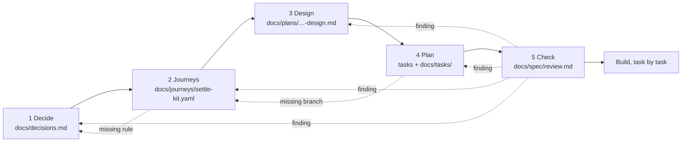

# How Settle Kit goes from idea to a build-ready spec

The spec is five artifacts, each with one job, written in this order. Skills in
`.agents/skills/` tell an agent how to write each one; `/spec` picks the current stage.
Rules shared by every stage: [CONTRACT](../../.agents/skills/CONTRACT.md).

| Stage | Question it answers | Artifact | Skill | Owner's part |
|---|---|---|---|---|
| 1 Decide | What are we building, and what did we rule out? | `docs/decisions.md` | `decide` | Answer open questions, confirm the list |
| 2 Journeys | What exactly happens, step by step, including every failure? | `docs/journeys/settle-kit.yaml` | `journeys` | Walk each journey, challenge branches |
| 3 Design | Why is it built this way, and how do the pieces fit? | `docs/plans/<date>-settle-kit-design.md` | `design` | Review |
| 4 Plan | In what order, in which tasks? | `tasks:` in the spine, `docs/tasks/M<n>.T<n>-*.md` | `plan` | Review; pick hand-written tasks |
| 5 Check | What is missing or contradictory? | `docs/spec/review.md` | `spec-check` (separate agent) | Final approval |
| Build | Does the code do what the steps say? | Code + tests named `J2.S4: …` | `build` | Review each PR |

**The journeys are the heart.** Decisions say *what*; journeys say *exactly how it
behaves*, including every failure path, in EARS sentences that become test names. Code
exists because a step needs it, and `bun run check-journeys` keeps tests and steps linked.

**Tooling**

| Command | Does |
|---|---|
| `bun run journeys:validate` | Check the spine while drafting (warnings are advice) |
| `bun run journeys:render` | Regenerate the `.md` view (tables, flowcharts, criteria) |
| `bun run check-journeys` | Merge bar: spine valid with no warnings, `.md` fresh, test citations real |
| `bun run check-journeys -- --complete` | Release gate: every served step has a test |
| `bun run check-skills` | Skills stay short, well-formed and linked |

## Status

| Stage | Status | Updated | PR |
|---|---|---|---|
| Tooling and skills | done | 2026-10-14 | this PR |
| 1 Decide | not started | | |
| 2 Journeys | not started | | |
| 3 Design | not started | | |
| 4 Plan | not started | | |
| 5 Check | not started | | |

Until stage 3 replaces them, `docs/plans/2026-10-13-deposit-kit-design.md` and
`docs/tasks/T*.md` describe the earlier checkout-first plan. They are inputs to stage 1,
not the current spec.
